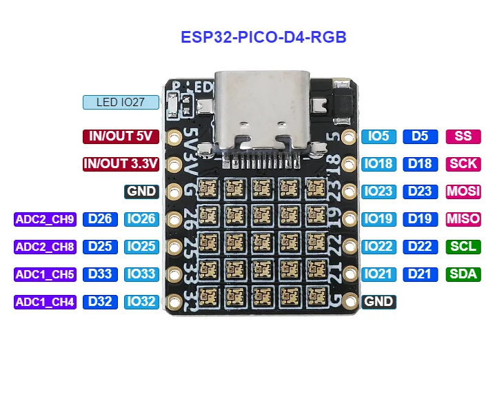
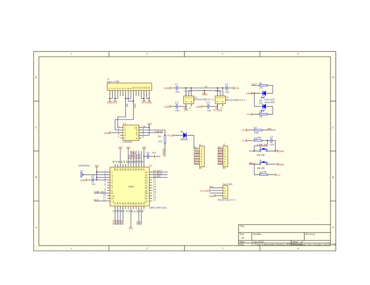

# ESP32-PICO-D4-RGB

**01space** · ESP32-PICO-D4

Revision: Not identified

Coverage: Manufacturer references collected; complete physical pinout approval pending

[Browse all manufacturers](../../../../BROWSE.md) · [Devices & IoT](../../../../DEVICES.md) · [Open in the browser guide](https://valleytech-black-wire-guide.pages.dev/?board=01space-esp32-pico-d4-rgb)

## Datasheets and original documentation

Board datasheet: **not yet recorded**. Visual reference: **available**.

[Original manufacturer documentation](https://github.com/01Space/ESP32-PICO-D4-RGB)

- **hardware-guide / board**: [Manufacturer hardware documentation and specifications](https://github.com/01Space/ESP32-PICO-D4-RGB) · online
- **schematic / board**: [ESP32-PICO-D4-RGB schematic](https://raw.githubusercontent.com/01Space/ESP32-PICO-D4-RGB/a924816d0b2882f4b4a8aa9e4ae6a0358b80f314/Schematic/ESP32-PICO-D4 RGB Schematic.pdf) · [saved document](../../../../library/media/9478b557839f8d3ed02003f3d343adc78258669bd98eb9a43fd7955ddc93df7d.pdf)

Older hardware newly added to this collection, not a claimed October 2026 launch. Original source labels are preserved. Match the pictured PCB before wiring.

[Documentation coverage and remaining gaps](../../../../DOCUMENTATION.md)

## Specifications and hardware documentation

- [Manufacturer specifications and hardware documentation](https://github.com/01Space/ESP32-PICO-D4-RGB)

## ESP32-PICO-D4-RGB physical pinout

**pinout image** · Source identity and visual reference scope reviewed; independent electrical and all-connector completeness review pending · PNG

[Open original reference](../../../../library/media/e53e6fbd9a51e4976de329940d3601e2716b1101cc6d76f2a72f07d27c78608b.png)

**Credit and rights:** Original manufacturer/publisher artwork; redistribution and print rights not established. Attribution does not grant a license or relicense the original.. Source/manufacturer: 01space.

[Source 1](https://raw.githubusercontent.com/01Space/ESP32-PICO-D4-RGB/a924816d0b2882f4b4a8aa9e4ae6a0358b80f314/image/ESP32-PICO-D4-Page-1.drawio.png) · [Source 2](https://github.com/01Space/ESP32-PICO-D4-RGB)

Original source retained unchanged. Scope review does not establish every connector or electrical limit.

Image revision: Match the revision printed in the original source

SHA-256: `e53e6fbd9a51e4976de329940d3601e2716b1101cc6d76f2a72f07d27c78608b`

## ESP32-PICO-D4-RGB schematic

**reference PDF** · Source identity and visual reference scope reviewed; independent electrical and all-connector completeness review pending · PDF

[Open original reference](../../../../library/media/9478b557839f8d3ed02003f3d343adc78258669bd98eb9a43fd7955ddc93df7d.pdf)

**Credit and rights:** Original manufacturer/publisher artwork; redistribution and print rights not established. Attribution does not grant a license or relicense the original.. Source/manufacturer: 01space.

[Source 1](https://raw.githubusercontent.com/01Space/ESP32-PICO-D4-RGB/a924816d0b2882f4b4a8aa9e4ae6a0358b80f314/Schematic/ESP32-PICO-D4 RGB Schematic.pdf) · [Source 2](https://github.com/01Space/ESP32-PICO-D4-RGB)

Original source retained unchanged. Scope review does not establish every connector or electrical limit.

Image revision: Match the revision printed in the original source

SHA-256: `9478b557839f8d3ed02003f3d343adc78258669bd98eb9a43fd7955ddc93df7d`

Pin assignments have not been independently electrically verified. Check board revision before wiring.
