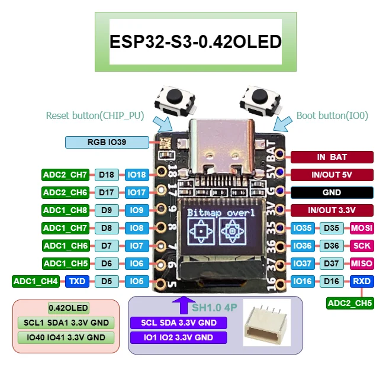
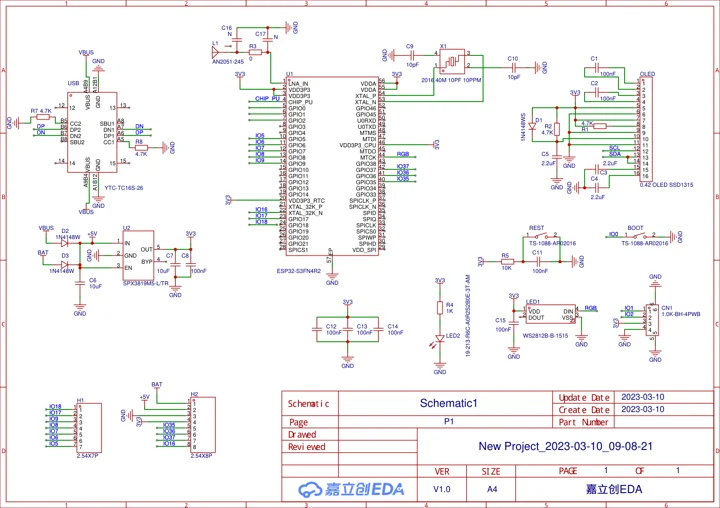

# ESP32-S3-0.42OLED

**01space** · ESP32-S3

Revision: Not identified

Coverage: Manufacturer references collected; complete physical pinout approval pending

[Browse all manufacturers](../../../../BROWSE.md) · [Devices & IoT](../../../../DEVICES.md) · [Open in the browser guide](https://valleytech-black-wire-guide.pages.dev/?board=01space-esp32-s3-0-42oled)

## Datasheets and original documentation

Board datasheet: **not yet recorded**. Visual reference: **available**.

[Original manufacturer documentation](https://github.com/01Space/ESP32-S3-0.42OLED)

- **hardware-guide / board**: [Manufacturer hardware documentation and specifications](https://github.com/01Space/ESP32-S3-0.42OLED) · online
- **schematic / board**: [ESP32-S3-0.42OLED schematic](https://raw.githubusercontent.com/01Space/ESP32-S3-0.42OLED/bd90e21a2364a209f841e87382db9719bf8139ff/Schematic/ESP32-S3-0.42OLED_Schematic.pdf) · [saved document](../../../../library/media/49948668e08995c36e007f327bf725dffe826251b11aa3a26fc56bfab4ce8283.pdf)

Older hardware newly added to this collection, not a claimed October 2026 launch. Original source labels are preserved. Match the pictured PCB before wiring.

[Documentation coverage and remaining gaps](../../../../DOCUMENTATION.md)

## Specifications and hardware documentation

- [Manufacturer specifications and hardware documentation](https://github.com/01Space/ESP32-S3-0.42OLED)

## ESP32-S3-0.42OLED physical pinout

**pinout image** · Source identity and visual reference scope reviewed; independent electrical and all-connector completeness review pending · PNG

[Open original reference](../../../../library/media/25a2ff91e86cdb9e512020424d046f4e528b8cba3687a92e91c8f8a25aa7bf84.png)

**Credit and rights:** Original manufacturer/publisher artwork; redistribution and print rights not established. Attribution does not grant a license or relicense the original.. Source/manufacturer: 01space.

[Source 1](https://raw.githubusercontent.com/01Space/ESP32-S3-0.42OLED/bd90e21a2364a209f841e87382db9719bf8139ff/image/ESP32-S3-0.42OLED.png) · [Source 2](https://github.com/01Space/ESP32-S3-0.42OLED)

Original source retained unchanged. Scope review does not establish every connector or electrical limit.

Image revision: Match the revision printed in the original source

SHA-256: `25a2ff91e86cdb9e512020424d046f4e528b8cba3687a92e91c8f8a25aa7bf84`

## ESP32-S3-0.42OLED schematic

**reference PDF** · Source identity and visual reference scope reviewed; independent electrical and all-connector completeness review pending · PDF

[Open original reference](../../../../library/media/49948668e08995c36e007f327bf725dffe826251b11aa3a26fc56bfab4ce8283.pdf)

**Credit and rights:** Original manufacturer/publisher artwork; redistribution and print rights not established. Attribution does not grant a license or relicense the original.. Source/manufacturer: 01space.

[Source 1](https://raw.githubusercontent.com/01Space/ESP32-S3-0.42OLED/bd90e21a2364a209f841e87382db9719bf8139ff/Schematic/ESP32-S3-0.42OLED_Schematic.pdf) · [Source 2](https://github.com/01Space/ESP32-S3-0.42OLED)

Original source retained unchanged. Scope review does not establish every connector or electrical limit.

Image revision: Match the revision printed in the original source

SHA-256: `49948668e08995c36e007f327bf725dffe826251b11aa3a26fc56bfab4ce8283`

Pin assignments have not been independently electrically verified. Check board revision before wiring.
