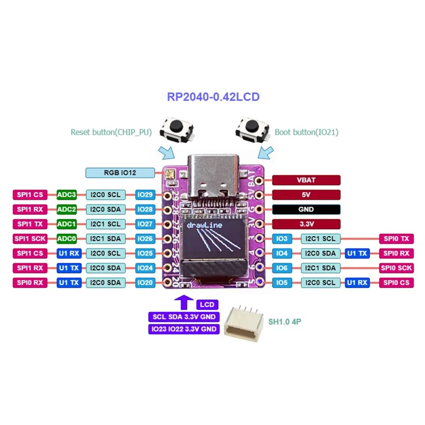

# RP2040-0.42LCD

**01space** · RP2040

Revision: Not identified

Coverage: Manufacturer references collected; complete physical pinout approval pending

[Browse all manufacturers](../../../../BROWSE.md) · [Devices & IoT](../../../../DEVICES.md) · [Open in the browser guide](https://valleytech-black-wire-guide.pages.dev/?board=01space-rp2040-0-42lcd)

## Datasheets and original documentation

Board datasheet: **not yet recorded**. Visual reference: **available**.

[Original manufacturer documentation](https://github.com/01Space/RP2040-0.42LCD)

- **hardware-guide / board**: [Manufacturer hardware documentation and specifications](https://github.com/01Space/RP2040-0.42LCD) · online

Older hardware newly added to this collection, not a claimed October 2026 launch. Original source labels are preserved. Match the pictured PCB before wiring.

[Documentation coverage and remaining gaps](../../../../DOCUMENTATION.md)

## Specifications and hardware documentation

- [Manufacturer specifications and hardware documentation](https://github.com/01Space/RP2040-0.42LCD)

## RP2040-0.42LCD physical pinout

**pinout image** · Source identity and visual reference scope reviewed; independent electrical and all-connector completeness review pending · JPG

[Open original reference](../../../../library/media/30058c8455834ec1719ee99201732abac9a53a1c633985633d5556490b60934b.jpg)

**Credit and rights:** Original manufacturer/publisher artwork; redistribution and print rights not established. Attribution does not grant a license or relicense the original.. Source/manufacturer: 01space.

[Source 1](https://raw.githubusercontent.com/01Space/RP2040-0.42LCD/13354fb3fc512ea23eb5f2260af7f1d887e0e055/image/RP2040-0.42LCD.jpg) · [Source 2](https://github.com/01Space/RP2040-0.42LCD)

Original source retained unchanged. Scope review does not establish every connector or electrical limit.

Image revision: Match the revision printed in the original source

SHA-256: `30058c8455834ec1719ee99201732abac9a53a1c633985633d5556490b60934b`

Pin assignments have not been independently electrically verified. Check board revision before wiring.
