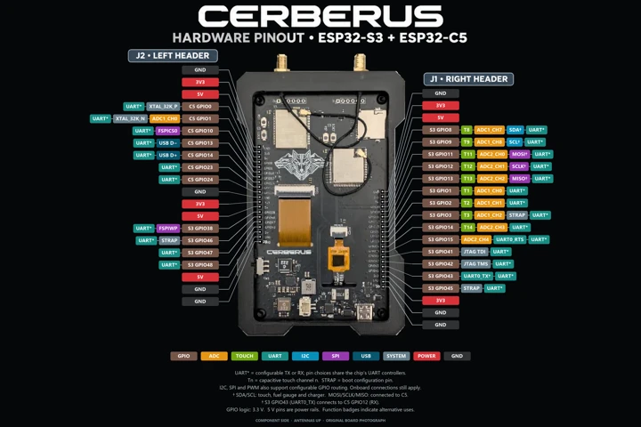

# Cerberus Development Board

**463n7.io** · ESP32-S3 / ESP32-C5

Revision: PCB revision unspecified; supplied diagram shows component side with antennas up

Coverage: Physical J1/J2 header pinout supplied; exact PCB revision, all-connector coverage and independent electrical review pending

[Browse all manufacturers](../../../../BROWSE.md) · [Devices & IoT](../../../../DEVICES.md) · [Open in the browser guide](https://valleytech-black-wire-guide.pages.dev/?board=463n7-io-cerberus)

Device category: **Handhelds & pocket tools**

Modular handheld development platform; match the pictured physical board and revision.

## Datasheets and original documentation

Board datasheet: **not yet recorded**. Visual reference: **available**.

[463n7.io — Cerberus Development Board](https://463n7.io/products/cerberus-development-board)

- **specifications / board**: [463n7.io Cerberus manufacturer specifications](https://463n7.io/products/cerberus-development-board) · online
- **datasheet / component**: [ESP32-S3 component datasheet; not a Cerberus board datasheet](https://www.espressif.com/sites/default/files/documentation/esp32-s3_datasheet_en.pdf) · online
- **datasheet / component**: [ESP32-C5 component datasheet; not a Cerberus board datasheet](https://www.espressif.com/sites/default/files/documentation/esp32-c5_datasheet_en.pdf) · online

Pinout supplied by the project maintainer on 2026-11-07 for the Cerberus development board by 463n7.io. Original bytes are preserved. The manufacturer product page establishes device identity and specifications; it has not been verified as the publication source of this exact diagram. PCB revision is not stated in the supplied image. Component side, antennas up; J2 left and J1 right as shown. The diagram marks alternate functions and shared onboard signals; these are not necessarily free peripheral pins. Match the actual hardware revision and firmware before wiring. No independent electrical verification or power measurements are claimed. A dedicated board datasheet or manufacturer schematic was not established in this intake; the Espressif documents are component references only.

[Documentation coverage and remaining gaps](../../../../DOCUMENTATION.md)

## Specifications and hardware documentation

- [Manufacturer hardware specifications](https://463n7.io/products/cerberus-development-board)

## Cerberus physical hardware pinout — ESP32-S3 + ESP32-C5

**pinout image** · Visual identity and header scope reviewed 2026-11-07; independent pin-by-pin electrical review pending · WEBP

[Open original reference](../../../../library/media/cb47a1c5a58833726744071d36fa111a2649b7e71837d28ce0426398be43dc16.webp)

**Credit and rights:** Device manufacturer credited to 463n7.io as requested by the contributor. User-supplied diagram; diagram authorship and redistribution/print license not independently established. Black Wire code/editorial licenses do not relicense this artwork.. Source/manufacturer: 463n7.io.

[Source 1](https://463n7.io/products/cerberus-development-board)

Pinout supplied by the project maintainer on 2026-11-07 for the Cerberus development board by 463n7.io. Original bytes are preserved. The manufacturer product page establishes device identity and specifications; it has not been verified as the publication source of this exact diagram. PCB revision is not stated in the supplied image. Component side, antennas up; J2 left and J1 right as shown. The diagram marks alternate functions and shared onboard signals; these are not necessarily free peripheral pins. Match the actual hardware revision and firmware before wiring. No independent electrical verification or power measurements are claimed.

Image revision: PCB revision unspecified; supplied diagram shows component side with antennas up

SHA-256: `cb47a1c5a58833726744071d36fa111a2649b7e71837d28ce0426398be43dc16`

Pin assignments have not been independently electrically verified. Check board revision before wiring.
