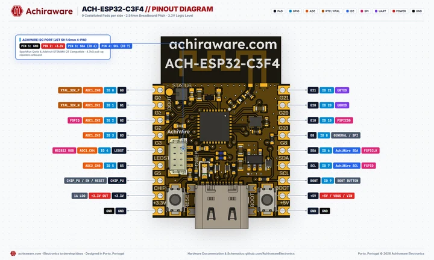

# ACH-ESP32-C3F4

**Achiraware Electronics** · ESP32-C3

Revision: PCB revision unspecified. Pinned documentation commit dated 2026-11-04.

Coverage: Original physical pinout available offline.

[Browse all manufacturers](../../../../BROWSE.md) · [Devices & IoT](../../../../DEVICES.md) · [Open in the browser guide](https://valleytech-black-wire-guide.pages.dev/?board=achiraware-ach-esp32-c3f4)

## Datasheets and original documentation

Board datasheet: **not yet recorded**. Visual reference: **available**.

[Maker documentation](https://github.com/AchirawareElectronics/ACH-ESP32-C3F4/blob/896f0b14adc55f37948202223b40cde451b830b4/README.md)

- **source / board**: [Tindie seller listing](https://www.tindie.com/products/achiraware/ach-esp32-c3f4-esp32-c3-risc-v-mini-dev-board-4m/) · online

Front view, USB-C at bottom. Two rows of 9 castellated pads, numbered GPIO and power/ground callouts. A separate four-position AchiWire I2C legend identifies connector order.

[Documentation coverage and remaining gaps](../../../../DOCUMENTATION.md)

## ACH-ESP32-C3F4 edge pads and AchiWire I2C connector

**pinout image** · Seller or manufacturer artwork and physical connector positions reviewed November 26, 2026. Independent electrical verification pending. · PNG

[Open original reference](../../../../library/media/06d122477ba5c132dd43e0b99248fa7a488fdb26256e56c4a8546c8c85df02a6.png)

**Credit and rights:** © 2026 Achiraware Electronics. CERN-OHL-P-2.0 covers hardware documentation. Original drawing unchanged. https://github.com/AchirawareElectronics/ACH-ESP32-C3F4/blob/896f0b14adc55f37948202223b40cde451b830b4/README.md#-license--attribution. Source/manufacturer: Achiraware Electronics.

[Source 1](https://raw.githubusercontent.com/AchirawareElectronics/ACH-ESP32-C3F4/896f0b14adc55f37948202223b40cde451b830b4/hardware/ACH-ESP32-C3F4_Pinout_Diagram.png) · [Source 2](https://www.tindie.com/products/achiraware/ach-esp32-c3f4-esp32-c3-risc-v-mini-dev-board-4m/) · [Source 3](https://github.com/AchirawareElectronics/ACH-ESP32-C3F4/blob/896f0b14adc55f37948202223b40cde451b830b4/README.md#-license--attribution)

Front view, USB-C at bottom. Two rows of 9 castellated pads, numbered GPIO and power/ground callouts. A separate four-position AchiWire I2C legend identifies connector order.

Image revision: PCB revision unspecified. Pinned documentation commit dated 2026-11-04.

SHA-256: `06d122477ba5c132dd43e0b99248fa7a488fdb26256e56c4a8546c8c85df02a6`

Pin assignments have not been independently electrically verified. Check board revision before wiring.
