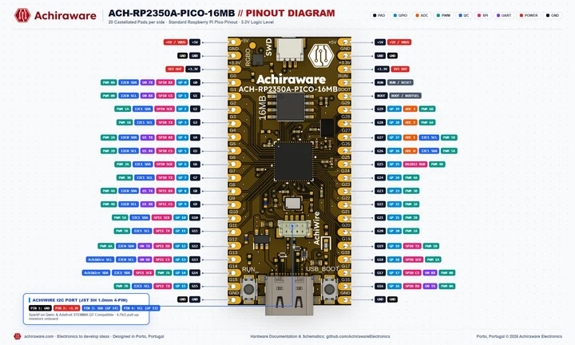

# ACH-RP2350A-PICO-16MB

**Achiraware Electronics** · RP2350A

Revision: No hardware revision is identified. Match the ACH-RP2350A-PICO-16MB marking and 16 MB variant.

Coverage: Original physical pinout available offline.

[Browse all manufacturers](../../../../BROWSE.md) · [Devices & IoT](../../../../DEVICES.md) · [Open in the browser guide](https://valleytech-black-wire-guide.pages.dev/?board=achiraware-ach-rp2350a-pico-16mb)

## Datasheets and original documentation

Board datasheet: **not yet recorded**. Visual reference: **available**.

[Maker documentation](https://github.com/AchirawareElectronics/ACH-RP2350A-PICO-16MB/blob/c5575ff6772a21fa8a49bf0994bdba50cf8aa413/README.md)

- **source / board**: [Tindie seller listing](https://www.tindie.com/products/achiraware/ach-rp2350a-pico-16mb-raspberry-pi-rp2350a-board/) · online

Forty castellated pads and a separate four-contact AchiWire connector.

[Documentation coverage and remaining gaps](../../../../DOCUMENTATION.md)

## ACH-RP2350A-PICO-16MB edge pads and AchiWire connector

**pinout image** · Seller or manufacturer artwork and physical connector positions reviewed November 26, 2026. Independent electrical verification pending. · PNG

[Open original reference](../../../../library/media/cf9a8139f97e815aab0a37a21c4333980a8ad6f3f99b7d409841101fc98dc935.png)

**Credit and rights:** © 2026 Achiraware Electronics. CERN-OHL-P-2.0 covers hardware documentation. Original drawing unchanged. https://github.com/AchirawareElectronics/ACH-RP2350A-PICO-16MB/blob/c5575ff6772a21fa8a49bf0994bdba50cf8aa413/README.md#-license--attribution. Source/manufacturer: Achiraware Electronics.

[Source 1](https://raw.githubusercontent.com/AchirawareElectronics/ACH-RP2350A-PICO-16MB/c5575ff6772a21fa8a49bf0994bdba50cf8aa413/hardware/ACH-RP2350A-PICO-16MB_Pinout_Diagram.png) · [Source 2](https://www.tindie.com/products/achiraware/ach-rp2350a-pico-16mb-raspberry-pi-rp2350a-board/) · [Source 3](https://github.com/AchirawareElectronics/ACH-RP2350A-PICO-16MB/blob/c5575ff6772a21fa8a49bf0994bdba50cf8aa413/README.md#-license--attribution)

USB-C at the bottom. Forty castellated pads show power, RUN/BOOT, GPIO and alternate functions. An inset identifies the four AchiWire contacts.

Image revision: No hardware revision is identified. Match the ACH-RP2350A-PICO-16MB marking and 16 MB variant.

SHA-256: `cf9a8139f97e815aab0a37a21c4333980a8ad6f3f99b7d409841101fc98dc935`

Pin assignments have not been independently electrically verified. Check board revision before wiring.
