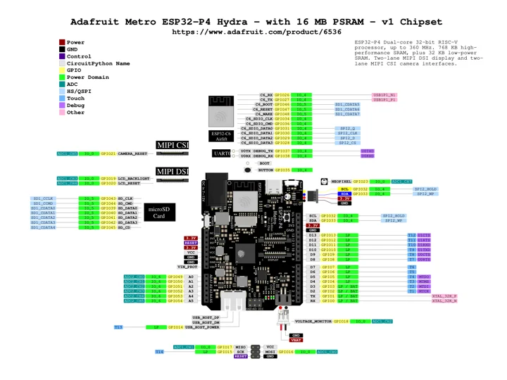
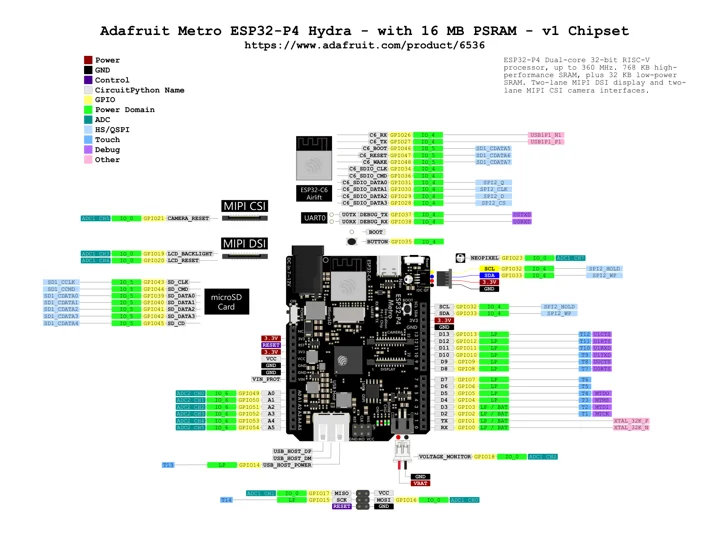

# Metro ESP32-P4 Hydra

**Adafruit** · ESP32-P4 / ESP32-C6

Revision: Match model and revision in manufacturer references

Coverage: Manufacturer references collected; independent complete-pinout approval pending

[Browse all manufacturers](../../../../BROWSE.md) · [Devices & IoT](../../../../DEVICES.md) · [Open in the browser guide](https://valleytech-black-wire-guide.pages.dev/?board=adafruit-metro-esp32-p4-hydra)

## Datasheets and original documentation

Board datasheet: **not yet recorded**. Visual reference: **available**.

[Original manufacturer documentation](https://www.adafruit.com/product/6536)

- **hardware-guide / board**: [Manufacturer specifications and hardware documentation](https://www.adafruit.com/product/6536) · online
- **hardware-guide / board**: [Metro ESP32-P4 Hydra PrettyPins PDF](https://raw.githubusercontent.com/adafruit/Adafruit-Metro-ESP32-P4-Hydra-PCB/3c5562c252c3a305da0ac7bf753c536295643b14/Adafruit_Metro_ESP32-P4_PrettyPins.pdf) · [saved document](../../../../library/media/d7bfc48b465bb89613fe3da49ca58c0428a0718db5f36182477318b39ef58270.pdf)
- **design-files / board**: [Original schematic and PCB CAD (rev A)](https://github.com/adafruit/Adafruit-Metro-ESP32-P4-Hydra-PCB/tree/3c5562c252c3a305da0ac7bf753c536295643b14) · online
- **datasheet / component**: [ESP32-P4 component datasheet; not a board datasheet](https://cdn-shop.adafruit.com/product-files/6536/P6536+esp32-p4_datasheet_en.pdf) · online

Original PrettyPins SVG and printable PDF for the v1-chip board. Do not substitute ESP32-P4X/v3 specifications. Manufacturer product text contains conflicting generic PSRAM statements; use the exact board revision and source diagram. No power test values added.

[Documentation coverage and remaining gaps](../../../../DOCUMENTATION.md)

## Specifications and hardware documentation

- [Manufacturer hardware specifications](https://www.adafruit.com/product/6536)

## Metro ESP32-P4 Hydra PrettyPins SVG

**pinout image** · Source identity and visual scope reviewed on 2026-10-30; independent electrical and all-connector review pending · SVG

[Open original reference](../../../../library/media/59a56a24c3258a65b81391bad3ab8622f2b6cf5d85d93cc5ba604cf1c11e81cf.svg)

**Credit and rights:** Designed by Limor Fried/Ladyada for Adafruit Industries. CC BY-SA 3.0 Unported; original README and license included in library/licenses/adafruit-metro-esp32-p4-hydra/. Original SVG/PDF unchanged; viewing thumbnail derived from original.. Source/manufacturer: Adafruit.

[Source 1](https://raw.githubusercontent.com/adafruit/Adafruit-Metro-ESP32-P4-Hydra-PCB/3c5562c252c3a305da0ac7bf753c536295643b14/Adafruit_Metro_ESP32-P4_PrettyPins.svg) · [Source 2](https://github.com/adafruit/Adafruit-Metro-ESP32-P4-Hydra-PCB)

Source retained unchanged. Connector scope and electrical limits require the matching manufacturer documentation.

Image revision: Match the source and PCB revision

SHA-256: `59a56a24c3258a65b81391bad3ab8622f2b6cf5d85d93cc5ba604cf1c11e81cf`

## Metro ESP32-P4 Hydra PrettyPins PDF

**reference PDF** · Source identity and visual scope reviewed on 2026-10-30; independent electrical and all-connector review pending · PDF

[Open original reference](../../../../library/media/d7bfc48b465bb89613fe3da49ca58c0428a0718db5f36182477318b39ef58270.pdf)

**Credit and rights:** Designed by Limor Fried/Ladyada for Adafruit Industries. CC BY-SA 3.0 Unported; original README and license included in library/licenses/adafruit-metro-esp32-p4-hydra/. Original SVG/PDF unchanged; viewing thumbnail derived from original.. Source/manufacturer: Adafruit.

[Source 1](https://raw.githubusercontent.com/adafruit/Adafruit-Metro-ESP32-P4-Hydra-PCB/3c5562c252c3a305da0ac7bf753c536295643b14/Adafruit_Metro_ESP32-P4_PrettyPins.pdf) · [Source 2](https://github.com/adafruit/Adafruit-Metro-ESP32-P4-Hydra-PCB)

Source retained unchanged. Connector scope and electrical limits require the matching manufacturer documentation.

Image revision: Match the source and PCB revision

SHA-256: `d7bfc48b465bb89613fe3da49ca58c0428a0718db5f36182477318b39ef58270`

Pin assignments have not been independently electrically verified. Check board revision before wiring.
