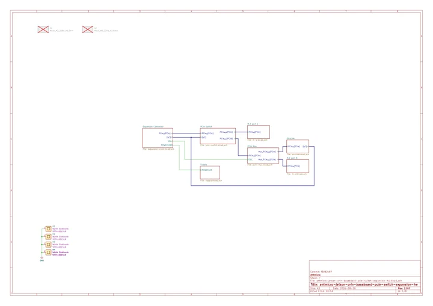

# PCIe Switch Expansion for Jetson Orin Baseboard

**Antmicro** · Diodes PI7C9X3G606G PCIe switch

Revision: 1.0.0

Coverage: Manufacturer references collected; independent complete-pinout approval pending

[Browse all manufacturers](../../../../BROWSE.md) · [Devices & IoT](../../../../DEVICES.md) · [Open in the browser guide](https://valleytech-black-wire-guide.pages.dev/?board=antmicro-pcie-switch-expansion-for-jetson-orin-baseboard)

## Datasheets and original documentation

Board datasheet: **not yet recorded**. Visual reference: **available**.

[Original manufacturer model documentation](https://openhardware.antmicro.com/boards/jetson-orin-baseboard-pcie-switch-expansion/?tab=features)

- **hardware-guide / board**: [Antmicro hardware portal](https://openhardware.antmicro.com/boards/jetson-orin-baseboard-pcie-switch-expansion/?tab=features) · online
- **hardware-guide / board**: [Official project design files](https://github.com/antmicro/job-pcie-switch-expansion) · online
- **schematic / board**: [Jetson Orin PCIe expansion schematic](https://openhardware.antmicro.com/imported/boards/jetson-orin-baseboard-pcie-switch-expansion/rev.1.0.0/doc/antmicro-jetson-orin-baseboard-pcie-switch-expansion-hw-Unknown-d551c6be-schematic.pdf) · [saved document](../../../../library/media/b6627bed7a6da6c98f11f5451b0f30dad2b45648c3110f8b987e5ca1851240a7.pdf)

Manufacturer announcement 2026-10-27; this is an expansion board for Antmicro Jetson Orin Baseboard, not a standalone Jetson. Original 8-page schematic title date 2026-08-26, Rev1.0.0, printed commit f3082c87; URL artifact identifier d551c6be differs, retain both instead of calling them the same commit. Schematic only; no complete physical pinout image approved, no dedicated board datasheet. Useful supporting reference if gap status remains explicit.

[Documentation coverage and remaining gaps](../../../../DOCUMENTATION.md)

## Specifications and hardware documentation

- [Manufacturer hardware specifications](https://openhardware.antmicro.com/boards/jetson-orin-baseboard-pcie-switch-expansion/?tab=features)

## Jetson Orin PCIe expansion schematic

**reference PDF** · Source identity and visual scope reviewed on 2026-11-03; independent electrical and all-connector review pending · PDF

[Open original reference](../../../../library/media/b6627bed7a6da6c98f11f5451b0f30dad2b45648c3110f8b987e5ca1851240a7.pdf)

**Credit and rights:** Antmicro copyright 2026; hardware repository explicitly Apache-2.0: https://github.com/antmicro/job-pcie-switch-expansion/blob/main/LICENSE. Preserve license and notices.. Source/manufacturer: Antmicro.

[Source 1](https://openhardware.antmicro.com/imported/boards/jetson-orin-baseboard-pcie-switch-expansion/rev.1.0.0/doc/antmicro-jetson-orin-baseboard-pcie-switch-expansion-hw-Unknown-d551c6be-schematic.pdf) · [Source 2](https://openhardware.antmicro.com/boards/jetson-orin-baseboard-pcie-switch-expansion/?tab=features)

Source retained unchanged. Match the hardware revision and connector orientation; independent electrical review pending.

Image revision: 1.0.0 / 2026-08-26

SHA-256: `b6627bed7a6da6c98f11f5451b0f30dad2b45648c3110f8b987e5ca1851240a7`

Pin assignments have not been independently electrically verified. Check board revision before wiring.
