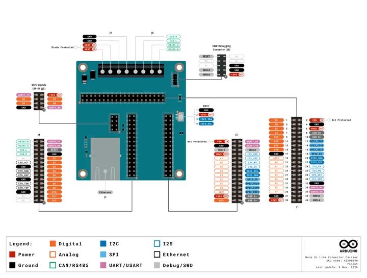

# Nano XL Link Connector Carrier

**Arduino** · Carrier for the Nano XL Link

Revision: SKU ASX00090. The carrier pinout is dated November 9, 2026.

Coverage: Manufacturer source files collected. Carrier connector layout, screw-terminal pin assignments, Wi-Fi expansion header, debug and breakout headers.

[Browse all manufacturers](../../../../BROWSE.md) · [Devices & IoT](../../../../DEVICES.md) · [Open in the browser guide](https://valleytech-black-wire-guide.pages.dev/?board=arduino-nano-xl-connector-carrier)

## Datasheets and original documentation

Board datasheet: **recorded**. Visual reference: **available**.

[Manufacturer model documentation](https://docs.arduino.cc/hardware/nano-xl-connector-carrier/)

- **connector-reference / connector**: [Nano XL Link Connector Carrier ASX00090 printable pinout](https://raw.githubusercontent.com/arduino/docs-content/827bd4ebb9fb71bd7aa768c259ed70af9143ff1c/content/hardware/nano/carriers/nano-xl-connector-carrier/downloads/ASX00090-full-pinout.pdf) · [saved document](../../../../library/media/6cc56a9434f5cbab7e154aa1b3add5b8f79bd42c96216504c94d3b295f1caf2f.pdf)
- **source / board**: [Manufacturer background and documentation](https://blog.arduino.cc/2026/11/10/just-announced-at-electronica-the-arduino-nano-family-is-now-xl/) · online
- **datasheet / board**: [Manufacturer board datasheet](https://docs.arduino.cc/resources/datasheets/ASX00090-datasheet.pdf) · online

Carrier connector layout, screw-terminal pin assignments, Wi-Fi expansion header, debug and breakout headers. Arduino announced the hardware on November 10. Its product landing page links to the technical documentation. 2026-11-10 (announcement; no shipping date verified)

[Documentation coverage and remaining gaps](../../../../DOCUMENTATION.md)

## Specifications and hardware documentation

- [Manufacturer documentation](https://docs.arduino.cc/hardware/nano-xl-connector-carrier/)

## Nano XL Link Connector Carrier ASX00090 physical pinout

**pinout image** · Manufacturer artwork and model identity reviewed November 25, 2026. Independent electrical verification pending. · PNG

[Open original reference](../../../../library/media/689c0d8fb23c9c3ea162da59e2f2f96fe6915b1b642298408befad997118a592.png)

**Credit and rights:** Arduino Documentation, CC BY-SA 4.0 International (https://creativecommons.org/licenses/by-sa/4.0/). Original diagram by Arduino, reproduced unchanged. Documentation licence: https://github.com/arduino/docs-content/blob/827bd4ebb9fb71bd7aa768c259ed70af9143ff1c/LICENSE.md. Source/manufacturer: Arduino.

[Source 1](https://raw.githubusercontent.com/arduino/docs-content/827bd4ebb9fb71bd7aa768c259ed70af9143ff1c/content/hardware/nano/carriers/nano-xl-connector-carrier/interactive/ASX00090-pinout.png) · [Source 2](https://docs.arduino.cc/hardware/nano-xl-connector-carrier/)

Carrier connector layout, screw-terminal pin assignments, Wi-Fi expansion header, debug and breakout headers.

Image revision: SKU ASX00090. The carrier pinout is dated November 9, 2026.

SHA-256: `689c0d8fb23c9c3ea162da59e2f2f96fe6915b1b642298408befad997118a592`

## Nano XL Link Connector Carrier ASX00090 printable pinout

**reference PDF** · Manufacturer artwork and model identity reviewed November 25, 2026. Independent electrical verification pending. · PDF

[Open original reference](../../../../library/media/6cc56a9434f5cbab7e154aa1b3add5b8f79bd42c96216504c94d3b295f1caf2f.pdf)

**Credit and rights:** Arduino Documentation, CC BY-SA 4.0 International (https://creativecommons.org/licenses/by-sa/4.0/). Original diagram by Arduino, reproduced unchanged. Documentation licence: https://github.com/arduino/docs-content/blob/827bd4ebb9fb71bd7aa768c259ed70af9143ff1c/LICENSE.md. Source/manufacturer: Arduino.

[Source 1](https://raw.githubusercontent.com/arduino/docs-content/827bd4ebb9fb71bd7aa768c259ed70af9143ff1c/content/hardware/nano/carriers/nano-xl-connector-carrier/downloads/ASX00090-full-pinout.pdf) · [Source 2](https://docs.arduino.cc/hardware/nano-xl-connector-carrier/)

Carrier connector layout, screw-terminal pin assignments, Wi-Fi expansion header, debug and breakout headers.

Image revision: SKU ASX00090. The carrier pinout is dated November 9, 2026.

SHA-256: `6cc56a9434f5cbab7e154aa1b3add5b8f79bd42c96216504c94d3b295f1caf2f`

Pin assignments have not been independently electrically verified. Check board revision before wiring.
