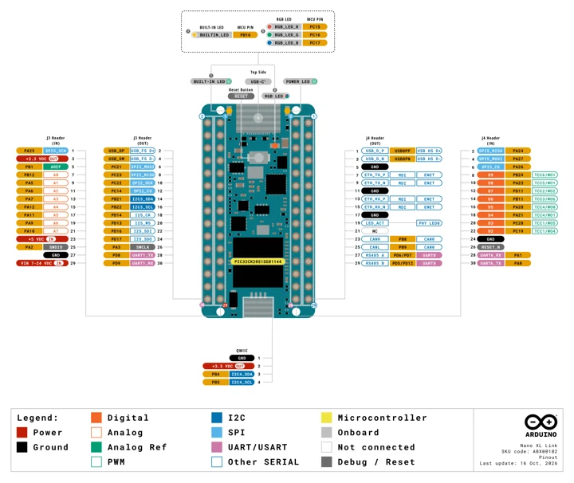
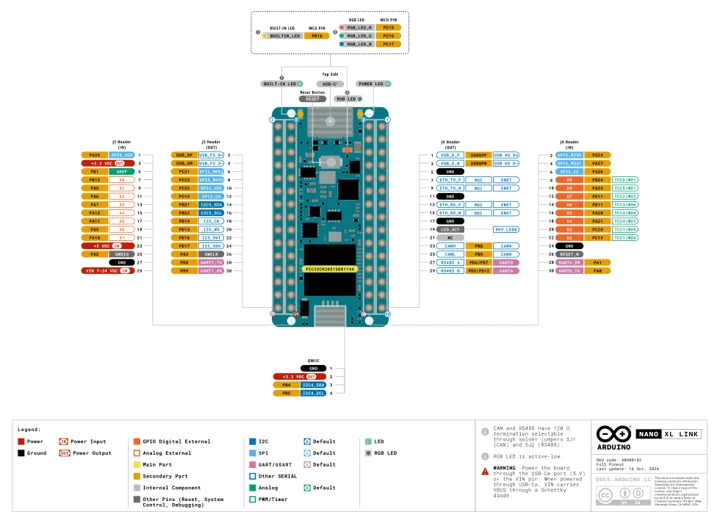

# Nano XL Link

**Arduino** · PIC32CK2051SG01144

Revision: SKU ABX00182. The full pinout is dated October 16, 2026.

Coverage: Manufacturer source files collected. Physical layout of the two extended Nano header rows and Qwiic connector with pin functions.

[Browse all manufacturers](../../../../BROWSE.md) · [Devices & IoT](../../../../DEVICES.md) · [Open in the browser guide](https://valleytech-black-wire-guide.pages.dev/?board=arduino-nano-xl-link)

## Datasheets and original documentation

Board datasheet: **recorded**. Visual reference: **available**.

[Manufacturer model documentation](https://docs.arduino.cc/hardware/nano-xl-link/)

- **connector-reference / connector**: [Nano XL Link ABX00182 printable pinout](https://raw.githubusercontent.com/arduino/docs-content/827bd4ebb9fb71bd7aa768c259ed70af9143ff1c/content/hardware/nano/boards/nano-xl-link/downloads/ABX00182-full-pinout.pdf) · [saved document](../../../../library/media/d9c914b2fdcdf8453524bab511b74c16525b184d2bc702e84ba3180adbd1f4db.pdf)
- **source / board**: [Manufacturer background and documentation](https://blog.arduino.cc/2026/11/10/just-announced-at-electronica-the-arduino-nano-family-is-now-xl/) · online
- **datasheet / board**: [Manufacturer board datasheet](https://docs.arduino.cc/resources/datasheets/ABX00182-datasheet.pdf) · online

Physical layout of the two extended Nano header rows and Qwiic connector with pin functions. Arduino announced the hardware on November 10. Its product landing page links to the technical documentation. 2026-11-10 (announcement; no shipping date verified)

[Documentation coverage and remaining gaps](../../../../DOCUMENTATION.md)

## Specifications and hardware documentation

- [Manufacturer documentation](https://docs.arduino.cc/hardware/nano-xl-link/)

## Nano XL Link ABX00182 physical pinout

**pinout image** · Manufacturer artwork and model identity reviewed November 25, 2026. Independent electrical verification pending. · PNG

[Open original reference](../../../../library/media/348089c03c22bb4b15acaad5a8bce633d2d9ee19cca0404e661081e66b043315.png)

**Credit and rights:** Arduino Documentation, CC BY-SA 4.0 International (https://creativecommons.org/licenses/by-sa/4.0/). Original diagram by Arduino, reproduced unchanged. Documentation licence: https://github.com/arduino/docs-content/blob/827bd4ebb9fb71bd7aa768c259ed70af9143ff1c/LICENSE.md. Source/manufacturer: Arduino.

[Source 1](https://raw.githubusercontent.com/arduino/docs-content/827bd4ebb9fb71bd7aa768c259ed70af9143ff1c/content/hardware/nano/boards/nano-xl-link/interactive/ABX00182-pinout.png) · [Source 2](https://docs.arduino.cc/hardware/nano-xl-link/)

Physical layout of the two extended Nano header rows and Qwiic connector with pin functions.

Image revision: SKU ABX00182. The full pinout is dated October 16, 2026.

SHA-256: `348089c03c22bb4b15acaad5a8bce633d2d9ee19cca0404e661081e66b043315`

## Nano XL Link ABX00182 printable pinout

**reference PDF** · Manufacturer artwork and model identity reviewed November 25, 2026. Independent electrical verification pending. · PDF

[Open original reference](../../../../library/media/d9c914b2fdcdf8453524bab511b74c16525b184d2bc702e84ba3180adbd1f4db.pdf)

**Credit and rights:** Arduino, CC BY-SA 4.0 International. The October 16, 2026 full pinout carries this licence in its title block. Original PDF reproduced unchanged. https://creativecommons.org/licenses/by-sa/4.0/. Source/manufacturer: Arduino.

[Source 1](https://raw.githubusercontent.com/arduino/docs-content/827bd4ebb9fb71bd7aa768c259ed70af9143ff1c/content/hardware/nano/boards/nano-xl-link/downloads/ABX00182-full-pinout.pdf) · [Source 2](https://docs.arduino.cc/hardware/nano-xl-link/)

Physical layout of the two extended Nano header rows and Qwiic connector with pin functions.

Image revision: SKU ABX00182. The full pinout is dated October 16, 2026.

SHA-256: `d9c914b2fdcdf8453524bab511b74c16525b184d2bc702e84ba3180adbd1f4db`

Pin assignments have not been independently electrically verified. Check board revision before wiring.
