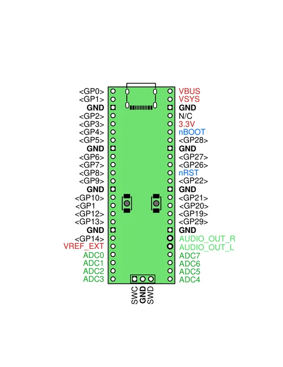

# PicoADK - Audio Development Kit

**DatanoiseTV** · RP2040

Revision: 48-pin RP2040 PicoADK. The maker labels the alternate-function chart v1.1. The vector drawing has no revision marking.

Coverage: Original physical pinout available offline. A second physical pinout is available online.

[Browse all manufacturers](../../../../BROWSE.md) · [Devices & IoT](../../../../DEVICES.md) · [Open in the browser guide](https://valleytech-black-wire-guide.pages.dev/?board=datanoisetv-rp2040-picoadk-audio-development-kit)

## Datasheets and original documentation

Board datasheet: **not yet recorded**. Visual reference: **available**.

[Maker documentation](https://github.com/DatanoiseTV/PicoADK-Hardware/blob/3e53a5dc2deac3fa4400d9db82d81c0e2f23f7b5/README.md#pinout-picoadk-v11---48-pin)

- **source / board**: [Tindie seller listing](https://www.tindie.com/products/datanoisetv/picoadk-audio-development-kit-raspberry-rp2040/) · online
- **connector-reference / connector**: [PicoADK v1.1, 48-pin alternate-function chart](https://user-images.githubusercontent.com/6614616/198907086-aaeb9831-ceb2-4acc-8242-45671ba2a3fd.png) · online

USB-up PCB outline, 24 positions per side numbered 1-48. Audio L/R, ADC0-7, external reference, power, GPIO and alternate signals are aligned to their physical pads. Pin 45 has no named function on this drawing; SWD pads are shown without assignments.

DatanoiseTV publishes this image as a GitHub attachment. Permission to redistribute the attachment is unconfirmed. https://github.com/DatanoiseTV/PicoADK-Hardware/blob/3e53a5dc2deac3fa4400d9db82d81c0e2f23f7b5/LICENSE

SHA-256 of manufacturer original: `f585d2bca5ff7f9786f48e8532ca94c51ca04301754a753f96e180d0819bdf2a`

48-pin RP2040 PicoADK. The maker labels the alternate-function chart v1.1. The vector drawing has no revision marking.

[Documentation coverage and remaining gaps](../../../../DOCUMENTATION.md)

## RP2040 PicoADK 48-pad vector pinout

**pinout image** · Seller or manufacturer artwork and physical connector positions reviewed November 26, 2026. Independent electrical verification pending. · SVG

[Open original reference](../../../../library/media/05deae5b064eb5904e8acbb7fabcd16815216a62daca7c9c88a7593897e4d6e0.svg)

**Credit and rights:** Copyright (c) 2022 Datanoise. MIT license for the hardware repository and associated documentation. Original SVG unchanged. https://github.com/DatanoiseTV/PicoADK-Hardware/blob/3e53a5dc2deac3fa4400d9db82d81c0e2f23f7b5/LICENSE. Source/manufacturer: DatanoiseTV.

[Source 1](https://raw.githubusercontent.com/DatanoiseTV/PicoADK-Hardware/3e53a5dc2deac3fa4400d9db82d81c0e2f23f7b5/picoadk_pinout_template.svg) · [Source 2](https://www.tindie.com/products/datanoisetv/picoadk-audio-development-kit-raspberry-rp2040/) · [Source 3](https://github.com/DatanoiseTV/PicoADK-Hardware/blob/3e53a5dc2deac3fa4400d9db82d81c0e2f23f7b5/LICENSE)

USB-up physical outline with 24 pads per side, primary GPIO and supply signals, audio L/R, external analog reference and eight ADC inputs. SWC, GND and SWD are labeled on the three-pad bottom connector. Spare pad is marked N/C. No alternate-function matrix.

Image revision: 48-pad RP2040 PicoADK. Artwork omits a revision mark. Its header layout and audio/ADC positions match the v1.1 chart in this repository. Do not extend to the RP2350 v2.

SHA-256: `05deae5b064eb5904e8acbb7fabcd16815216a62daca7c9c88a7593897e4d6e0`

Pin assignments have not been independently electrically verified. Check board revision before wiring.
