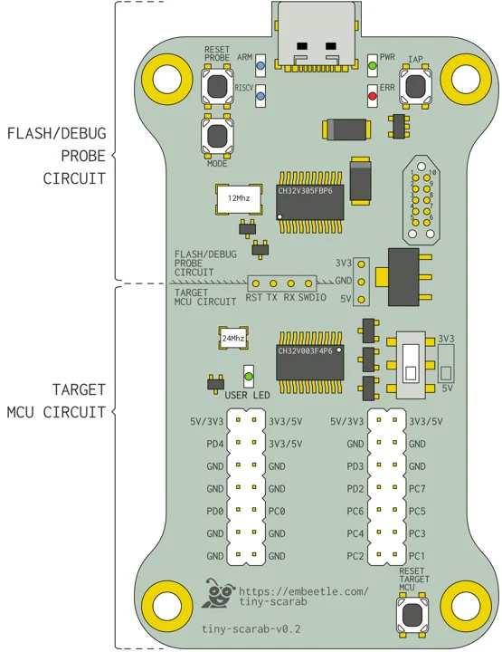
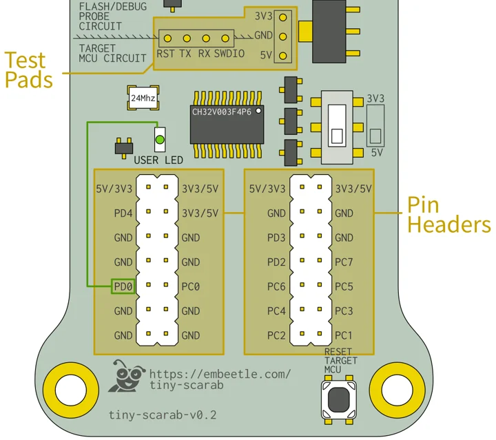

# Tiny Scarab v0.2

**Embeetle** · CH32V003F4P6

Revision: tiny-scarab-v0.2 on both drawings

Coverage: Manufacturer source files collected. Full board, USB-C at the top. Target MCU below the debug probe.

[Browse all manufacturers](../../../../BROWSE.md) · [Devices & IoT](../../../../DEVICES.md) · [Open in the browser guide](https://valleytech-black-wire-guide.pages.dev/?board=embeetle-tiny-scarab-v0-2)

## Datasheets and original documentation

Board datasheet: **not yet recorded**. Visual reference: **available**.

[Manufacturer model documentation](https://github.com/Embeetle/tiny-scarab)

- **source / board**: [Manufacturer background and documentation](https://github.com/Embeetle/tiny-scarab/blob/8286a41d26a00a9bdbb60e7d465b7f4a191a6934/documentation/readme_pinout_and_features.md) · online

The board has a target MCU and a separate onboard debug probe. Match the target header names to the v0.2 marking. Previously documented board. Hardware launch date unverified.

[Documentation coverage and remaining gaps](../../../../DOCUMENTATION.md)

## Specifications and hardware documentation

- [Manufacturer documentation](https://github.com/Embeetle/tiny-scarab)

## Board GPIO headers and debug pads

**pinout image** · Manufacturer artwork and model identity reviewed November 25, 2026. Independent electrical verification pending. · WEBP

[Open original reference](../../../../library/media/9fb60c62556acbfe9c153f06e1f8d90511575357da58fe9de2a313f63f5baa96.webp)

**Credit and rights:** Copyright (c) 2023 Embeetle. MIT license for associated documentation. Original unchanged. https://github.com/Embeetle/tiny-scarab/blob/8286a41d26a00a9bdbb60e7d465b7f4a191a6934/LICENSE. Source/manufacturer: Embeetle.

[Source 1](https://raw.githubusercontent.com/Embeetle/tiny-scarab/8286a41d26a00a9bdbb60e7d465b7f4a191a6934/documentation/website_figures/pinout_01.webp) · [Source 2](https://github.com/Embeetle/tiny-scarab)

Full board, USB-C at the top. Target MCU below the debug probe.

Image revision: tiny-scarab-v0.2 on both drawings

SHA-256: `9fb60c62556acbfe9c153f06e1f8d90511575357da58fe9de2a313f63f5baa96`

## Target MCU header detail

**pinout image** · Manufacturer artwork and model identity reviewed November 25, 2026. Independent electrical verification pending. · WEBP

[Open original reference](../../../../library/media/c356959d595e444fad0bde9060174836a7781ad9b46cf70905f4717913aa25e2.webp)

**Credit and rights:** Copyright (c) 2023 Embeetle. MIT license for associated documentation. Original unchanged. https://github.com/Embeetle/tiny-scarab/blob/8286a41d26a00a9bdbb60e7d465b7f4a191a6934/LICENSE. Source/manufacturer: Embeetle.

[Source 1](https://raw.githubusercontent.com/Embeetle/tiny-scarab/8286a41d26a00a9bdbb60e7d465b7f4a191a6934/documentation/website_figures/pinout_02.webp) · [Source 2](https://github.com/Embeetle/tiny-scarab)

Enlarged lower portion showing the two headers and the test pads.

Image revision: tiny-scarab-v0.2 on both drawings

SHA-256: `c356959d595e444fad0bde9060174836a7781ad9b46cf70905f4717913aa25e2`

Pin assignments have not been independently electrically verified. Check board revision before wiring.
