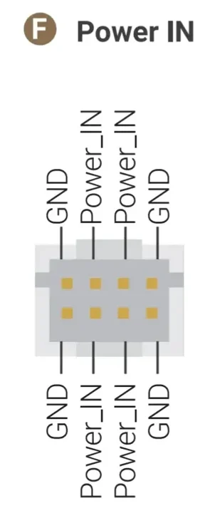
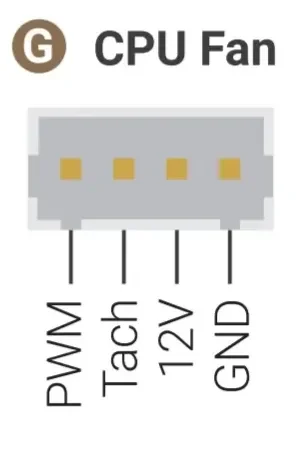
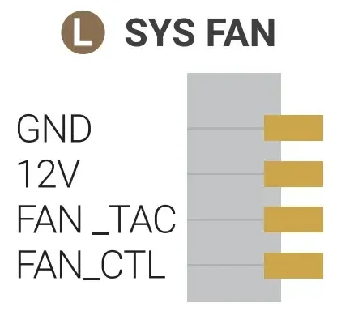
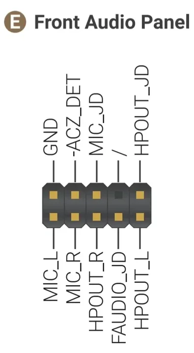
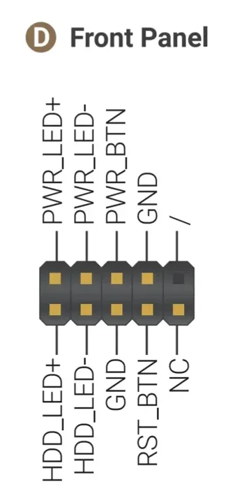
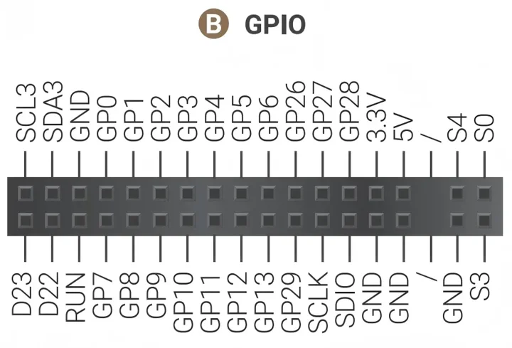
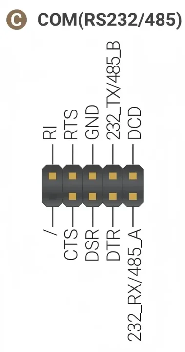
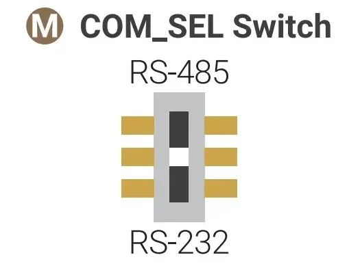
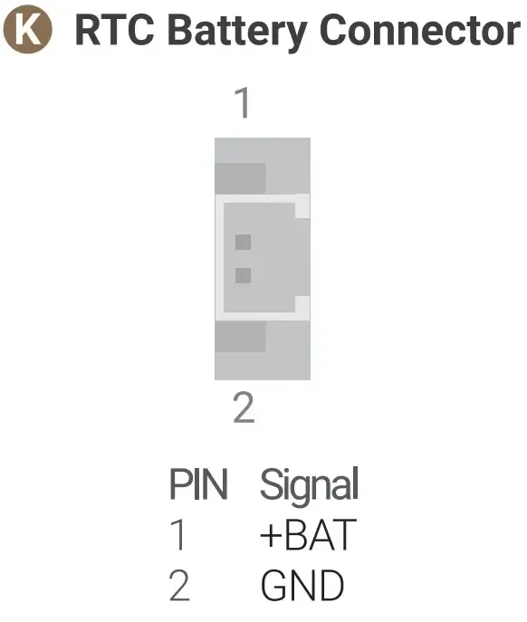
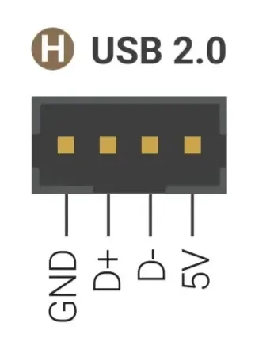

# Sigma 2

**LattePanda** · Intel Core Ultra X7 358H / RP2350

Revision: Match model and revision in manufacturer references

Coverage: Manufacturer references collected; independent complete-pinout approval pending

[Browse all manufacturers](../../../../BROWSE.md) · [Devices & IoT](../../../../DEVICES.md) · [Open in the browser guide](https://valleytech-black-wire-guide.pages.dev/?board=lattepanda-sigma-2)

Architecture: **x86**

## Datasheets and original documentation

Board datasheet: **not yet recorded**. Visual reference: **available**.

[Original manufacturer documentation](https://docs.lattepanda.com/content/sigma2_edition/specification/)

- **hardware-guide / board**: [Manufacturer specifications and hardware documentation](https://docs.lattepanda.com/content/sigma2_edition/specification/) · online
- **hardware-guide / board**: [Internal connector orientation and signal definitions](https://docs.lattepanda.com/content/sigma2_edition/io_playability_internal/) · online
- **hardware-guide / board**: [PCH GPIO electrical behavior](https://docs.lattepanda.com/content/sigma2_edition/processor_gpio/) · online

Ten original connector/switch diagrams. They are connector references, not a complete board overview. GPIO logic is 3.3V; PCH pins use pull-ups/level shifting. Power headers and fan rails are not GPIO. A dedicated board PDF datasheet was not found.

[Documentation coverage and remaining gaps](../../../../DOCUMENTATION.md)

## Specifications and hardware documentation

- [Manufacturer hardware specifications](https://docs.lattepanda.com/content/sigma2_edition/specification/)

## Sigma 2 dc in connector reference

**connector reference** · Source identity and visual scope reviewed on 2026-10-30; independent electrical and all-connector review pending · WEBP

[Open original reference](../../../../library/media/21bde59e510658eb1cf1295474fd796e280f2643e790e160e0af40eb1b9f5e70.webp)

**Credit and rights:** Original manufacturer artwork; redistribution and print rights not established. Attribution is not a license grant.. Source/manufacturer: LattePanda.

[Source 1](https://docs.lattepanda.com/assets/images/Sigma2/pinout_dc_in.webp) · [Source 2](https://docs.lattepanda.com/content/sigma2_edition/io_playability_internal/)

Source retained unchanged. Connector scope and electrical limits require the matching manufacturer documentation.

Image revision: Match the source and PCB revision

SHA-256: `21bde59e510658eb1cf1295474fd796e280f2643e790e160e0af40eb1b9f5e70`

## Sigma 2 cpu fan connector reference

**connector reference** · Source identity and visual scope reviewed on 2026-10-30; independent electrical and all-connector review pending · WEBP

[Open original reference](../../../../library/media/65bc877e2d8ec88ea5e23852f145a42ff78cc0c17a48c99624a183698e2b940c.webp)

**Credit and rights:** Original manufacturer artwork; redistribution and print rights not established. Attribution is not a license grant.. Source/manufacturer: LattePanda.

[Source 1](https://docs.lattepanda.com/assets/images/Sigma2/pinout_cpu_fan.webp) · [Source 2](https://docs.lattepanda.com/content/sigma2_edition/io_playability_internal/)

Source retained unchanged. Connector scope and electrical limits require the matching manufacturer documentation.

Image revision: Match the source and PCB revision

SHA-256: `65bc877e2d8ec88ea5e23852f145a42ff78cc0c17a48c99624a183698e2b940c`

## Sigma 2 sys fan connector reference

**connector reference** · Source identity and visual scope reviewed on 2026-10-30; independent electrical and all-connector review pending · WEBP

[Open original reference](../../../../library/media/43efdbd6d3f874b842a87183ef718cba46187dc0c2104473fce24caa566fb49d.webp)

**Credit and rights:** Original manufacturer artwork; redistribution and print rights not established. Attribution is not a license grant.. Source/manufacturer: LattePanda.

[Source 1](https://docs.lattepanda.com/assets/images/Sigma2/pinout_sys_fan.webp) · [Source 2](https://docs.lattepanda.com/content/sigma2_edition/io_playability_internal/)

Source retained unchanged. Connector scope and electrical limits require the matching manufacturer documentation.

Image revision: Match the source and PCB revision

SHA-256: `43efdbd6d3f874b842a87183ef718cba46187dc0c2104473fce24caa566fb49d`

## Sigma 2 front audio connector reference

**connector reference** · Source identity and visual scope reviewed on 2026-10-30; independent electrical and all-connector review pending · WEBP

[Open original reference](../../../../library/media/8cfb7165215254362cce492eec9a2122ac47bb547102685c0dfd90305fc1c944.webp)

**Credit and rights:** Original manufacturer artwork; redistribution and print rights not established. Attribution is not a license grant.. Source/manufacturer: LattePanda.

[Source 1](https://docs.lattepanda.com/assets/images/Sigma2/pinout_front_audio.webp) · [Source 2](https://docs.lattepanda.com/content/sigma2_edition/io_playability_internal/)

Source retained unchanged. Connector scope and electrical limits require the matching manufacturer documentation.

Image revision: Match the source and PCB revision

SHA-256: `8cfb7165215254362cce492eec9a2122ac47bb547102685c0dfd90305fc1c944`

## Sigma 2 front panel connector reference

**connector reference** · Source identity and visual scope reviewed on 2026-10-30; independent electrical and all-connector review pending · WEBP

[Open original reference](../../../../library/media/ae03f0d690f6d39bed55bf06067a894c5c8a976e15eee96e10f9f2c6bc20d475.webp)

**Credit and rights:** Original manufacturer artwork; redistribution and print rights not established. Attribution is not a license grant.. Source/manufacturer: LattePanda.

[Source 1](https://docs.lattepanda.com/assets/images/Sigma2/pinout_front_panel.webp) · [Source 2](https://docs.lattepanda.com/content/sigma2_edition/io_playability_internal/)

Source retained unchanged. Connector scope and electrical limits require the matching manufacturer documentation.

Image revision: Match the source and PCB revision

SHA-256: `ae03f0d690f6d39bed55bf06067a894c5c8a976e15eee96e10f9f2c6bc20d475`

## Sigma 2 gpio connector reference

**connector reference** · Source identity and visual scope reviewed on 2026-10-30; independent electrical and all-connector review pending · WEBP

[Open original reference](../../../../library/media/553b8b4cae8ccd49c7c211bb90d7de26f390effae6551c938af489b3c3a6c37b.webp)

**Credit and rights:** Original manufacturer artwork; redistribution and print rights not established. Attribution is not a license grant.. Source/manufacturer: LattePanda.

[Source 1](https://docs.lattepanda.com/assets/images/Sigma2/pinout_gpio.webp) · [Source 2](https://docs.lattepanda.com/content/sigma2_edition/io_playability_internal/)

Source retained unchanged. Connector scope and electrical limits require the matching manufacturer documentation.

Image revision: Match the source and PCB revision

SHA-256: `553b8b4cae8ccd49c7c211bb90d7de26f390effae6551c938af489b3c3a6c37b`

## Sigma 2 com connector reference

**connector reference** · Source identity and visual scope reviewed on 2026-10-30; independent electrical and all-connector review pending · WEBP

[Open original reference](../../../../library/media/df9364cb23a6dfc1959cd021df6bfba988efbdeb595f4ba1c2d04d4c2f570ac0.webp)

**Credit and rights:** Original manufacturer artwork; redistribution and print rights not established. Attribution is not a license grant.. Source/manufacturer: LattePanda.

[Source 1](https://docs.lattepanda.com/assets/images/Sigma2/pinout_com.webp) · [Source 2](https://docs.lattepanda.com/content/sigma2_edition/io_playability_internal/)

Source retained unchanged. Connector scope and electrical limits require the matching manufacturer documentation.

Image revision: Match the source and PCB revision

SHA-256: `df9364cb23a6dfc1959cd021df6bfba988efbdeb595f4ba1c2d04d4c2f570ac0`

## Sigma 2 com sel connector reference

**connector reference** · Source identity and visual scope reviewed on 2026-10-30; independent electrical and all-connector review pending · WEBP

[Open original reference](../../../../library/media/3f78e07d92d222fa19e8defb823bd33cd52e29fc0eec9712676514e93033c787.webp)

**Credit and rights:** Original manufacturer artwork; redistribution and print rights not established. Attribution is not a license grant.. Source/manufacturer: LattePanda.

[Source 1](https://docs.lattepanda.com/assets/images/Sigma2/pinout_com_sel.webp) · [Source 2](https://docs.lattepanda.com/content/sigma2_edition/io_playability_internal/)

Source retained unchanged. Connector scope and electrical limits require the matching manufacturer documentation.

Image revision: Match the source and PCB revision

SHA-256: `3f78e07d92d222fa19e8defb823bd33cd52e29fc0eec9712676514e93033c787`

## Sigma 2 rtc connector reference

**connector reference** · Source identity and visual scope reviewed on 2026-10-30; independent electrical and all-connector review pending · WEBP

[Open original reference](../../../../library/media/43f0994f292e57de5c9298f2b08946859ed7144b6df98b95c5d137f422cff4e9.webp)

**Credit and rights:** Original manufacturer artwork; redistribution and print rights not established. Attribution is not a license grant.. Source/manufacturer: LattePanda.

[Source 1](https://docs.lattepanda.com/assets/images/Sigma2/pinout_rtc.webp) · [Source 2](https://docs.lattepanda.com/content/sigma2_edition/io_playability_internal/)

Source retained unchanged. Connector scope and electrical limits require the matching manufacturer documentation.

Image revision: Match the source and PCB revision

SHA-256: `43f0994f292e57de5c9298f2b08946859ed7144b6df98b95c5d137f422cff4e9`

## Sigma 2 usb2 connector reference

**connector reference** · Source identity and visual scope reviewed on 2026-10-30; independent electrical and all-connector review pending · WEBP

[Open original reference](../../../../library/media/5d05a5a2c2a88317f101b660b876d0767b5b1054f147a9080b79ed5747084e66.webp)

**Credit and rights:** Original manufacturer artwork; redistribution and print rights not established. Attribution is not a license grant.. Source/manufacturer: LattePanda.

[Source 1](https://docs.lattepanda.com/assets/images/Sigma2/pinout_usb2.webp) · [Source 2](https://docs.lattepanda.com/content/sigma2_edition/io_playability_internal/)

Source retained unchanged. Connector scope and electrical limits require the matching manufacturer documentation.

Image revision: Match the source and PCB revision

SHA-256: `5d05a5a2c2a88317f101b660b876d0767b5b1054f147a9080b79ed5747084e66`

Pin assignments have not been independently electrically verified. Check board revision before wiring.
