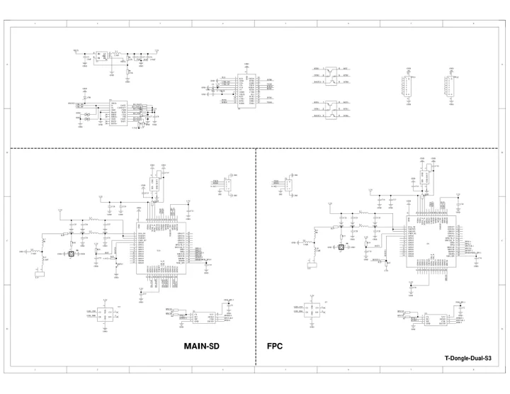

# T-Dongle-S3-Dual

**LILYGO** · ESP32-S3

Revision: Not identified

Coverage: Manufacturer references collected; complete physical pinout approval pending

[Browse all manufacturers](../../../../BROWSE.md) · [Devices & IoT](../../../../DEVICES.md) · [Open in the browser guide](https://valleytech-black-wire-guide.pages.dev/?board=lilygo-t-dongle-s3-dual)

Device category: **Controllers & instruments**

## Datasheets and original documentation

Board datasheet: **not yet recorded**. Visual reference: **available**.

[Original manufacturer documentation](https://github.com/Xinyuan-LilyGO/T-Dongle-S3)

- **hardware-guide / board**: [Manufacturer hardware documentation and specifications](https://github.com/Xinyuan-LilyGO/T-Dongle-S3) · online
- **schematic / board**: [T-Dongle-S3-Dual schematic](https://raw.githubusercontent.com/Xinyuan-LilyGO/T-Dongle-S3/03d51691e70271aeb988d0d1d930650595176736/schematic/T-Dongle-DualS3.pdf) · [saved document](../../../../library/media/244b59508c81ab81cb94bbf0ef58c2c4189caa7354b5b88d593c24e03609782f.pdf)

Variant-specific manufacturer schematic. A verified physical GPIO connector map is still needed; the product photo is not a pinout. Dual and Plus are not interchangeable with the standard T-Dongle-S3.

[Documentation coverage and remaining gaps](../../../../DOCUMENTATION.md)

## Specifications and hardware documentation

- [Manufacturer specifications and hardware documentation](https://github.com/Xinyuan-LilyGO/T-Dongle-S3)

## T-Dongle-S3-Dual schematic

**reference PDF** · Source identity and visual reference scope reviewed; independent electrical and all-connector completeness review pending · PDF

[Open original reference](../../../../library/media/244b59508c81ab81cb94bbf0ef58c2c4189caa7354b5b88d593c24e03609782f.pdf)

**Credit and rights:** Original manufacturer/publisher artwork; redistribution and print rights not established. Attribution does not grant a license or relicense the original.. Source/manufacturer: LILYGO.

[Source 1](https://raw.githubusercontent.com/Xinyuan-LilyGO/T-Dongle-S3/03d51691e70271aeb988d0d1d930650595176736/schematic/T-Dongle-DualS3.pdf) · [Source 2](https://github.com/Xinyuan-LilyGO/T-Dongle-S3)

Original source retained unchanged. Scope review does not establish every connector or electrical limit.

Image revision: Match the revision printed in the original source

SHA-256: `244b59508c81ab81cb94bbf0ef58c2c4189caa7354b5b88d593c24e03609782f`

Pin assignments have not been independently electrically verified. Check board revision before wiring.
