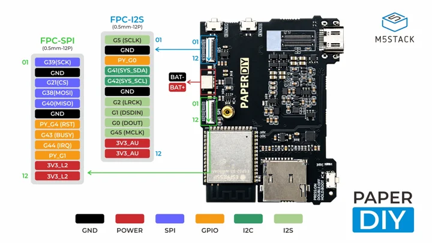
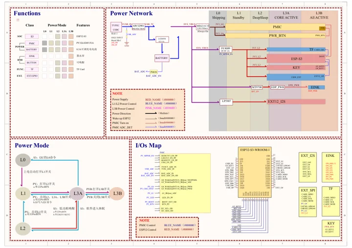
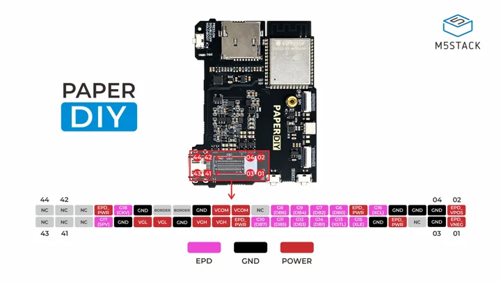

# PaperDIY

**M5Stack** · ESP32-S3R8

Revision: Not identified

Coverage: Manufacturer references collected; complete physical pinout approval pending

[Browse all manufacturers](../../../../BROWSE.md) · [Devices & IoT](../../../../DEVICES.md) · [Open in the browser guide](https://valleytech-black-wire-guide.pages.dev/?board=m5stack-paperdiy)

Device category: **Controllers & instruments**

## Datasheets and original documentation

Board datasheet: **not yet recorded**. Visual reference: **available**.

[Original manufacturer documentation](https://docs.m5stack.com/en/core/PaperDIY_Complete_Kit)

- **hardware-guide / board**: [Manufacturer hardware documentation and specifications](https://docs.m5stack.com/en/core/PaperDIY_Complete_Kit) · online
- **schematic / board**: [PaperDIY schematic](https://m5stack-doc.oss-cn-shenzhen.aliyuncs.com/1288/K159-B_PaperDIY_sche.pdf) · [saved document](../../../../library/media/d3dbc90ac64058a16e9a4426e8924b8f9a51dabac255f450bb91a478af2c6760.pdf)

K159 assembly and K159-B complete kits share the PaperDIY controller references linked by the manufacturer. Maps cover external FPC SPI/I2S and e-paper connector. PY_G labels belong to the PMIC, not ESP32 GPIO. The e-paper connector includes generated display supply rails; it is not a general-purpose GPIO header.

[Documentation coverage and remaining gaps](../../../../DOCUMENTATION.md)

## Specifications and hardware documentation

- [Manufacturer specifications and hardware documentation](https://docs.m5stack.com/en/core/PaperDIY_Complete_Kit)

## PaperDIY FPC pinmap 01

**pinout image** · Source identity and visual reference scope reviewed; independent electrical and all-connector completeness review pending · JPG

[Open original reference](../../../../library/media/5993e2e7a8145ad2e84778addc05bd067101bd0126f88c9ab5e031b07c058460.jpg)

**Credit and rights:** Original manufacturer/publisher artwork; redistribution and print rights not established. Attribution does not grant a license or relicense the original.. Source/manufacturer: M5Stack.

[Source 1](https://m5stack-doc.oss-cn-shenzhen.aliyuncs.com/1288/K159-PaperDIY-Assembly-Kit-pinmap_01.jpg) · [Source 2](https://docs.m5stack.com/en/core/PaperDIY_Complete_Kit)

Original source retained unchanged. Scope review does not establish every connector or electrical limit.

Image revision: Match the revision printed in the original source

SHA-256: `5993e2e7a8145ad2e84778addc05bd067101bd0126f88c9ab5e031b07c058460`

## PaperDIY schematic

**reference PDF** · Source identity and visual reference scope reviewed; independent electrical and all-connector completeness review pending · PDF

[Open original reference](../../../../library/media/d3dbc90ac64058a16e9a4426e8924b8f9a51dabac255f450bb91a478af2c6760.pdf)

**Credit and rights:** Original manufacturer/publisher artwork; redistribution and print rights not established. Attribution does not grant a license or relicense the original.. Source/manufacturer: M5Stack.

[Source 1](https://m5stack-doc.oss-cn-shenzhen.aliyuncs.com/1288/K159-B_PaperDIY_sche.pdf) · [Source 2](https://docs.m5stack.com/en/core/PaperDIY_Complete_Kit)

Original source retained unchanged. Scope review does not establish every connector or electrical limit.

Image revision: Match the revision printed in the original source

SHA-256: `d3dbc90ac64058a16e9a4426e8924b8f9a51dabac255f450bb91a478af2c6760`

## PaperDIY connector locations

**pinout image** · Source identity and visual reference scope reviewed; independent electrical and all-connector completeness review pending · JPG

[Open original reference](../../../../library/media/3bdc57f66a37b5e08245d380e69bbb213f8f31348c7be9bbf72838dfacab04ec.jpg)

**Credit and rights:** Original manufacturer/publisher artwork; redistribution and print rights not established. Attribution does not grant a license or relicense the original.. Source/manufacturer: M5Stack.

[Source 1](https://m5stack-doc.oss-cn-shenzhen.aliyuncs.com/1288/K159-PaperDIY-Assembly-Kit-pinmap_02.jpg) · [Source 2](https://docs.m5stack.com/en/core/PaperDIY_Complete_Kit)

Original source retained unchanged. Scope review does not establish every connector or electrical limit.

Image revision: Match the revision printed in the original source

SHA-256: `3bdc57f66a37b5e08245d380e69bbb213f8f31348c7be9bbf72838dfacab04ec`

Pin assignments have not been independently electrically verified. Check board revision before wiring.
