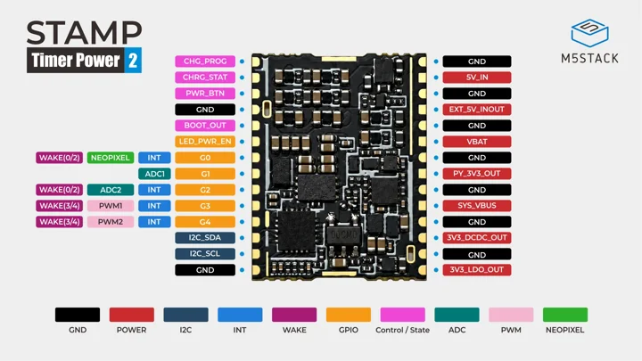
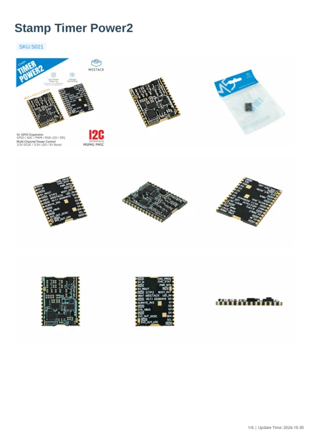
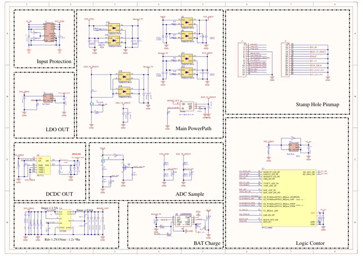

# Stamp Timer Power2

**M5Stack** · M5PM1 / PY32

Revision: Match model and revision in manufacturer references

Coverage: Manufacturer references collected; independent complete-pinout approval pending

[Browse all manufacturers](../../../../BROWSE.md) · [Devices & IoT](../../../../DEVICES.md) · [Open in the browser guide](https://valleytech-black-wire-guide.pages.dev/?board=m5stack-stamp-timer-power2)

## Datasheets and original documentation

Board datasheet: **not yet recorded**. Visual reference: **available**.

[Original manufacturer documentation](https://docs.m5stack.com/en/stamp/Stamp_Timer_Power2)

- **hardware-guide / board**: [Manufacturer specifications and hardware documentation](https://docs.m5stack.com/en/stamp/Stamp_Timer_Power2) · online
- **hardware-guide / board**: [Stamp_Timer_Power2 hardware manual](https://m5stack.oss-cn-shenzhen.aliyuncs.com/resource/docs/static/pdf/static/en/stamp/Stamp_Timer_Power2.pdf) · [saved document](../../../../library/media/85f11b41c207d144444fc20b9bf0c3a4d0249351232d853d5644c6dbb57e3e0d.pdf)
- **schematic / board**: [Stamp_Timer_Power2 schematic](https://m5stack-doc.oss-cn-shenzhen.aliyuncs.com/1294/S021_Stamp_Timer_Power2_SCH_V0.7.1.pdf) · [saved document](../../../../library/media/271d3f7004bffff588c4bf4e0c0423e2da3f7c5edfdd4b557a00fc448699321d.pdf)

Physical pad map, schematic and hardware manual. Power rails and programmable PMIC pins must not be confused with an attached host MCU GPIO. Charge-current settings and power sequencing require the source manual.

[Documentation coverage and remaining gaps](../../../../DOCUMENTATION.md)

## Specifications and hardware documentation

- [Manufacturer hardware specifications](https://docs.m5stack.com/en/stamp/Stamp_Timer_Power2)

## Stamp Timer Power2 physical pinout (embedded original from manual page 4)

**pinout image** · Source identity and visual scope reviewed on 2026-10-30; independent electrical and all-connector review pending · JPEG

[Open original reference](../../../../library/media/603805243f117991f9854b22b17b02116d953bb6955987e3656a1fe88da24218.jpeg)

**Credit and rights:** Original manufacturer artwork; redistribution and print rights not established. Attribution is not a license grant.. Source/manufacturer: M5Stack.

[Source 1](https://m5stack.oss-cn-shenzhen.aliyuncs.com/resource/docs/static/pdf/static/en/stamp/Stamp_Timer_Power2.pdf) · [Source 2](https://docs.m5stack.com/en/stamp/Stamp_Timer_Power2)

Embedded original JPEG extracted without redrawing from manufacturer manual page 4. The PDF and image hashes are recorded separately.

Image revision: Match the source and PCB revision

SHA-256: `603805243f117991f9854b22b17b02116d953bb6955987e3656a1fe88da24218`

## Stamp_Timer_Power2 hardware manual

**reference PDF** · Source identity and visual scope reviewed on 2026-10-30; independent electrical and all-connector review pending · PDF

[Open original reference](../../../../library/media/85f11b41c207d144444fc20b9bf0c3a4d0249351232d853d5644c6dbb57e3e0d.pdf)

**Credit and rights:** Original manufacturer artwork; redistribution and print rights not established. Attribution is not a license grant.. Source/manufacturer: M5Stack.

[Source 1](https://m5stack.oss-cn-shenzhen.aliyuncs.com/resource/docs/static/pdf/static/en/stamp/Stamp_Timer_Power2.pdf) · [Source 2](https://docs.m5stack.com/en/stamp/Stamp_Timer_Power2)

Source retained unchanged. Connector scope and electrical limits require the matching manufacturer documentation.

Image revision: Match the source and PCB revision

SHA-256: `85f11b41c207d144444fc20b9bf0c3a4d0249351232d853d5644c6dbb57e3e0d`

## Stamp_Timer_Power2 schematic

**reference PDF** · Source identity and visual scope reviewed on 2026-10-30; independent electrical and all-connector review pending · PDF

[Open original reference](../../../../library/media/271d3f7004bffff588c4bf4e0c0423e2da3f7c5edfdd4b557a00fc448699321d.pdf)

**Credit and rights:** Original manufacturer artwork; redistribution and print rights not established. Attribution is not a license grant.. Source/manufacturer: M5Stack.

[Source 1](https://m5stack-doc.oss-cn-shenzhen.aliyuncs.com/1294/S021_Stamp_Timer_Power2_SCH_V0.7.1.pdf) · [Source 2](https://docs.m5stack.com/en/stamp/Stamp_Timer_Power2)

Source retained unchanged. Connector scope and electrical limits require the matching manufacturer documentation.

Image revision: Match the source and PCB revision

SHA-256: `271d3f7004bffff588c4bf4e0c0423e2da3f7c5edfdd4b557a00fc448699321d`

Pin assignments have not been independently electrically verified. Check board revision before wiring.
