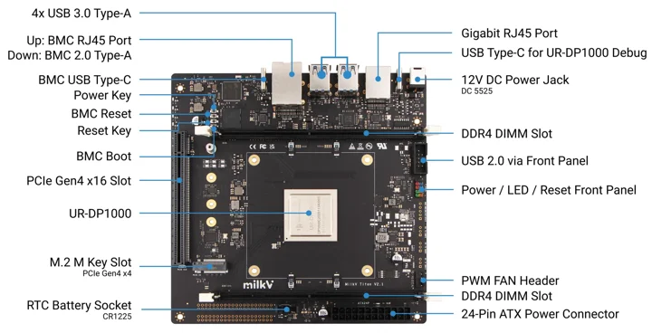
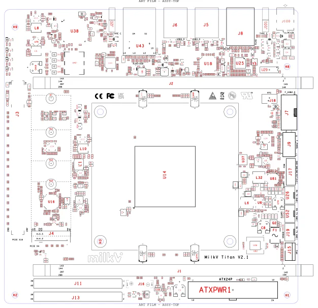
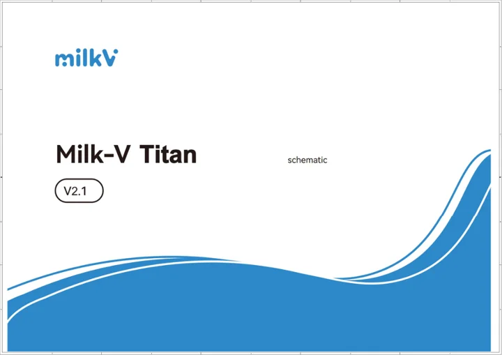

# Titan

**Milk-V** · UltraRISC UR-DP1000

Revision: V2.1

Coverage: Manufacturer references collected; independent complete-pinout approval pending

[Browse all manufacturers](../../../../BROWSE.md) · [Devices & IoT](../../../../DEVICES.md) · [Open in the browser guide](https://valleytech-black-wire-guide.pages.dev/?board=milk-v-titan)

Architecture: **RISC-V**

## Datasheets and original documentation

Board datasheet: **not yet recorded**. Visual reference: **available**.

[Original manufacturer model documentation](https://milkv.io/docs/titan/getting-started/hardware)

- **hardware-guide / board**: [Titan hardware and connector pin tables](https://milkv.io/docs/titan/getting-started/hardware) · online
- **hardware-guide / board**: [Titan official resource downloads](https://milkv.io/docs/titan/getting-started/resources) · online
- **hardware-guide / board**: [Titan V2.1 component placement](https://raw.githubusercontent.com/milkv-titan/titan-files/main/hardware/v2.1/milkv_titan_v2.1_smd.pdf) · [saved document](../../../../library/media/8e7956c065620143082b184bea81c257ec5b998aca454bfc96cd71cc01338e71.pdf)
- **schematic / board**: [Titan V2.1 schematic](https://raw.githubusercontent.com/milkv-titan/titan-files/main/hardware/v2.1/milkv_titan_v2.1_schematic.pdf) · [saved document](../../../../library/media/3a30759069523097624c80724114a109add649e2b810262a22151f324aee2c2f.pdf)

Supporting documentation only: V2.1 motherboard connector-location diagram, 28-page original schematic and 2-page component placement PDF visually verified. Interface image labels whole ports, not individual GPIO pins; must not count it as a complete physical pinout. Hardware guide contains separate front-panel/USB/fan pin tables; no complete board-wide physical pinout approved. No dedicated board datasheet identified.

[Documentation coverage and remaining gaps](../../../../DOCUMENTATION.md)

## Specifications and hardware documentation

- [Manufacturer hardware specifications](https://milkv.io/docs/titan/getting-started/hardware)

## Titan V2.1 connector locations

**board layout** · Source identity and visual scope reviewed on 2026-11-03; independent electrical and all-connector review pending · WEBP

[Open original reference](../../../../library/media/13bd8b442ba118218180fc3cb3237a27a51b60286debed9abb953448b1335e85.webp)

**Credit and rights:** Original manufacturer artwork; redistribution and print rights not established. Preserve attribution; public availability is not a license.. Source/manufacturer: Milk-V.

[Source 1](https://milkv.io/docs/titan/titan-interface.webp) · [Source 2](https://milkv.io/docs/titan/getting-started/hardware)

Source retained unchanged. Match the hardware revision and connector orientation; independent electrical review pending.

Image revision: V2.1

SHA-256: `13bd8b442ba118218180fc3cb3237a27a51b60286debed9abb953448b1335e85`

## Titan V2.1 component placement

**reference PDF** · Source identity and visual scope reviewed on 2026-11-03; independent electrical and all-connector review pending · PDF

[Open original reference](../../../../library/media/8e7956c065620143082b184bea81c257ec5b998aca454bfc96cd71cc01338e71.pdf)

**Credit and rights:** Original manufacturer artwork; redistribution and print rights not established. Preserve attribution; public availability is not a license.. Source/manufacturer: Milk-V.

[Source 1](https://raw.githubusercontent.com/milkv-titan/titan-files/main/hardware/v2.1/milkv_titan_v2.1_smd.pdf) · [Source 2](https://milkv.io/docs/titan/getting-started/resources)

Source retained unchanged. Match the hardware revision and connector orientation; independent electrical review pending.

Image revision: V2.1

SHA-256: `8e7956c065620143082b184bea81c257ec5b998aca454bfc96cd71cc01338e71`

## Titan V2.1 schematic

**reference PDF** · Source identity and visual scope reviewed on 2026-11-03; independent electrical and all-connector review pending · PDF

[Open original reference](../../../../library/media/3a30759069523097624c80724114a109add649e2b810262a22151f324aee2c2f.pdf)

**Credit and rights:** Original manufacturer artwork; redistribution and print rights not established. Preserve attribution; public availability is not a license.. Source/manufacturer: Milk-V.

[Source 1](https://raw.githubusercontent.com/milkv-titan/titan-files/main/hardware/v2.1/milkv_titan_v2.1_schematic.pdf) · [Source 2](https://milkv.io/docs/titan/getting-started/resources)

Source retained unchanged. Match the hardware revision and connector orientation; independent electrical review pending.

Image revision: V2.1

SHA-256: `3a30759069523097624c80724114a109add649e2b810262a22151f324aee2c2f`

Pin assignments have not been independently electrically verified. Check board revision before wiring.
