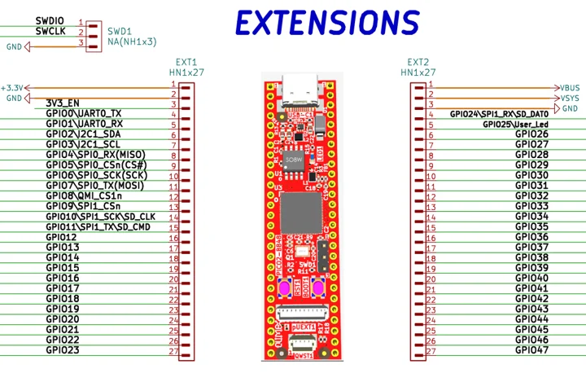

# RP2350-PICO2-BB48R

**Olimex** · RP2350B

Revision: Manufacturer BB48 family drawing. PCB revision unspecified.

Coverage: Manufacturer source files collected. USB-C at the top. Two 27-position edge headers and a three-position SWD header.

[Browse all manufacturers](../../../../BROWSE.md) · [Devices & IoT](../../../../DEVICES.md) · [Open in the browser guide](https://valleytech-black-wire-guide.pages.dev/?board=olimex-rp2350-pico2-bb48r)

## Datasheets and original documentation

Board datasheet: **not yet recorded**. Visual reference: **available**.

[Manufacturer model documentation](https://www.olimex.com/Products/RaspberryPi/PICO/RP2350-PICO2-BB48/open-source-hardware)

- **source / board**: [Manufacturer background and documentation](https://olimex.wordpress.com/2025/09/22/new-rp2350-pico2-open-source-hardware-development-board-with-all-48-gpios-exposed-in-breadboard-friendly-layout/) · online

The BB48R adds PSRAM and microSD. Olimex publishes one extension-header drawing for both variants. Olimex announced both variants on September 22, 2025.

[Documentation coverage and remaining gaps](../../../../DOCUMENTATION.md)

## Specifications and hardware documentation

- [Manufacturer documentation](https://www.olimex.com/Products/RaspberryPi/PICO/RP2350-PICO2-BB48/open-source-hardware)

## EXT1, EXT2 and SWD header pinout

**pinout image** · Manufacturer artwork and model identity reviewed November 25, 2026. Independent electrical verification pending. · PNG

[Open original reference](../../../../library/media/0b625415d4eb09481c35a9f9a777db410f4c9d8ce95133e644019edb701f8378.png)

**Credit and rights:** Copyright (c) 2025 OLIMEX LTD BULGARIA. MIT license for associated documentation. Original PNG unchanged. https://github.com/OLIMEX/RP2350-PICO2-BB48/blob/74b030363ca03eea5bfa6dac59cbcd9e4277e910/LICENSE. Source/manufacturer: Olimex.

[Source 1](https://raw.githubusercontent.com/OLIMEX/RP2350-PICO2-BB48/74b030363ca03eea5bfa6dac59cbcd9e4277e910/DOCUMENTS/RP2350-PICO2-BB48-pinout.png) · [Source 2](https://www.olimex.com/Products/RaspberryPi/PICO/RP2350-PICO2-BB48/open-source-hardware)

USB-C at the top. Two 27-position edge headers and a three-position SWD header.

Image revision: Manufacturer BB48 family drawing. PCB revision unspecified.

SHA-256: `0b625415d4eb09481c35a9f9a777db410f4c9d8ce95133e644019edb701f8378`

Pin assignments have not been independently electrically verified. Check board revision before wiring.
