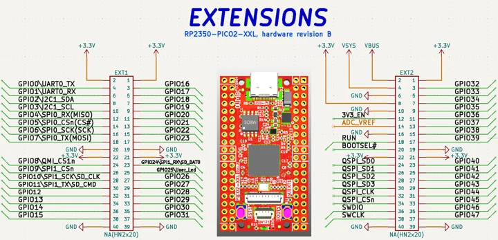

# RP2350-PICO2-XXL Rev B

**Olimex** · RP2350B

Revision: Hardware revision B on drawing

Coverage: Manufacturer source files collected. Top view with numbered 2×20 connectors.

[Browse all manufacturers](../../../../BROWSE.md) · [Devices & IoT](../../../../DEVICES.md) · [Open in the browser guide](https://valleytech-black-wire-guide.pages.dev/?board=olimex-rp2350-pico2-xxl-rev-b)

## Datasheets and original documentation

Board datasheet: **not yet recorded**. Visual reference: **available**.

[Manufacturer model documentation](https://github.com/OLIMEX/RP2350-PICO2-XXL)

- **source / board**: [Manufacturer background and documentation](https://olimex.wordpress.com/2024/11/28/pico2-xl-and-pico2-xxl-are-open-source-hardware-boards-with-rp2350b-and-offering-48-gpios-available-2-16mb-flash-0-8mb-psram-sd-card-usb-c-and-2a-3-3v-power-supply/) · online

The manufacturer identifies both the XXL model and revision B in the drawing. Olimex introduced the XL and XXL on November 28, 2024. The drawing specifies XXL Rev B.

[Documentation coverage and remaining gaps](../../../../DOCUMENTATION.md)

## Specifications and hardware documentation

- [Manufacturer documentation](https://github.com/OLIMEX/RP2350-PICO2-XXL)

## Rev B EXT1 and EXT2 pinout

**pinout image** · Manufacturer artwork and model identity reviewed November 25, 2026. Independent electrical verification pending. · PNG

[Open original reference](../../../../library/media/17063ce1579544cb4cb6ff075ca1ccb7cf89c74050958ad6e6dc1d77145414e8.png)

**Credit and rights:** Olimex documentation, CC BY-SA 4.0. Original unchanged. https://creativecommons.org/licenses/by-sa/4.0/ https://github.com/OLIMEX/RP2350-PICO2-XXL/blob/a73c9253e8142eadf8e10bc8a2f13d502ec3fa4a/README.md. Source/manufacturer: Olimex.

[Source 1](https://raw.githubusercontent.com/OLIMEX/RP2350-PICO2-XXL/a73c9253e8142eadf8e10bc8a2f13d502ec3fa4a/DOCUMENTS/Extensions-pinout.png) · [Source 2](https://github.com/OLIMEX/RP2350-PICO2-XXL)

Top view with numbered 2×20 connectors.

Image revision: Hardware revision B on drawing

SHA-256: `17063ce1579544cb4cb6ff075ca1ccb7cf89c74050958ad6e6dc1d77145414e8`

Pin assignments have not been independently electrically verified. Check board revision before wiring.
