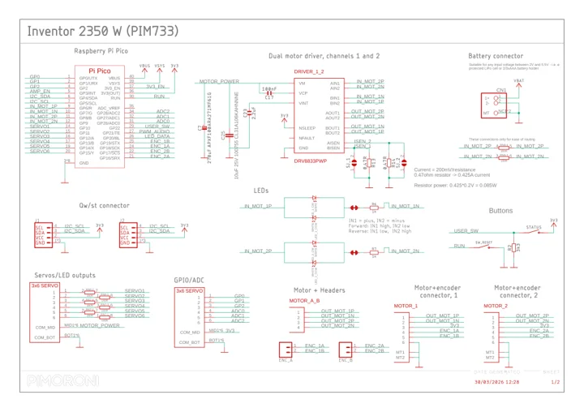

# Inventor 2350 W

**Pimoroni** · RP2350

Revision: Not identified

Coverage: Manufacturer references collected; complete physical pinout approval pending

[Browse all manufacturers](../../../../BROWSE.md) · [Devices & IoT](../../../../DEVICES.md) · [Open in the browser guide](https://valleytech-black-wire-guide.pages.dev/?board=pimoroni-inventor-2350-w)

## Datasheets and original documentation

Board datasheet: **not yet recorded**. Visual reference: **available**.

[Original manufacturer documentation](https://shop.pimoroni.com/products/inventor-2350-w)

- **hardware-guide / board**: [Manufacturer hardware documentation and specifications](https://shop.pimoroni.com/products/inventor-2350-w) · online
- **schematic / board**: [Inventor 2350 W schematic](https://cdn.shopify.com/s/files/1/0174/1800/files/inventor_2350_w_schematic.pdf?v=1774870556) · [saved document](../../../../library/media/282b145761b85e3e50fa2c2cd300b64ad77fef9e9eeaf09327e63dec0a5c02d4.pdf)

Manufacturer board schematic and specifications recorded. A physical pinout diagram has not yet been verified; supporting documentation must not be mistaken for a complete connector map.

[Documentation coverage and remaining gaps](../../../../DOCUMENTATION.md)

## Specifications and hardware documentation

- [Manufacturer specifications and hardware documentation](https://shop.pimoroni.com/products/inventor-2350-w)

## Inventor 2350 W schematic

**reference PDF** · Source identity and visual reference scope reviewed; independent electrical and all-connector completeness review pending · PDF

[Open original reference](../../../../library/media/282b145761b85e3e50fa2c2cd300b64ad77fef9e9eeaf09327e63dec0a5c02d4.pdf)

**Credit and rights:** Original manufacturer/publisher artwork; redistribution and print rights not established. Attribution does not grant a license or relicense the original.. Source/manufacturer: Pimoroni.

[Source 1](https://cdn.shopify.com/s/files/1/0174/1800/files/inventor_2350_w_schematic.pdf?v=1774870556) · [Source 2](https://shop.pimoroni.com/products/inventor-2350-w)

Original source retained unchanged. Scope review does not establish every connector or electrical limit.

Image revision: Match the revision printed in the original source

SHA-256: `282b145761b85e3e50fa2c2cd300b64ad77fef9e9eeaf09327e63dec0a5c02d4`

Pin assignments have not been independently electrically verified. Check board revision before wiring.
