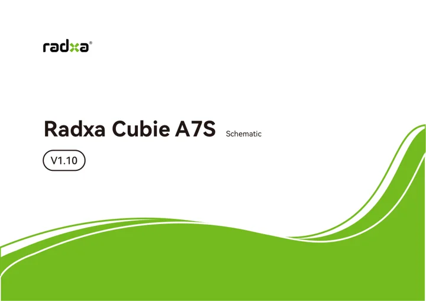

# Cubie A7S

**Radxa** · Allwinner A733

Revision: v1.10

Coverage: Manufacturer references collected; complete physical pinout approval pending

[Browse all manufacturers](../../../../BROWSE.md) · [Devices & IoT](../../../../DEVICES.md) · [Open in the browser guide](https://valleytech-black-wire-guide.pages.dev/?board=radxa-cubie-a7s)

Architecture: **Arm**

## Datasheets and original documentation

Board datasheet: **not yet recorded**. Visual reference: **available**.

[Original manufacturer documentation](https://docs.radxa.com/en/cubie/a7s/download)

- **hardware-guide / board**: [Manufacturer hardware documentation and specifications](https://docs.radxa.com/en/cubie/a7s/download) · online
- **schematic / board**: [Cubie A7S schematic](https://dl.radxa.com/cubie/a7s/hw/radxa_cubie_a7s_schematic_v1.10.pdf) · [saved document](../../../../library/media/89bf60f0d08373fd7aa99329c7f66151a6097c5b7e3a15f71863448f0363500f.pdf)

Original board schematic saved. Physical GPIO connector pinout image and dedicated board datasheet still need review.

[Documentation coverage and remaining gaps](../../../../DOCUMENTATION.md)

## Specifications and hardware documentation

- [Manufacturer specifications and hardware documentation](https://docs.radxa.com/en/cubie/a7s/download)

## Cubie A7S schematic

**reference PDF** · Source identity and visual reference scope reviewed; independent electrical and all-connector completeness review pending · PDF

[Open original reference](../../../../library/media/89bf60f0d08373fd7aa99329c7f66151a6097c5b7e3a15f71863448f0363500f.pdf)

**Credit and rights:** Original manufacturer/publisher artwork; redistribution and print rights not established. Attribution does not grant a license or relicense the original.. Source/manufacturer: Radxa.

[Source 1](https://dl.radxa.com/cubie/a7s/hw/radxa_cubie_a7s_schematic_v1.10.pdf) · [Source 2](https://docs.radxa.com/en/cubie/a7s/download)

Original source retained unchanged. Scope review does not establish every connector or electrical limit.

Image revision: Match the revision printed in the original source

SHA-256: `89bf60f0d08373fd7aa99329c7f66151a6097c5b7e3a15f71863448f0363500f`

Pin assignments have not been independently electrically verified. Check board revision before wiring.
