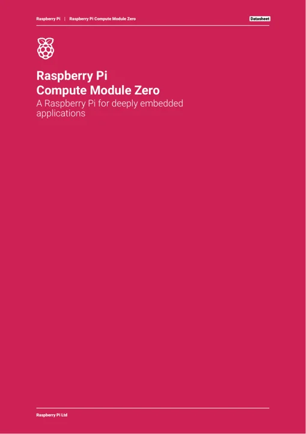

# Compute Module Zero

**Raspberry Pi** · RP3A0

Revision: Not identified

Coverage: Manufacturer references collected; complete physical pinout approval pending

[Browse all manufacturers](../../../../BROWSE.md) · [Devices & IoT](../../../../DEVICES.md) · [Open in the browser guide](https://valleytech-black-wire-guide.pages.dev/?board=raspberry-pi-compute-module-zero)

Architecture: **Arm Cortex-A53**

## Datasheets and original documentation

Board datasheet: **recorded**. Visual reference: **available**.

[Original manufacturer documentation](https://www.raspberrypi.com/products/compute-module-zero/)

- **hardware-guide / board**: [Manufacturer hardware documentation and specifications](https://www.raspberrypi.com/products/compute-module-zero/) · online
- **datasheet / board**: [Compute Module Zero board datasheet](https://pip-assets.raspberrypi.com/categories/1286-raspberry-pi-compute-module-zero/documents/RP-009251-DS-2-cm0-datasheet.pdf) · [saved document](../../../../library/media/861c9d1849bf206cce79bfa1beaabe8f86b195356f8db8d534b58cb49e8cd28e.pdf)

Official board datasheet covers CM0 variants, physical footprint and 132 castellated pin functions (PDF pages 12–16). A visual map with every signal labeled around the module remains missing. This is a solder-down SoM, not a chip-package pinout.

[Documentation coverage and remaining gaps](../../../../DOCUMENTATION.md)

## Specifications and hardware documentation

- [Manufacturer specifications and hardware documentation](https://www.raspberrypi.com/products/compute-module-zero/)

## Compute Module Zero board datasheet

**reference PDF** · Source identity and visual reference scope reviewed; independent electrical and all-connector completeness review pending · PDF

[Open original reference](../../../../library/media/861c9d1849bf206cce79bfa1beaabe8f86b195356f8db8d534b58cb49e8cd28e.pdf)

**Credit and rights:** Original manufacturer/publisher artwork; redistribution and print rights not established. Attribution does not grant a license or relicense the original.. Source/manufacturer: Raspberry Pi.

[Source 1](https://pip-assets.raspberrypi.com/categories/1286-raspberry-pi-compute-module-zero/documents/RP-009251-DS-2-cm0-datasheet.pdf) · [Source 2](https://www.raspberrypi.com/products/compute-module-zero/)

Original source retained unchanged. Scope review does not establish every connector or electrical limit.

Image revision: Match the revision printed in the original source

SHA-256: `861c9d1849bf206cce79bfa1beaabe8f86b195356f8db8d534b58cb49e8cd28e`

Pin assignments have not been independently electrically verified. Check board revision before wiring.
