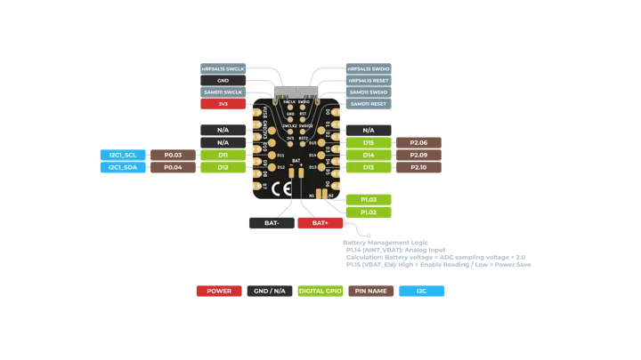

# XIAO nRF54L15 V1.2

**Seeed Studio** · Nordic nRF54L15

Revision: V1.2 (rear PCB silkscreen)

Coverage: Manufacturer source files collected. Physical rear pinout shared by the base and Sense V1.2 boards; dedicated V1.2 front artwork pending.

[Browse all manufacturers](../../../../BROWSE.md) · [Devices & IoT](../../../../DEVICES.md) · [Open in the browser guide](https://valleytech-black-wire-guide.pages.dev/?board=seeed-studio-xiao-nrf54l15-v1-2)

## Datasheets and original documentation

Board datasheet: **not yet recorded**. Visual reference: **available**.

[Manufacturer model documentation](https://wiki.seeedstudio.com/xiao_nrf54l15_sense_getting_started/)

- **source / board**: [Manufacturer background and documentation](https://wiki.seeedstudio.com/Seeed_Elderly/weekly_wiki/2026/wiki261116/) · online

Identify V1.2 by the rear PCB silkscreen. The 3V3, RST2, SWCLK2 and SWDIO2 rear pads moved. The side headers retain the earlier layout. Seeed uses the same rear pinout artwork for both variants. Dedicated V1.2 front artwork is pending manufacturer approval. Exact hardware launch date unknown. Seeed documented the revised rear pinout in its November 16, 2026 weekly update.

[Documentation coverage and remaining gaps](../../../../DOCUMENTATION.md)

## Specifications and hardware documentation

- [Manufacturer documentation](https://wiki.seeedstudio.com/xiao_nrf54l15_sense_getting_started/)

## V1.2 rear GPIO, power and debug pad pinout

**pinout image** · Manufacturer artwork and model identity reviewed November 25, 2026. Independent electrical verification pending. · PNG

[Open original reference](../../../../library/media/632f826f875a81fa7f1a25cdb7eec36017ca22eb5f5321d7ee7cd942146e8602.png)

**Credit and rights:** Seeed Studio, CC BY-SA 4.0. Original image unchanged. License https://creativecommons.org/licenses/by-sa/4.0/ under https://wiki.seeedstudio.com/License/. Source/manufacturer: Seeed Studio.

[Source 1](https://files.seeedstudio.com/wiki/XIAO_nRF54L15/Getting_Start/XIAO_nRF54L15_Pinout_Back_20261112.png) · [Source 2](https://wiki.seeedstudio.com/xiao_nrf54l15_sense_getting_started/)

Physical rear pinout shared by the base and Sense V1.2 boards; dedicated V1.2 front artwork pending.

Image revision: V1.2 (rear PCB silkscreen)

SHA-256: `632f826f875a81fa7f1a25cdb7eec36017ca22eb5f5321d7ee7cd942146e8602`

Pin assignments have not been independently electrically verified. Check board revision before wiring.
