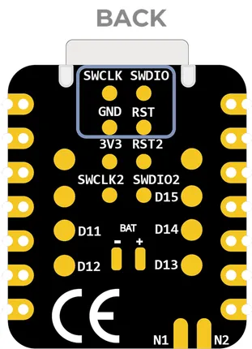
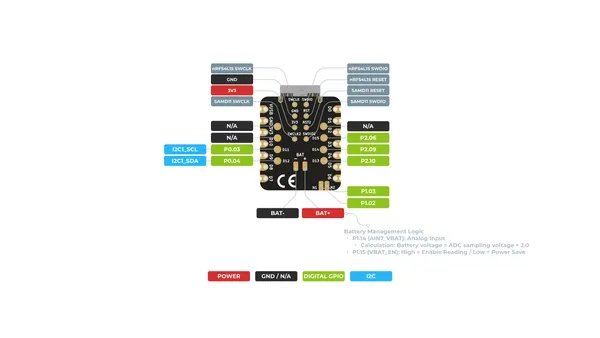
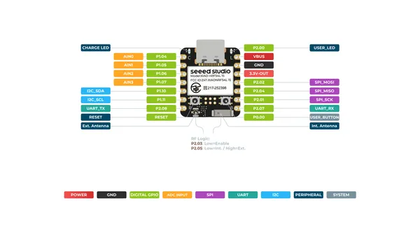
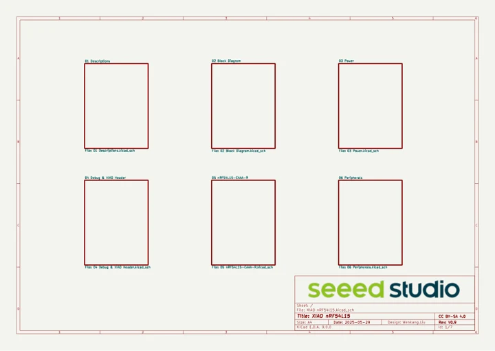

# XIAO nRF54L15

**Seeed Studio** · Other

Revision: Earlier hardware. V1.2 moves the 3V3, RST2, SWCLK2 and SWDIO2 rear pads. Use the separate V1.2 listing when the back of your PCB is marked v1.2.

Coverage: Manufacturer references reviewed by scope; independent electrical and all-connector review pending

[Browse all manufacturers](../../../../BROWSE.md) · [Devices & IoT](../../../../DEVICES.md) · [Open in the browser guide](https://valleytech-black-wire-guide.pages.dev/?board=seeed-studio-other-xiao-nrf54l15)

## Datasheets and original documentation

Board datasheet: **not yet recorded**. Visual reference: **available**.

[Manufacturer hardware documentation](https://wiki.seeedstudio.com/xiao_nrf54l15_sense_getting_started/)

- **schematic / board**: [XIAO nRF54L15 Schematic](https://files.seeedstudio.com/wiki/XIAO_nRF54L15/Getting_Start/nRF54L15_Schematic.pdf) · [saved document](../../../../library/media/d747f0aaa001dde088d13ce76e4bc9b7b46de26a54cc12805bd21248bee55d23.pdf)
- **hardware-guide / board**: [Manufacturer pin and hardware documentation](https://wiki.seeedstudio.com/xiao_nrf54l15_sense_getting_started/) · online

Earlier hardware. V1.2 moves the 3V3, RST2, SWCLK2 and SWDIO2 rear pads. Use the separate V1.2 listing when the back of your PCB is marked v1.2.

[Documentation coverage and remaining gaps](../../../../DOCUMENTATION.md)

## Standard XIAO edge contacts

Only the named external connector is covered. Other connectors and internal signals are not included.

Use the manufacturer diagram for orientation. Source labels are preserved; physical order is not inferred.

| Board label / source position | Purpose | Connection notes |
|---|---|---|
| 5V / 5V | Power Input/Output | Function: VBUS; Chip Pin: ; Standard edge contact only; no physical ordering inferred. |
| GND / GND | GND | Function: ; Chip Pin: ; Standard edge contact only; no physical ordering inferred. |
| 3V3 / 3V3 | Power Output | Function: 3V3_OUT; Chip Pin: ; Standard edge contact only; no physical ordering inferred. |
| D0 / D0 | GPIO, ADC | Function: Analog; Chip Pin: P1.04; Standard edge contact only; no physical ordering inferred. |
| D1 / D1 | GPIO, ADC | Function: Analog; Chip Pin: P1.05; Standard edge contact only; no physical ordering inferred. |
| D2 / D2 | GPIO, ADC | Function: Analog; Chip Pin: P1.06; Standard edge contact only; no physical ordering inferred. |
| D3 / D3 | GPIO, ADC | Function: Analog; Chip Pin: P1.07; Standard edge contact only; no physical ordering inferred. |
| D4 / D4 | GPIO, I2C Data | Function: SDA-0; Chip Pin: P1.10; Standard edge contact only; no physical ordering inferred. |
| D5 / D5 | GPIO, I2C Clock | Function: SCL-0; Chip Pin: P1.11; Standard edge contact only; no physical ordering inferred. |
| D6 / D6 | GPIO, UART Transmit | Function: TX; Chip Pin: P2.08; Standard edge contact only; no physical ordering inferred. |
| D7 / D7 | GPIO, UART Receive | Function: RX; Chip Pin: P2.07; Standard edge contact only; no physical ordering inferred. |
| D8 / D8 | GPIO, SPI Clock | Function: SPI_SCK; Chip Pin: P2.01; Standard edge contact only; no physical ordering inferred. |
| D9 / D9 | GPIO, SPI Data | Function: SPI_MISO; Chip Pin: P2.04; Standard edge contact only; no physical ordering inferred. |
| D10 / D10 | GPIO, SPI Data | Function: SPI_MOSI; Chip Pin: P2.02; Standard edge contact only; no physical ordering inferred. |

[Source evidence](https://wiki.seeedstudio.com/xiao_nrf54l15_sense_getting_started/) · Pin Map ​ / XIAO Pin, Function, Chip Pin, Description · Transcribed from manufacturer table; independent electrical validation pending

## Pinout (Back) (SWD Pads) — earlier hardware

**pinout image** · Reviewed source · PNG

[Open original reference](../../../../library/media/4fe2a25110d4c35b3be242c29e926ac63cc70c3f277651f85d8f70da88199262.png)

**Credit and rights:** Not established; source attribution retained. Source/manufacturer: Seeed Studio.

[Source 1](https://files.seeedstudio.com/wiki/XIAO_nRF54L15/Getting_Start/j_link.png) · [Source 2](https://wiki.seeedstudio.com/xiao_nrf54l15_sense_getting_started/)

Earlier hardware. V1.2 moves the 3V3, RST2, SWCLK2 and SWDIO2 rear pads. Use the separate V1.2 listing when the back of your PCB is marked v1.2.

Image revision: Earlier hardware. V1.2 moves the 3V3, RST2, SWCLK2 and SWDIO2 rear pads. Use the separate V1.2 listing when the back of your PCB is marked v1.2.

SHA-256: `4fe2a25110d4c35b3be242c29e926ac63cc70c3f277651f85d8f70da88199262`

## Pinout (Back) — earlier hardware

**pinout image** · Reviewed source · PNG

[Open original reference](../../../../library/media/ef97b35e6b9e5595f0417242ae9b566eecbc9d0b8081f9d65cf3523afc5f94c0.png)

**Credit and rights:** Not established; source attribution retained. Source/manufacturer: Seeed Studio.

[Source 1](https://files.seeedstudio.com/wiki/XIAO_nRF54L15/Getting_Start/XIAO_nRF54L15_back_pinout.png) · [Source 2](https://wiki.seeedstudio.com/xiao_nrf54l15_sense_getting_started/)

Earlier hardware. V1.2 moves the 3V3, RST2, SWCLK2 and SWDIO2 rear pads. Use the separate V1.2 listing when the back of your PCB is marked v1.2.

Image revision: Earlier hardware. V1.2 moves the 3V3, RST2, SWCLK2 and SWDIO2 rear pads. Use the separate V1.2 listing when the back of your PCB is marked v1.2.

SHA-256: `ef97b35e6b9e5595f0417242ae9b566eecbc9d0b8081f9d65cf3523afc5f94c0`

## Pinout (Front)

**pinout image** · Reviewed source · PNG

[Open original reference](../../../../library/media/76fdc1c3dd5aa13fb3a94e055a1b2eba33051f43f906cc8df4e26a40b6b5d365.png)

**Credit and rights:** Not established; source attribution retained. Source/manufacturer: Seeed Studio.

[Source 1](https://files.seeedstudio.com/wiki/XIAO_nRF54L15/Getting_Start/XIAO_nRF54L15_front_pinout.png) · [Source 2](https://wiki.seeedstudio.com/xiao_nrf54l15_sense_getting_started/)

Image revision: Not identified

SHA-256: `76fdc1c3dd5aa13fb3a94e055a1b2eba33051f43f906cc8df4e26a40b6b5d365`

## Pinout Sheet

**source reference** · Unreviewed source · XLSX

[Open original reference](../../../../library/media/e20d3eac300188e0280a857a303f643ea43a63bd0d5ee77384229fad28209d7f.xlsx)

**Credit and rights:** Source rights not yet established. Source/manufacturer: Seeed Studio.

[Source 1](https://files.seeedstudio.com/wiki/XIAO_nRF54L15/Getting_Start/XIAO_nRF54L15datasheet.xlsx) · [Source 2](https://wiki.seeedstudio.com/xiao_nrf54l15_sense_getting_started/)

Original source index: Pinout Sheet. This file is searchable but has not been promoted to a reviewed physical board pinout.

Image revision: Not identified

SHA-256: `e20d3eac300188e0280a857a303f643ea43a63bd0d5ee77384229fad28209d7f`

## XIAO nRF54L15 Schematic

**original reference PDF** · Source identity and visual scope inspected; PDF review covers first-page preview. Independent electrical and all-connector completeness review pending. · PDF

[Open original reference](../../../../library/media/d747f0aaa001dde088d13ce76e4bc9b7b46de26a54cc12805bd21248bee55d23.pdf)

**Credit and rights:** Manufacturer artwork; reuse and print rights not established. Inclusion does not relicense the original.. Source/manufacturer: Seeed Studio.

[Source 1](https://files.seeedstudio.com/wiki/XIAO_nRF54L15/Getting_Start/nRF54L15_Schematic.pdf) · [Source 2](https://wiki.seeedstudio.com/xiao_nrf54l15_sense_getting_started/)

Manufacturer source retained unchanged. Source identity and visual scope inspected; PDF review covers first-page preview. Independent electrical and all-connector completeness review pending.

Image revision: As supplied in the original; match exact board revision

SHA-256: `d747f0aaa001dde088d13ce76e4bc9b7b46de26a54cc12805bd21248bee55d23`

Pin assignments have not been independently electrically verified. Check board revision before wiring.
