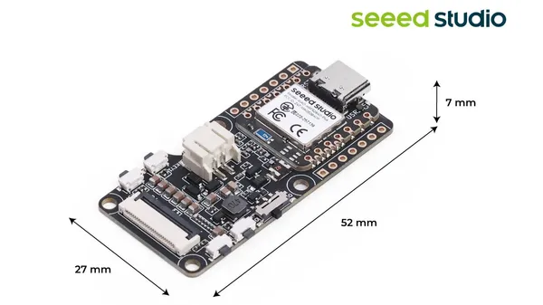

# XIAO ePaper Display Board EN05

**Seeed Studio** · Source collection

Revision: Unverified source identity

Coverage: Source collection; review pending

[Browse all manufacturers](../../../../BROWSE.md) · [Devices & IoT](../../../../DEVICES.md) · [Open in the browser guide](https://valleytech-black-wire-guide.pages.dev/?board=source-board-d745c212b37971519a)

## Datasheets and original documentation

Board datasheet: **not yet recorded**. Visual reference: **available**.

[Manufacturer source (recorded link)](https://wiki.seeedstudio.com/xiao_epaper_display_board_overview/)

- **hardware-guide / kit**: [4.26-inch Mono kit official setup and specifications](https://wiki.seeedstudio.com/opendisplay_426_mono_kit/) · online

 New assembled kit uses the already-cataloged EN05 (Mono) or EN04 (Color) board; add descriptive search alias/resource relationship if desired, without treating the kit as a new PCB or copying duplicate pinout images. Wiki last updated Oct 22 indicates documentation predates marketing announcement.

[Documentation coverage and remaining gaps](../../../../DOCUMENTATION.md)

## Dimensions

**source reference** · Unreviewed source · JPG

[Open original reference](../../../../library/media/7f16193bb2811584e0a17e252e6bbe00769be6e97436a7d513fbfad84750e75b.jpg)

**Credit and rights:** Source rights not yet established. Source/manufacturer: Seeed Studio.

[Source 1](https://files.seeedstudio.com/wiki/Epaper/EN05/3.jpg) · [Source 2](https://wiki.seeedstudio.com/xiao_epaper_display_board_overview/)

Original source index: Dimensions. This file is searchable but has not been promoted to a reviewed physical board pinout.

Image revision: Not identified

SHA-256: `7f16193bb2811584e0a17e252e6bbe00769be6e97436a7d513fbfad84750e75b`

Pin assignments have not been independently electrically verified. Check board revision before wiring.
