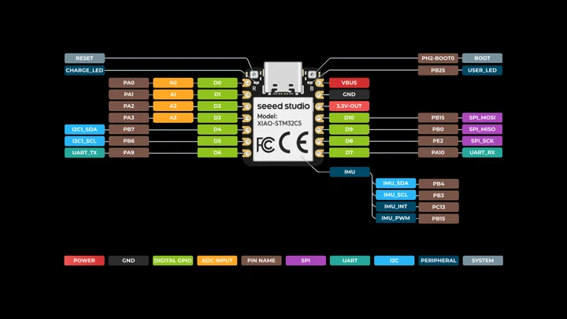
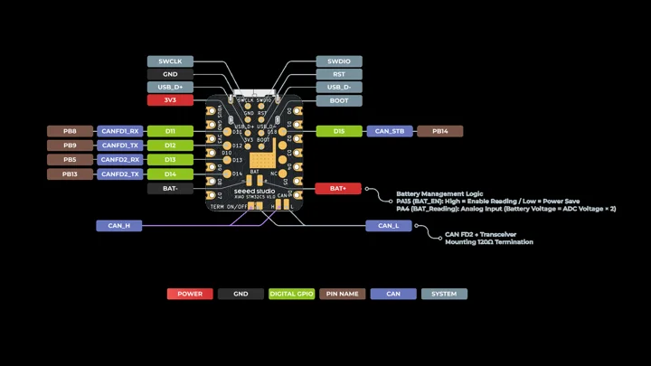
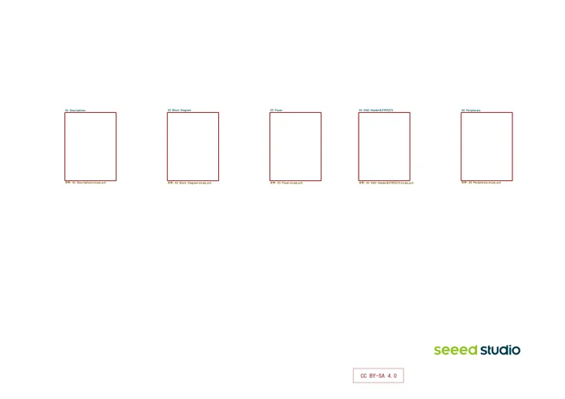

# XIAO STM32C5

**Seeed Studio** · STM32C5A3CG

Revision: Schematic v1.0

Coverage: Manufacturer references collected; complete physical pinout approval pending

[Browse all manufacturers](../../../../BROWSE.md) · [Devices & IoT](../../../../DEVICES.md) · [Open in the browser guide](https://valleytech-black-wire-guide.pages.dev/?board=seeed-studio-xiao-stm32c5)

Architecture: **Arm Cortex-M33**

## Datasheets and original documentation

Board datasheet: **not yet recorded**. Visual reference: **available**.

[Original manufacturer documentation](https://wiki.seeedstudio.com/xiao_stm32c5_getting_started/)

- **hardware-guide / board**: [Manufacturer hardware documentation and specifications](https://wiki.seeedstudio.com/xiao_stm32c5_getting_started/) · online
- **schematic / board**: [XIAO STM32C5 schematic v1.0](https://files.seeedstudio.com/wiki/XIAO_STM32C5/res/Seeed-Studio-XIAO-STM32C5-v1.0.pdf) · [saved document](../../../../library/media/6e32a6515372feb5b5c6e16864d37423c9d938b442907b26ea556fc93f35ce21.pdf)

Separate front and back physical maps. Board schematic v1.0. Match the actual PCB revision; component datasheets do not replace board power limits.

[Documentation coverage and remaining gaps](../../../../DOCUMENTATION.md)

## Specifications and hardware documentation

- [Manufacturer specifications and hardware documentation](https://wiki.seeedstudio.com/xiao_stm32c5_getting_started/)

## XIAO STM32C5 front pinout

**pinout image** · Source identity and visual reference scope reviewed; independent electrical and all-connector completeness review pending · PNG

[Open original reference](../../../../library/media/3479900fb784435e9079cd2da67ff730d85469db672553f7e02885b3f865b82f.png)

**Credit and rights:** Original manufacturer/publisher artwork; redistribution and print rights not established. Attribution does not grant a license or relicense the original.. Source/manufacturer: Seeed Studio.

[Source 1](https://files.seeedstudio.com/wiki/XIAO_STM32C5/img/XIAO STM32C5_Front_1.png) · [Source 2](https://wiki.seeedstudio.com/xiao_stm32c5_getting_started/)

Original source retained unchanged. Scope review does not establish every connector or electrical limit.

Image revision: Match the revision printed in the original source

SHA-256: `3479900fb784435e9079cd2da67ff730d85469db672553f7e02885b3f865b82f`

## XIAO STM32C5 back pinout

**pinout image** · Source identity and visual reference scope reviewed; independent electrical and all-connector completeness review pending · PNG

[Open original reference](../../../../library/media/fa2193b23902500740180821d1ceb4615261e2b2f2dfdcd88b1706cf4ed2a5b9.png)

**Credit and rights:** Original manufacturer/publisher artwork; redistribution and print rights not established. Attribution does not grant a license or relicense the original.. Source/manufacturer: Seeed Studio.

[Source 1](https://files.seeedstudio.com/wiki/XIAO_STM32C5/img/XIAO STM32C5_Back_1.png) · [Source 2](https://wiki.seeedstudio.com/xiao_stm32c5_getting_started/)

Original source retained unchanged. Scope review does not establish every connector or electrical limit.

Image revision: Match the revision printed in the original source

SHA-256: `fa2193b23902500740180821d1ceb4615261e2b2f2dfdcd88b1706cf4ed2a5b9`

## XIAO STM32C5 schematic v1.0

**reference PDF** · Source identity and visual reference scope reviewed; independent electrical and all-connector completeness review pending · PDF

[Open original reference](../../../../library/media/6e32a6515372feb5b5c6e16864d37423c9d938b442907b26ea556fc93f35ce21.pdf)

**Credit and rights:** Original manufacturer/publisher artwork; redistribution and print rights not established. Attribution does not grant a license or relicense the original.. Source/manufacturer: Seeed Studio.

[Source 1](https://files.seeedstudio.com/wiki/XIAO_STM32C5/res/Seeed-Studio-XIAO-STM32C5-v1.0.pdf) · [Source 2](https://wiki.seeedstudio.com/xiao_stm32c5_getting_started/)

Original source retained unchanged. Scope review does not establish every connector or electrical limit.

Image revision: Match the revision printed in the original source

SHA-256: `6e32a6515372feb5b5c6e16864d37423c9d938b442907b26ea556fc93f35ce21`

Pin assignments have not been independently electrically verified. Check board revision before wiring.
