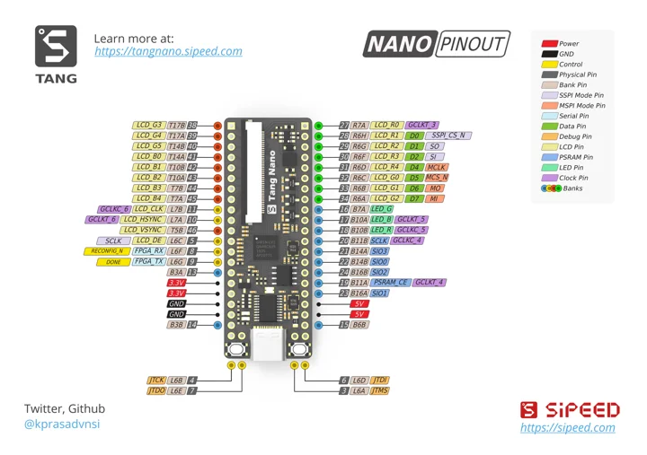
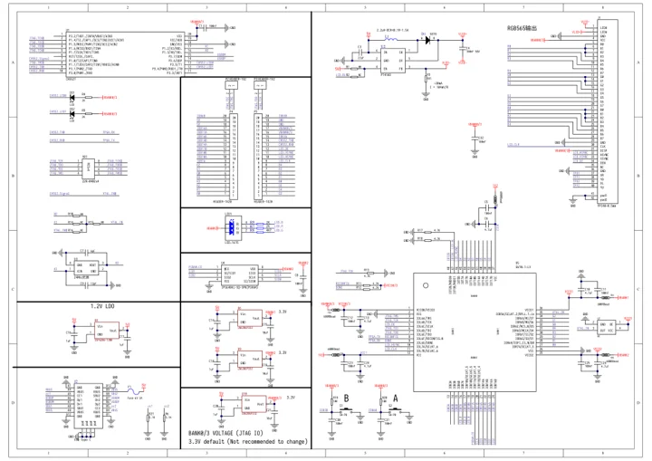

# Tang Nano

**Sipeed** · Gowin GW1N-LV1QN48C6/I5

Revision: Original Tang Nano; pinout artwork v1.0.0

Coverage: Manufacturer references collected; independent complete-pinout approval pending

[Browse all manufacturers](../../../../BROWSE.md) · [Devices & IoT](../../../../DEVICES.md) · [Open in the browser guide](https://valleytech-black-wire-guide.pages.dev/?board=sipeed-tang-nano)

## Datasheets and original documentation

Board datasheet: **not yet recorded**. Visual reference: **available**.

[Original manufacturer model documentation](https://wiki.sipeed.com/hardware/en/tang/Tang-Nano/Nano.html)

- **hardware-guide / board**: [Official Tang Nano hardware guide](https://wiki.sipeed.com/hardware/en/tang/Tang-Nano/Nano.html) · online
- **schematic / board**: [Original Tang Nano schematic](https://raw.githubusercontent.com/sipeed/Tang-Nano-Doc/master/assets/files/Tang-NANO.pdf) · [saved document](../../../../library/media/045c41db04f3024752757cd8c18f99714f040fa8eefee8fcf0faacf9fd2c80dd.pdf)

Older missing-board gap, not a newly released November 2026 board. Visually inspected manufacturer-hosted 1440x1014 diagram and original 5676x4000 artwork source: actual physical board with both header rows and JTAG pins mapped; preserve creator @kprasadvnsi. Dedicated board datasheet not located; manufacturer hardware guide and full schematic available. Match original GW1N-1 board; do not confuse with Nano 1K.

[Documentation coverage and remaining gaps](../../../../DOCUMENTATION.md)

## Specifications and hardware documentation

- [Manufacturer hardware specifications](https://wiki.sipeed.com/hardware/en/tang/Tang-Nano/Nano.html)

## Tang Nano original physical pinout

**pinout image** · Source identity and visual scope reviewed on 2026-11-03; independent electrical and all-connector review pending · PNG

[Open original reference](../../../../library/media/6d190161019ecd526daeadac09500a8311ace321e8e164fd4643bc00456a81a0.png)

**Credit and rights:** Original artwork credits @kprasadvnsi and Sipeed. Same diagram is in manufacturer sipeed/Tang-Nano-Doc repository under Apache-2.0; preserve original credits and LICENSE https://github.com/sipeed/Tang-Nano-Doc/blob/master/LICENSE. Asset-specific license scope should be checked during publication.. Source/manufacturer: Sipeed.

[Source 1](https://raw.githubusercontent.com/sipeed/Tang-Nano-Doc/master/assets/tang_nano_pinout_v1.0.0_w5676_h4000_large.png) · [Source 2](https://wiki.sipeed.com/hardware/en/tang/Tang-Nano/Nano.html)

Source retained unchanged. Match the hardware revision and connector orientation; independent electrical review pending.

Image revision: Artwork v1.0.0

SHA-256: `6d190161019ecd526daeadac09500a8311ace321e8e164fd4643bc00456a81a0`

## Tang Nano board schematic

**reference PDF** · Source identity and visual scope reviewed on 2026-11-03; independent electrical and all-connector review pending · PDF

[Open original reference](../../../../library/media/045c41db04f3024752757cd8c18f99714f040fa8eefee8fcf0faacf9fd2c80dd.pdf)

**Credit and rights:** Sipeed Tang-Nano-Doc hardware documentation repository under Apache-2.0; original LICENSE retained in library/licenses/sipeed-tang-nano. Source schematic unchanged; viewing thumbnail derived from original.. Source/manufacturer: Sipeed.

[Source 1](https://raw.githubusercontent.com/sipeed/Tang-Nano-Doc/master/assets/files/Tang-NANO.pdf) · [Source 2](https://wiki.sipeed.com/hardware/en/tang/Tang-Nano/Nano.html)

Source retained unchanged. Match the hardware revision and connector orientation; independent electrical review pending.

Image revision: Original Tang Nano

SHA-256: `045c41db04f3024752757cd8c18f99714f040fa8eefee8fcf0faacf9fd2c80dd`

Pin assignments have not been independently electrically verified. Check board revision before wiring.
