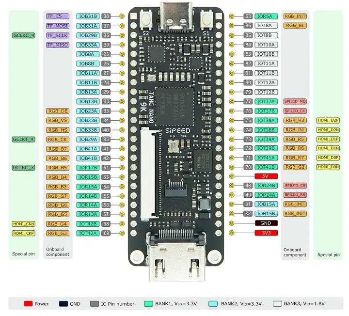
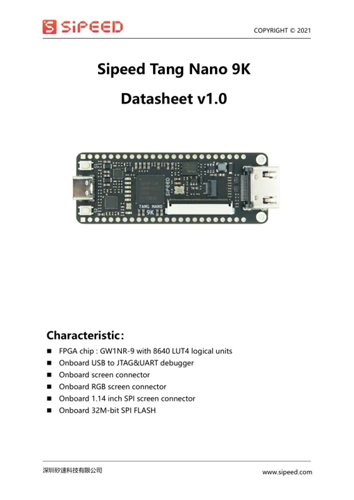
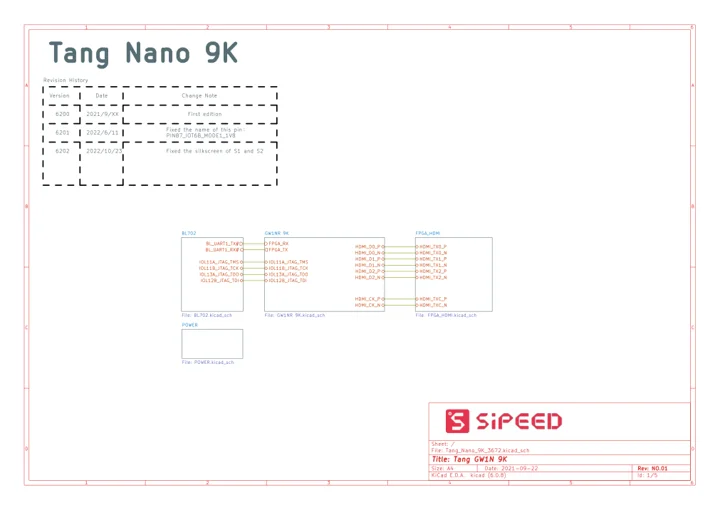

# Tang Nano 9K

**Sipeed** · Gowin GW1NR-LV9QN88PC6/I5

Revision: V1.0 shown on pinout; datasheet v1.0

Coverage: Manufacturer references collected; independent complete-pinout approval pending

[Browse all manufacturers](../../../../BROWSE.md) · [Devices & IoT](../../../../DEVICES.md) · [Open in the browser guide](https://valleytech-black-wire-guide.pages.dev/?board=sipeed-tang-nano-9k)

## Datasheets and original documentation

Board datasheet: **recorded**. Visual reference: **available**.

[Original manufacturer model documentation](https://wiki.sipeed.com/hardware/en/tang/Tang-Nano-9K/Nano-9K.html)

- **hardware-guide / board**: [Official Tang Nano 9K guide](https://wiki.sipeed.com/hardware/en/tang/Tang-Nano-9K/Nano-9K.html) · online
- **datasheet / board**: [Tang Nano 9K datasheet v1.0](https://dl.sipeed.com/fileList/TANG/Nano%209K/1_Specification/Sipeed_Tang_nano_9K_Datasheet_ENV1.0.pdf) · [saved document](../../../../library/media/c7e312507564cba21a47bc0937d2a8a58107f733e004d54db135588ea759c038.pdf)
- **schematic / board**: [Tang Nano 9K schematic](https://dl.sipeed.com/fileList/TANG/Nano%209K/2_Schematic/Tang_Nano_9k_3672_Schematic.pdf) · [saved document](../../../../library/media/71ccf1b7731589c8bc5b4c1dcf0c8906f52831785c703732d43a70f01ec574ec.pdf)

Older missing-board gap, not a new release. Physical board image visually verified: both 24-pin headers with FPGA I/O names, power, signal aliases and I/O-bank voltages; board silkscreen V1.0. Datasheet is a board datasheet, not chip-only. Schematic PDF has title Rev NO.01 and revision-history entries through 6202 / 2022-10-23; retain revision cautions rather than imply every production variant verified. Independent electrical review pending.

[Documentation coverage and remaining gaps](../../../../DOCUMENTATION.md)

## Specifications and hardware documentation

- [Manufacturer hardware specifications](https://wiki.sipeed.com/hardware/en/tang/Tang-Nano-9K/Nano-9K.html)

## Tang Nano 9K physical header pinout

**pinout image** · Source identity and visual scope reviewed on 2026-11-03; independent electrical and all-connector review pending · WEBP

[Open original reference](../../../../library/media/ab6fb8ea1f4e7a2a99c20553200d8ffc00cd36389438ec243a104b7474f24f08.webp)

**Credit and rights:** Original manufacturer artwork; redistribution and print rights not established. Preserve attribution; public availability is not a license.. Source/manufacturer: Sipeed.

[Source 1](https://wiki.sipeed.com/hardware/zh/tang/Tang-Nano-9K/assets/clip_image010.webp) · [Source 2](https://wiki.sipeed.com/hardware/en/tang/Tang-Nano-9K/Nano-9K.html)

Source retained unchanged. Match the hardware revision and connector orientation; independent electrical review pending.

Image revision: V1.0 board shown

SHA-256: `ab6fb8ea1f4e7a2a99c20553200d8ffc00cd36389438ec243a104b7474f24f08`

## Tang Nano 9K board datasheet

**reference PDF** · Source identity and visual scope reviewed on 2026-11-03; independent electrical and all-connector review pending · PDF

[Open original reference](../../../../library/media/c7e312507564cba21a47bc0937d2a8a58107f733e004d54db135588ea759c038.pdf)

**Credit and rights:** Original manufacturer artwork; redistribution and print rights not established. Preserve attribution; public availability is not a license. PDF explicitly copyright 2021 Sipeed, all rights reserved.. Source/manufacturer: Sipeed.

[Source 1](https://dl.sipeed.com/fileList/TANG/Nano%209K/1_Specification/Sipeed_Tang_nano_9K_Datasheet_ENV1.0.pdf) · [Source 2](https://wiki.sipeed.com/hardware/en/tang/Tang-Nano-9K/Nano-9K.html)

Source retained unchanged. Match the hardware revision and connector orientation; independent electrical review pending.

Image revision: v1.0

SHA-256: `c7e312507564cba21a47bc0937d2a8a58107f733e004d54db135588ea759c038`

## Tang Nano 9K board schematic

**reference PDF** · Source identity and visual scope reviewed on 2026-11-03; independent electrical and all-connector review pending · PDF

[Open original reference](../../../../library/media/71ccf1b7731589c8bc5b4c1dcf0c8906f52831785c703732d43a70f01ec574ec.pdf)

**Credit and rights:** Original manufacturer artwork; redistribution and print rights not established. Preserve attribution; public availability is not a license.. Source/manufacturer: Sipeed.

[Source 1](https://dl.sipeed.com/fileList/TANG/Nano%209K/2_Schematic/Tang_Nano_9k_3672_Schematic.pdf) · [Source 2](https://wiki.sipeed.com/hardware/en/tang/Tang-Nano-9K/Nano-9K.html)

Source retained unchanged. Match the hardware revision and connector orientation; independent electrical review pending.

Image revision: Rev NO.01; history through 6202 / 2022-10-23

SHA-256: `71ccf1b7731589c8bc5b4c1dcf0c8906f52831785c703732d43a70f01ec574ec`

Pin assignments have not been independently electrically verified. Check board revision before wiring.
