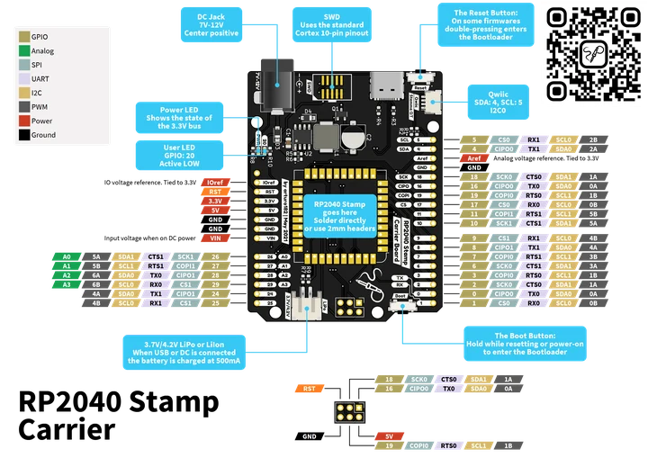

# RP2040 Stamp Carrier

**Solder Party** · RP2040 Stamp host module

Revision: Manufacturer links rev1 carrier hardware. Leaflet shows RP2040 Stamp configuration. Vendor separately documents fit with RP2350 Stamp. Use the original configuration for pin-function claims.

Coverage: Original physical pinout available offline.

[Browse all manufacturers](../../../../BROWSE.md) · [Devices & IoT](../../../../DEVICES.md) · [Open in the browser guide](https://valleytech-black-wire-guide.pages.dev/?board=solder-party-rp2040-stamp-carrier)

## Datasheets and original documentation

Board datasheet: **not yet recorded**. Visual reference: **available**.

[Maker documentation](https://www.solder.party/docs/rp2040-stamp/carrier/)

- **source / board**: [Tindie seller listing](https://www.tindie.com/products/arturo182/rp2040-stamp-carrier/) · online

Top view of rectangular carrier with empty Stamp footprint. Arduino-style headers, analog block, SPI header inset, power, reset, SWD connector location, Qwiic pins, battery and user LED. RP2040 functions are color-coded against actual header positions.

[Documentation coverage and remaining gaps](../../../../DOCUMENTATION.md)

## RP2040 Stamp rectangular carrier pinout leaflet

**pinout image** · Seller or manufacturer artwork and physical connector positions reviewed November 26, 2026. Independent electrical verification pending. · PNG

[Open original reference](../../../../library/media/228cf558e1eea0ab7cd9c4d293633a218f9fbbeb902502ea2f4c619836fd10ab.png)

**Credit and rights:** Solder Party. Creative Commons Attribution-ShareAlike 4.0 International. Original carrier leaflet unchanged. https://creativecommons.org/licenses/by-sa/4.0/ https://www.solder.party/docs/rp2040-stamp/licenses/. Source/manufacturer: Solder Party.

[Source 1](https://www.solder.party/docs/rp2040-stamp/carrier/rp2040_stamp_carrier_leaflet.png) · [Source 2](https://www.tindie.com/products/arturo182/rp2040-stamp-carrier/) · [Source 3](https://www.solder.party/docs/rp2040-stamp/licenses/)

Top view of rectangular carrier with empty Stamp footprint. Arduino-style headers, analog block, SPI header inset, power, reset, SWD connector location, Qwiic pins, battery and user LED. RP2040 functions are color-coded against actual header positions.

Image revision: Manufacturer links rev1 carrier hardware. Leaflet shows RP2040 Stamp configuration. Vendor separately documents fit with RP2350 Stamp. Use the original configuration for pin-function claims.

SHA-256: `228cf558e1eea0ab7cd9c4d293633a218f9fbbeb902502ea2f4c619836fd10ab`

Pin assignments have not been independently electrically verified. Check board revision before wiring.
