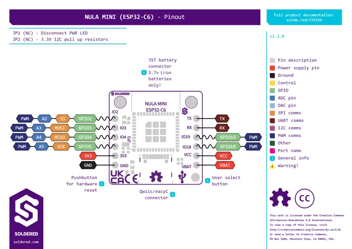

# NULA Mini ESP32-C6

**Soldered** · ESP32-C6

Revision: Pinout sheet v1.2.0; hardware revision not independently identified.

Coverage: Manufacturer source files collected. Header GPIO and alternate functions, power and battery connector.

[Browse all manufacturers](../../../../BROWSE.md) · [Devices & IoT](../../../../DEVICES.md) · [Open in the browser guide](https://valleytech-black-wire-guide.pages.dev/?board=soldered-nula-mini-esp32-c6)

## Datasheets and original documentation

Board datasheet: **not yet recorded**. Visual reference: **available**.

[Manufacturer model documentation](https://docs.soldered.com/nula-mini-esp32-c6/hardware/)

- **source / board**: [Manufacturer background and documentation](https://soldered.com/pages/about) · online

Header GPIO and alternate functions, power and battery connector. Manufacturer dates the Mini, Max and DeepSleep family introduction to 2025. Exact model release date unknown.

[Documentation coverage and remaining gaps](../../../../DOCUMENTATION.md)

## Specifications and hardware documentation

- [Manufacturer documentation](https://docs.soldered.com/nula-mini-esp32-c6/hardware/)

## NULA Mini ESP32-C6 physical GPIO pinout

**pinout image** · Manufacturer artwork and model identity reviewed November 25, 2026. Independent electrical verification pending. · WEBP

[Open original reference](../../../../library/media/f7fa7cf72c7350b6394c539ae0b7728ef0834855b48a2113a42660b97ae2ab5a.webp)

**Credit and rights:** Soldered Electronics, CC BY-SA 4.0, as printed on the original artwork. Original unchanged. https://creativecommons.org/licenses/by-sa/4.0/. Source/manufacturer: Soldered.

[Source 1](https://docs.soldered.com/img/nula-mini-esp32-c6/NULA-MINI-ESP32-C6-Pinout.webp) · [Source 2](https://docs.soldered.com/nula-mini-esp32-c6/hardware/)

Header GPIO and alternate functions, power and battery connector.

Image revision: Pinout sheet v1.2.0; hardware revision not independently identified.

SHA-256: `f7fa7cf72c7350b6394c539ae0b7728ef0834855b48a2113a42660b97ae2ab5a`

Pin assignments have not been independently electrically verified. Check board revision before wiring.
