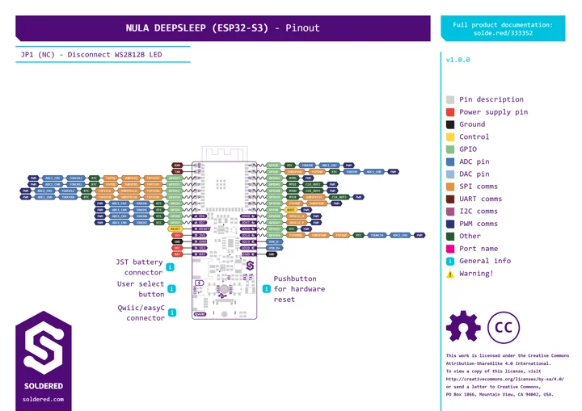

# NULA DeepSleep ESP32-S3

**Soldered** · ESP32-S3

Revision: Pinout sheet v1.0.0; hardware revision not independently identified.

Coverage: Manufacturer source files collected. GPIO lines, communication functions, control pins and power connections.

[Browse all manufacturers](../../../../BROWSE.md) · [Devices & IoT](../../../../DEVICES.md) · [Open in the browser guide](https://valleytech-black-wire-guide.pages.dev/?board=soldered-nula-deepsleep-esp32-s3)

## Datasheets and original documentation

Board datasheet: **not yet recorded**. Visual reference: **available**.

[Manufacturer model documentation](https://docs.soldered.com/nula-deepsleep-esp32-s3/hardware-details/)

- **source / board**: [Manufacturer background and documentation](https://soldered.com/pages/about) · online

GPIO lines, communication functions, control pins and power connections. Manufacturer dates the Mini, Max and DeepSleep family introduction to 2025. Exact model release date unknown.

[Documentation coverage and remaining gaps](../../../../DOCUMENTATION.md)

## Specifications and hardware documentation

- [Manufacturer documentation](https://docs.soldered.com/nula-deepsleep-esp32-s3/hardware-details/)

## NULA DeepSleep ESP32-S3 physical GPIO pinout

**pinout image** · Manufacturer artwork and model identity reviewed November 25, 2026. Independent electrical verification pending. · WEBP

[Open original reference](../../../../library/media/4495a1d825974aac9515d36456eba3735a8e171fbb31a2dc7c8b71a193a04ee6.webp)

**Credit and rights:** Soldered Electronics, CC BY-SA 4.0, as printed on the original artwork. Original unchanged. https://creativecommons.org/licenses/by-sa/4.0/. Source/manufacturer: Soldered.

[Source 1](https://docs.soldered.com/img/nula-deepsleep-esp32-s3/NULA-DEEPSLEEP-ESP32-S3-Pinout.webp) · [Source 2](https://docs.soldered.com/nula-deepsleep-esp32-s3/hardware-details/)

GPIO lines, communication functions, control pins and power connections.

Image revision: Pinout sheet v1.0.0; hardware revision not independently identified.

SHA-256: `4495a1d825974aac9515d36456eba3735a8e171fbb31a2dc7c8b71a193a04ee6`

Pin assignments have not been independently electrically verified. Check board revision before wiring.
