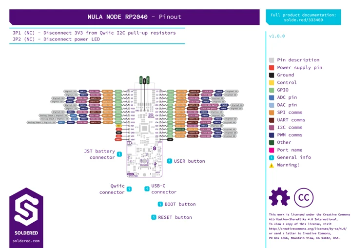

# NULA Node RP2040

**Soldered** · RP2040

Revision: Pinout sheet v1.0.0; hardware revision not independently identified.

Coverage: Manufacturer source files collected. Both 15-pin headers, GPIO alternate functions, SWD and power connections. SKU 333409 has unsoldered headers and SKU 333410 has soldered headers.

[Browse all manufacturers](../../../../BROWSE.md) · [Devices & IoT](../../../../DEVICES.md) · [Open in the browser guide](https://valleytech-black-wire-guide.pages.dev/?board=soldered-nula-node-rp2040)

## Datasheets and original documentation

Board datasheet: **not yet recorded**. Visual reference: **available**.

[Manufacturer model documentation](https://docs2.soldered.com/products/soldered-nula-node-rp2040/hardware)

- **source / board**: [Manufacturer background and documentation](https://soldered.com/products/nula-node) · online

Both 15-pin headers, GPIO alternate functions, SWD and power connections. SKU 333409 has unsoldered headers and SKU 333410 has soldered headers. Manufacturer product listing and pinout available. Store marked coming soon on the review date; shipping and launch date unconfirmed.

[Documentation coverage and remaining gaps](../../../../DOCUMENTATION.md)

## Specifications and hardware documentation

- [Manufacturer documentation](https://docs2.soldered.com/products/soldered-nula-node-rp2040/hardware)

## NULA Node RP2040 physical GPIO pinout

**pinout image** · Manufacturer artwork and model identity reviewed November 25, 2026. Independent electrical verification pending. · PNG

[Open original reference](../../../../library/media/f00a054b8344179b70774128af70e82fc2ead94ab8215e55880d122c75a90d84.png)

**Credit and rights:** Soldered Electronics, CC BY-SA 4.0, as printed on the original artwork. Original unchanged. https://creativecommons.org/licenses/by-sa/4.0/. Source/manufacturer: Soldered.

[Source 1](https://cms.soldered.com/products/333409/media/333409_pinout-png_b47dd6.png) · [Source 2](https://docs2.soldered.com/products/soldered-nula-node-rp2040/hardware)

Both 15-pin headers, GPIO alternate functions, SWD and power connections. SKU 333409 has unsoldered headers and SKU 333410 has soldered headers.

Image revision: Pinout sheet v1.0.0; hardware revision not independently identified.

SHA-256: `f00a054b8344179b70774128af70e82fc2ead94ab8215e55880d122c75a90d84`

Pin assignments have not been independently electrically verified. Check board revision before wiring.
