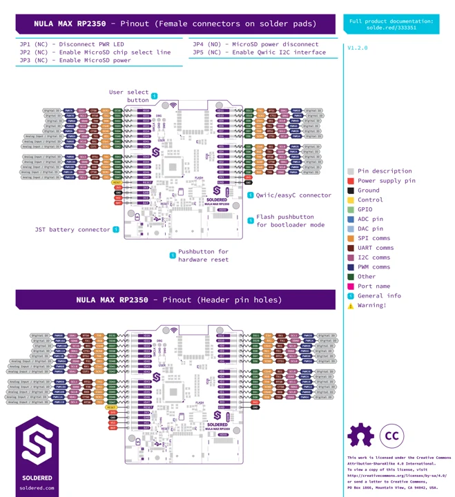

# NULA Max RP2350

**Soldered** · RP2350B

Revision: Pinout sheet v1.2.0; hardware revision not independently identified.

Coverage: Manufacturer source files collected. Separate diagrams for female connectors on solder pads and header pin holes.

[Browse all manufacturers](../../../../BROWSE.md) · [Devices & IoT](../../../../DEVICES.md) · [Open in the browser guide](https://valleytech-black-wire-guide.pages.dev/?board=soldered-nula-max-rp2350)

## Datasheets and original documentation

Board datasheet: **not yet recorded**. Visual reference: **available**.

[Manufacturer model documentation](https://docs.soldered.com/nula-max-rp2350/hardware/)

- **source / board**: [Manufacturer background and documentation](https://soldered.com/pages/about) · online

Separate diagrams for female connectors on solder pads and header pin holes. Manufacturer dates the Mini, Max and DeepSleep family introduction to 2025. Exact model release date unknown.

[Documentation coverage and remaining gaps](../../../../DOCUMENTATION.md)

## Specifications and hardware documentation

- [Manufacturer documentation](https://docs.soldered.com/nula-max-rp2350/hardware/)

## NULA Max RP2350 physical GPIO pinout

**pinout image** · Manufacturer artwork and model identity reviewed November 25, 2026. Independent electrical verification pending. · PNG

[Open original reference](../../../../library/media/ed857d8eb41f2594a872510f3b9b5912cea476e0d0032a54be4cce61f3d32ec7.png)

**Credit and rights:** Soldered Electronics, CC BY-SA 4.0, as printed on the original artwork. Original unchanged. https://creativecommons.org/licenses/by-sa/4.0/. Source/manufacturer: Soldered.

[Source 1](https://docs.soldered.com/img/nula-max-rp2350/nula_max_rp2350_pinout.png) · [Source 2](https://docs.soldered.com/nula-max-rp2350/hardware/)

Separate diagrams for female connectors on solder pads and header pin holes.

Image revision: Pinout sheet v1.2.0; hardware revision not independently identified.

SHA-256: `ed857d8eb41f2594a872510f3b9b5912cea476e0d0032a54be4cce61f3d32ec7`

Pin assignments have not been independently electrically verified. Check board revision before wiring.
