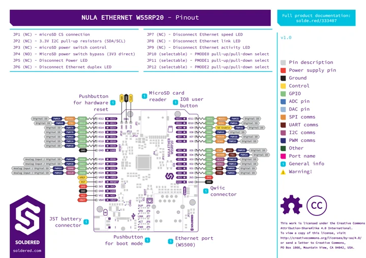

# NULA Ethernet W55RP20

**Soldered** · WIZnet W55RP20 (RP2040 and W5500)

Revision: Pinout sheet v1.0; hardware revision not independently identified.

Coverage: Manufacturer source files collected. Physical header locations, I2C, SPI, UART, PWM, ADC, power pins and jumpers.

[Browse all manufacturers](../../../../BROWSE.md) · [Devices & IoT](../../../../DEVICES.md) · [Open in the browser guide](https://valleytech-black-wire-guide.pages.dev/?board=soldered-nula-ethernet-w55rp20)

## Datasheets and original documentation

Board datasheet: **not yet recorded**. Visual reference: **available**.

[Manufacturer model documentation](https://docs.soldered.com/nula_w55rp20/hardware/)

- **source / board**: [Manufacturer background and documentation](https://soldered.com/collections/new-arrivals-staro/products/soldered-nula-ethernet-w55rp20) · online

Physical header locations, I2C, SPI, UART, PWM, ADC, power pins and jumpers. Listed in manufacturer new arrivals. Exact launch date unknown.

[Documentation coverage and remaining gaps](../../../../DOCUMENTATION.md)

## Specifications and hardware documentation

- [Manufacturer documentation](https://docs.soldered.com/nula_w55rp20/hardware/)

## NULA Ethernet W55RP20 physical GPIO pinout

**pinout image** · Manufacturer artwork and model identity reviewed November 25, 2026. Independent electrical verification pending. · PNG

[Open original reference](../../../../library/media/a1a882d395a1c78165c485b95a9712c4b54142b1a23240c1a10f8110626f1f5d.png)

**Credit and rights:** Soldered Electronics, CC BY-SA 4.0, as printed on the original artwork. Original unchanged. https://creativecommons.org/licenses/by-sa/4.0/. Source/manufacturer: Soldered.

[Source 1](https://docs.soldered.com/img/nula_w55rp20/Pinout.png) · [Source 2](https://docs.soldered.com/nula_w55rp20/hardware/)

Physical header locations, I2C, SPI, UART, PWM, ADC, power pins and jumpers.

Image revision: Pinout sheet v1.0; hardware revision not independently identified.

SHA-256: `a1a882d395a1c78165c485b95a9712c4b54142b1a23240c1a10f8110626f1f5d`

Pin assignments have not been independently electrically verified. Check board revision before wiring.
