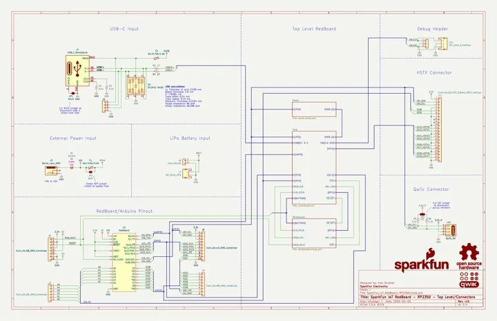

# IoT RedBoard RP2350

**SparkFun** · RP2350

Revision: Not identified

Coverage: Manufacturer references collected; complete physical pinout approval pending

[Browse all manufacturers](../../../../BROWSE.md) · [Devices & IoT](../../../../DEVICES.md) · [Open in the browser guide](https://valleytech-black-wire-guide.pages.dev/?board=sparkfun-iot-redboard-rp2350)

## Datasheets and original documentation

Board datasheet: **not yet recorded**. Visual reference: **available**.

[Original manufacturer documentation](https://docs.sparkfun.com/SparkFun_IoT_RedBoard-RP2350/)

- **hardware-guide / board**: [Manufacturer hardware documentation and specifications](https://docs.sparkfun.com/SparkFun_IoT_RedBoard-RP2350/) · online
- **schematic / board**: [IoT RedBoard RP2350 schematic](https://raw.githubusercontent.com/sparkfun/SparkFun_IoT_RedBoard-RP2350/46926c417395f6b195cc8077b2b0012884b60475/docs/assets/board_files/SparkFun_IoT_RedBoard-RP2350.pdf) · [saved document](../../../../library/media/6026adf49cab56f38c03189591777accc9ab8804d6ffa49eacf811064aac5014.pdf)

Manufacturer board schematic and specifications recorded. A physical pinout diagram has not yet been verified; supporting documentation must not be mistaken for a complete connector map.

[Documentation coverage and remaining gaps](../../../../DOCUMENTATION.md)

## Specifications and hardware documentation

- [Manufacturer specifications and hardware documentation](https://docs.sparkfun.com/SparkFun_IoT_RedBoard-RP2350/)

## IoT RedBoard RP2350 schematic

**reference PDF** · Source identity and visual reference scope reviewed; independent electrical and all-connector completeness review pending · PDF

[Open original reference](../../../../library/media/6026adf49cab56f38c03189591777accc9ab8804d6ffa49eacf811064aac5014.pdf)

**Credit and rights:** Original manufacturer/publisher artwork; redistribution and print rights not established. Attribution does not grant a license or relicense the original.. Source/manufacturer: SparkFun.

[Source 1](https://raw.githubusercontent.com/sparkfun/SparkFun_IoT_RedBoard-RP2350/46926c417395f6b195cc8077b2b0012884b60475/docs/assets/board_files/SparkFun_IoT_RedBoard-RP2350.pdf) · [Source 2](https://docs.sparkfun.com/SparkFun_IoT_RedBoard-RP2350/)

Original source retained unchanged. Scope review does not establish every connector or electrical limit.

Image revision: Match the revision printed in the original source

SHA-256: `6026adf49cab56f38c03189591777accc9ab8804d6ffa49eacf811064aac5014`

Pin assignments have not been independently electrically verified. Check board revision before wiring.
