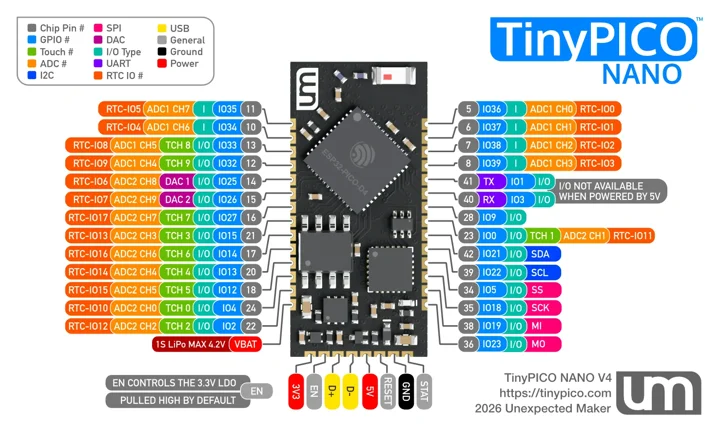

# Unexpected Maker TinyPICO NANO

**Unexpected Maker** · ESP32 original

Revision: Not identified

Coverage: V4-scoped physical pinout added; earlier revisions and independent all-pin approval remain unverified

[Browse all manufacturers](../../../../BROWSE.md) · [Devices & IoT](../../../../DEVICES.md) · [Open in the browser guide](https://valleytech-black-wire-guide.pages.dev/?board=unexpected-maker-esp32-tinypico-nano)

## Datasheets and original documentation

Board datasheet: **not yet recorded**. Visual reference: **available**.

[Original manufacturer model documentation](https://unexpectedmaker.com/dev-boards.php#tinypico-nano)

- **specifications / board**: [Manufacturer module specifications](https://unexpectedmaker.com/dev-boards.php#tinypico-nano) · online
- **specifications / board**: [Manufacturer-operated TinyPICO Nano V4 listing](https://www.lectronz.com/products/tinypico-nano-4) · online

Current manufacturer comparison page explicitly links this V4 pin-reference image and the V4 product. Manufacturer seller states V4 replaces discontinued Ignion antenna with new 3D antenna/RF network and uses 1 mm PCB, previously 0.8 mm. Exact launch date not established. Existing catalog has the Nano family without any visual asset; preserve distinction from earlier revisions.

[Documentation coverage and remaining gaps](../../../../DOCUMENTATION.md)

## Manufacturer TinyPICO Nano V4 physical pad map

**pinout image** · Source identity and visual scope reviewed on 2026-11-03; independent electrical and all-connector review pending · WEBP

[Open original reference](../../../../library/media/14be6d9d4841e26eee57028159a6e0aa1ab6a03bfedf65d528fd66105b255910.webp)

**Credit and rights:** Redistribution rights not established; original manufacturer attribution retained. Software licenses do not establish rights to hardware artwork.. Source/manufacturer: Unexpected Maker.

[Source 1](https://unexpectedmaker.com/images/pinouts/TinyPICO_Nano_V4_pinout.webp) · [Source 2](https://unexpectedmaker.com/dev-boards.php#tinypico-nano)

Source retained unchanged. Match the hardware revision and connector orientation; independent electrical review pending.

Image revision: V4

SHA-256: `14be6d9d4841e26eee57028159a6e0aa1ab6a03bfedf65d528fd66105b255910`

Pin assignments have not been independently electrically verified. Check board revision before wiring.
