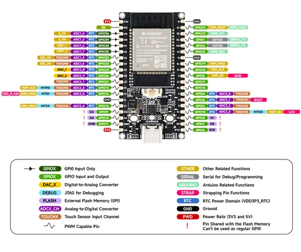
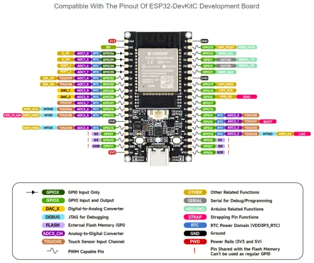
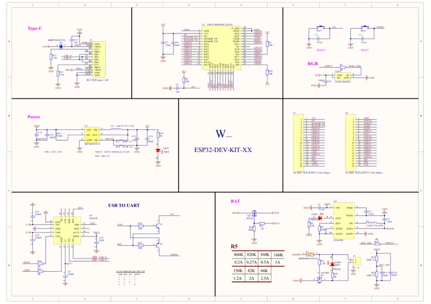

# ESP32-DEV-KIT-XX

**Waveshare** · ESP32 original

Revision: Not identified

Coverage: Pinout image collected

[Browse all manufacturers](../../../../BROWSE.md) · [Devices & IoT](../../../../DEVICES.md) · [Open in the browser guide](https://valleytech-black-wire-guide.pages.dev/?board=waveshare-esp32-esp32-dev-kit-xx)

## Datasheets and original documentation

Board datasheet: **not yet recorded**. Visual reference: **available**.

[Manufacturer source (recorded link)](https://www.waveshare.com/esp32-dev-kit-wroxx.htm)

- **schematic / board**: [ESP32-DEV-KIT-XX Schematic Diagram](https://files.waveshare.com/wiki/ESP32-DEV-KIT-XX/ESP32-DEV-KIT-XX.pdf) · [saved document](../../../../library/media/865e9cf4ddc53b39fa5737631ee949951d4eca1c4d6ac2b169556918380e75cc.pdf)

A chip datasheet, schematic and board datasheet have different scopes. Match the exact hardware revision.

[Documentation coverage and remaining gaps](../../../../DOCUMENTATION.md)

## Pinout

**pinout image** · Reviewed source · JPG

[Open original reference](../../../../library/media/8a005efa7a1a8840e745895622693473e583f9fa06411d87b89e951c357a7a1e.jpg)

**Credit and rights:** Not recorded; retain original attribution. Source/manufacturer: Waveshare.

[Source 1](https://www.waveshare.com/img/devkit/ESP32-DEV-KIT-WROOM-32E-N4/ESP32-DEV-KIT-WROOM-32E-N4-details-9.jpg) · [Source 2](https://www.waveshare.com/esp32-dev-kit-wroxx.htm)

Image revision: Not identified

SHA-256: `8a005efa7a1a8840e745895622693473e583f9fa06411d87b89e951c357a7a1e`

## Pinout

**pinout image** · Reviewed source · WEBP

[Open original reference](../../../../library/media/2e60d52c0aee686f702d099499f5378385bfa6af89cfee28a292761dc66d850d.webp)

**Credit and rights:** Not recorded; retain original attribution. Source/manufacturer: Waveshare.

[Source 1](https://docs.waveshare.com/assets/images/ESP32-DEV-KIT-XX-GPIO-5d311a2d0430fc218ab930a2422849a7.webp) · [Source 2](https://docs.waveshare.com/ESP32-DEV-KIT-XX)

Image revision: Not identified

SHA-256: `2e60d52c0aee686f702d099499f5378385bfa6af89cfee28a292761dc66d850d`

## ESP32-DEV-KIT-XX Schematic Diagram

**reference PDF** · Source identity and visual scope reviewed on 2026-10-30; independent electrical and all-connector review pending · PDF

[Open original reference](../../../../library/media/865e9cf4ddc53b39fa5737631ee949951d4eca1c4d6ac2b169556918380e75cc.pdf)

**Credit and rights:** Original manufacturer artwork; redistribution and print rights not established. Attribution is not a license grant.. Source/manufacturer: Waveshare.

[Source 1](https://files.waveshare.com/wiki/ESP32-DEV-KIT-XX/ESP32-DEV-KIT-XX.pdf) · [Source 2](https://docs.waveshare.com/ESP32-DEV-KIT-XX)

Source retained unchanged. Connector scope and electrical limits require the matching manufacturer documentation.

Image revision: Match the source and PCB revision

SHA-256: `865e9cf4ddc53b39fa5737631ee949951d4eca1c4d6ac2b169556918380e75cc`

Pin assignments have not been independently electrically verified. Check board revision before wiring.
