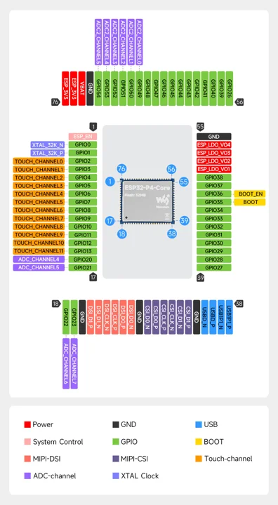
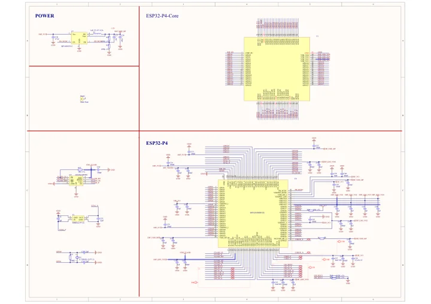

# ESP32-P4-Core

**Waveshare** · ESP32-P4

Revision: Match model and revision in manufacturer references

Coverage: Manufacturer references collected; independent complete-pinout approval pending

[Browse all manufacturers](../../../../BROWSE.md) · [Devices & IoT](../../../../DEVICES.md) · [Open in the browser guide](https://valleytech-black-wire-guide.pages.dev/?board=waveshare-esp32-p4-core)

## Datasheets and original documentation

Board datasheet: **not yet recorded**. Visual reference: **available**.

[Original manufacturer documentation](https://docs.waveshare.com/ESP32-P4-Core)

- **hardware-guide / board**: [Manufacturer specifications and hardware documentation](https://docs.waveshare.com/ESP32-P4-Core) · online
- **schematic / board**: [ESP32-P4-Core Schematic](https://docs.waveshare.com/assets/files/ESP32-P4-Core-Schematic-a722ef3b60d90d46f8fe6ada1aad1cbe.pdf) · [saved document](../../../../library/media/f89010e5c0a0f6df394fcace91743469f3de3bfc6fd46243edecd460ae12748a.pdf)

Original physical module pin map and schematic. This is a castellated circuit-board module, not a chip-package map.

[Documentation coverage and remaining gaps](../../../../DOCUMENTATION.md)

## Specifications and hardware documentation

- [Manufacturer hardware specifications](https://docs.waveshare.com/ESP32-P4-Core)

## ESP32-P4-Core physical pinout

**pinout image** · Source identity and visual scope reviewed on 2026-10-30; independent electrical and all-connector review pending · WEBP

[Open original reference](../../../../library/media/567296e80781621a62660df8511df5dc869a29f33caf5c90330d92913e4f85e5.webp)

**Credit and rights:** Original manufacturer artwork; redistribution and print rights not established. Attribution is not a license grant.. Source/manufacturer: Waveshare.

[Source 1](https://docs.waveshare.com/assets/images/ESP32-P4-Core-Pin-Definition-6b535d7ff2c1aa226fcdcc14c993ae96.webp) · [Source 2](https://docs.waveshare.com/ESP32-P4-Core)

Source retained unchanged. Connector scope and electrical limits require the matching manufacturer documentation.

Image revision: Match the source and PCB revision

SHA-256: `567296e80781621a62660df8511df5dc869a29f33caf5c90330d92913e4f85e5`

## ESP32-P4-Core Schematic

**reference PDF** · Source identity and visual scope reviewed on 2026-10-30; independent electrical and all-connector review pending · PDF

[Open original reference](../../../../library/media/f89010e5c0a0f6df394fcace91743469f3de3bfc6fd46243edecd460ae12748a.pdf)

**Credit and rights:** Original manufacturer artwork; redistribution and print rights not established. Attribution is not a license grant.. Source/manufacturer: Waveshare.

[Source 1](https://docs.waveshare.com/assets/files/ESP32-P4-Core-Schematic-a722ef3b60d90d46f8fe6ada1aad1cbe.pdf) · [Source 2](https://docs.waveshare.com/ESP32-P4-Core)

Source retained unchanged. Connector scope and electrical limits require the matching manufacturer documentation.

Image revision: Match the source and PCB revision

SHA-256: `f89010e5c0a0f6df394fcace91743469f3de3bfc6fd46243edecd460ae12748a`

Pin assignments have not been independently electrically verified. Check board revision before wiring.
