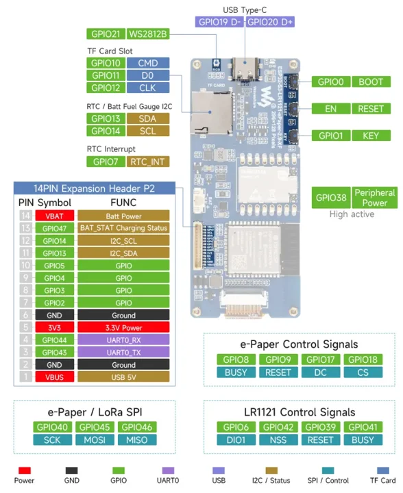
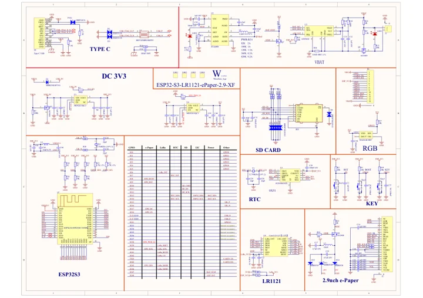

# ESP32-S3-LR1121-ePaper-2.9

**Waveshare** · ESP32-S3

Revision: Match model and revision in manufacturer references

Coverage: Manufacturer references collected; independent complete-pinout approval pending

[Browse all manufacturers](../../../../BROWSE.md) · [Devices & IoT](../../../../DEVICES.md) · [Open in the browser guide](https://valleytech-black-wire-guide.pages.dev/?board=waveshare-esp32-s3-lr1121-epaper-2-9)

## Datasheets and original documentation

Board datasheet: **not yet recorded**. Visual reference: **available**.

[Original manufacturer documentation](https://docs.waveshare.com/ESP32-S3-LR1121-ePaper-2.9)

- **hardware-guide / board**: [Manufacturer specifications and hardware documentation](https://docs.waveshare.com/ESP32-S3-LR1121-ePaper-2.9) · online
- **schematic / board**: [ESP32-S3-LR1121-ePaper-2.9 Schematic](https://raw.githubusercontent.com/waveshareteam/ESP32-S3-LR1121-ePaper-2.9/main/hardware/schematics/ESP32-S3-LR1121-ePaper-2.9-XF-Schematics.pdf) · [saved document](../../../../library/media/b72b0235e1cdfca69938748e05f84bdeaec17a41f571de7017410e99dbf68972.pdf)

Original physical map covers onboard signals and the 14-pin expansion connector. HF/LF RF variants share the source; match antenna band, PCB revision and battery polarity.

[Documentation coverage and remaining gaps](../../../../DOCUMENTATION.md)

## Specifications and hardware documentation

- [Manufacturer hardware specifications](https://docs.waveshare.com/ESP32-S3-LR1121-ePaper-2.9)

## ESP32-S3-LR1121-ePaper-2.9 physical pinout

**pinout image** · Source identity and visual scope reviewed on 2026-10-30; independent electrical and all-connector review pending · WEBP

[Open original reference](../../../../library/media/1857948df6f3d7436135940122927bf02cf7f03a6135070a107ae826d140c171.webp)

**Credit and rights:** Original manufacturer artwork; redistribution and print rights not established. Attribution is not a license grant.. Source/manufacturer: Waveshare.

[Source 1](https://docs.waveshare.com/assets/images/ESP32-S3-LR1121-ePaper-2.9-details-inter-4581501ef89ce0df0920ccb32b6bfa07.webp) · [Source 2](https://docs.waveshare.com/ESP32-S3-LR1121-ePaper-2.9)

Source retained unchanged. Connector scope and electrical limits require the matching manufacturer documentation.

Image revision: Match the source and PCB revision

SHA-256: `1857948df6f3d7436135940122927bf02cf7f03a6135070a107ae826d140c171`

## ESP32-S3-LR1121-ePaper-2.9 Schematic

**reference PDF** · Source identity and visual scope reviewed on 2026-10-30; independent electrical and all-connector review pending · PDF

[Open original reference](../../../../library/media/b72b0235e1cdfca69938748e05f84bdeaec17a41f571de7017410e99dbf68972.pdf)

**Credit and rights:** Original manufacturer artwork; redistribution and print rights not established. Attribution is not a license grant.. Source/manufacturer: Waveshare.

[Source 1](https://raw.githubusercontent.com/waveshareteam/ESP32-S3-LR1121-ePaper-2.9/main/hardware/schematics/ESP32-S3-LR1121-ePaper-2.9-XF-Schematics.pdf) · [Source 2](https://docs.waveshare.com/ESP32-S3-LR1121-ePaper-2.9)

Source retained unchanged. Connector scope and electrical limits require the matching manufacturer documentation.

Image revision: Match the source and PCB revision

SHA-256: `b72b0235e1cdfca69938748e05f84bdeaec17a41f571de7017410e99dbf68972`

Pin assignments have not been independently electrically verified. Check board revision before wiring.
