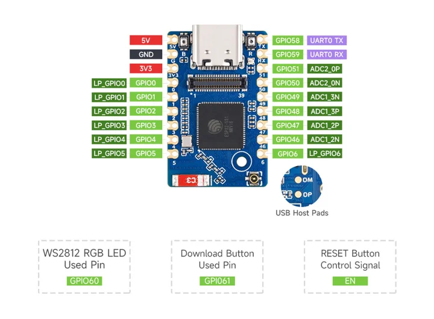
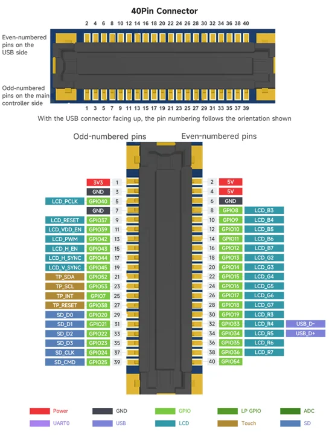

# ESP32-S31-Zero

**Waveshare** · ESP32-S31

Revision: Not identified; N16RX/N32RX memory and -M header options share the product pin map

Coverage: Manufacturer references collected; independent complete-pinout approval pending

[Browse all manufacturers](../../../../BROWSE.md) · [Devices & IoT](../../../../DEVICES.md) · [Open in the browser guide](https://valleytech-black-wire-guide.pages.dev/?board=waveshare-esp32-s31-zero)

## Datasheets and original documentation

Board datasheet: **not yet recorded**. Visual reference: **available**.

[Original manufacturer model documentation](https://www.waveshare.com/product/esp32-s31-zero.htm)

- **product-page / board**: [Waveshare ESP32-S31-Zero manufacturer product and specifications](https://www.waveshare.com/product/esp32-s31-zero.htm) · online

Fresh manufacturer documentation: both supplied pinout assets report HTTP Last-Modified 2026-11-02. This is asset metadata, not a verified launch date. Physical board header map visually inspected on 2026-11-03; separate expansion reference shows exact orientation of the 40-pin board-to-board connector. The product-linked manual https://docs.waveshare.com/ESP32-S31-Zero returned HTTP 404 during review; no exact-board schematic/datasheet available from the fetched page. Do not mark complete documentation or electrically tested. Manufacturer artwork rights are not established.

[Documentation coverage and remaining gaps](../../../../DOCUMENTATION.md)

## Specifications and hardware documentation

- [Manufacturer hardware specifications](https://www.waveshare.com/product/esp32-s31-zero.htm)

## Physical board header pinout and onboard LED/BOOT signals

**pinout image** · Source identity and visual scope reviewed on 2026-11-03; independent electrical and all-connector review pending · JPG

[Open original reference](../../../../library/media/f90c414bda91e32d5e0c1ac391823f735b038b1209eaad6e5a940bc8bf644c8a.jpg)

**Credit and rights:** Not established; manufacturer artwork, source attribution retained. Source/manufacturer: Waveshare.

[Source 1](https://www.waveshare.com/img/devkit/ESP32-S31-Zero-N16R16/ESP32-S31-Zero-N16R16-details-inter-1.jpg) · [Source 2](https://www.waveshare.com/product/esp32-s31-zero.htm)

Source retained unchanged. Match the hardware revision and connector orientation; independent electrical review pending.

Image revision: ESP32-S31-Zero shared product map; board PCB revision unspecified

SHA-256: `f90c414bda91e32d5e0c1ac391823f735b038b1209eaad6e5a940bc8bf644c8a`

## 40-pin board-to-board expansion connector pin assignment and orientation

**connector diagram** · Source identity and visual scope reviewed on 2026-11-03; independent electrical and all-connector review pending · JPG

[Open original reference](../../../../library/media/8d3dd43c8cb8ec9d17b55df22fdf31a6aa43935f2236a45b7620ec102572d0e9.jpg)

**Credit and rights:** Not established; manufacturer artwork, source attribution retained. Source/manufacturer: Waveshare.

[Source 1](https://www.waveshare.com/img/devkit/ESP32-S31-Zero-N16R16/ESP32-S31-Zero-N16R16-details-inter-2.jpg) · [Source 2](https://www.waveshare.com/product/esp32-s31-zero.htm)

Source retained unchanged. Match the hardware revision and connector orientation; independent electrical review pending.

Image revision: ESP32-S31-Zero shared product map; connector reference only

SHA-256: `8d3dd43c8cb8ec9d17b55df22fdf31a6aa43935f2236a45b7620ec102572d0e9`

Pin assignments have not been independently electrically verified. Check board revision before wiring.
