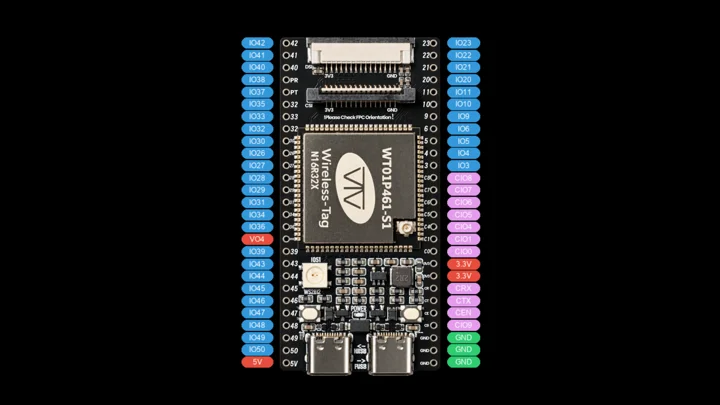
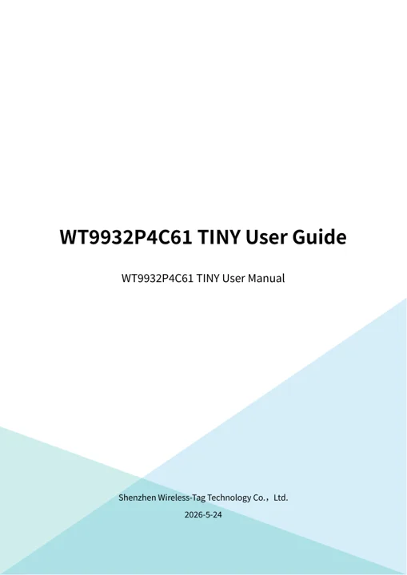
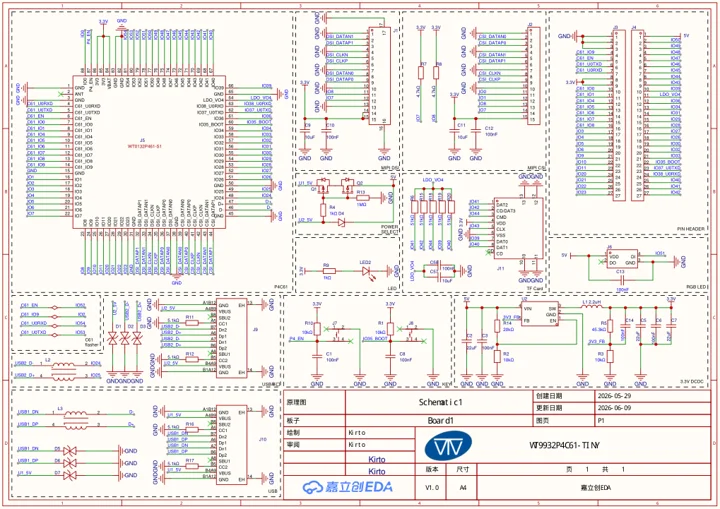

# WT9932P4C61-TINY

**Wireless-Tag** · ESP32-P4 + ESP32-C61

Revision: Pinout V1.1

Coverage: Manufacturer references collected; independent complete-pinout approval pending

[Browse all manufacturers](../../../../BROWSE.md) · [Devices & IoT](../../../../DEVICES.md) · [Open in the browser guide](https://valleytech-black-wire-guide.pages.dev/?board=wireless-tag-wt9932p4c61-tiny)

## Datasheets and original documentation

Board datasheet: **not yet recorded**. Visual reference: **available**.

[Original manufacturer model documentation](https://wiki.wireless-tag.com/docs/en/WT9932P4C61-TINY/board_resources.html)

- **specifications / board**: [Manufacturer model specifications and documentation](https://wiki.wireless-tag.com/docs/en/WT9932P4C61-TINY/board_resources.html) · online
- **hardware-guide / board**: [Manufacturer English user guide V1.0](https://res.8ms.xyz/wiki_assets/WT9932P4C61-TINY/WT9932P4C61-TINY_UserGuide_V1.0.pdf) · [saved document](../../../../library/media/392a731828f7491ce372d65ee8b2c66577aac2a79933584210d257ab7094554d.pdf)
- **schematic / board**: [Manufacturer board schematic V1.0](https://res.8ms.xyz/wiki_assets/WT9932P4C61-TINY/WT9932P4C61-TINY_SCH_V1.0.pdf) · [saved document](../../../../library/media/b5f54b6d58f540e18cc5ebc317139dcd0eecf54503ac3de87ed0d7fddc9aa896.pdf)
- **specifications / board**: [Manufacturer board features](https://wiki.wireless-tag.com/docs/en/WT9932P4C61-TINY/board_features.html) · online
- **datasheet / component**: [ESP32-P4 component datasheet](https://documentation.espressif.com/esp32-p4_datasheet_en.html) · online
- **datasheet / component**: [ESP32-C61 component datasheet](https://documentation.espressif.com/esp32-c61_datasheet_en.html) · online

Official resource-page history was updated 2026-11-02 for open-hardware links. Pinout V1.1 dates to the 2026-09-22 resource revision; this is a missing existing board, not a verified November launch. Original diagram visually identifies physical edge-header positions. FPC connector internals and independent electrical/all-connector completeness are not approved.

[Documentation coverage and remaining gaps](../../../../DOCUMENTATION.md)

## Specifications and hardware documentation

- [Manufacturer hardware specifications](https://wiki.wireless-tag.com/docs/en/WT9932P4C61-TINY/board_resources.html)

## Manufacturer physical edge-header pinout

**pinout image** · Source identity and visual scope reviewed on 2026-11-03; independent electrical and all-connector review pending · PNG

[Open original reference](../../../../library/media/8cdf76edac0cf9ff0bfe90e698cce13f5346f1bd74009ad0310444786f043566.png)

**Credit and rights:** Redistribution rights not established; original manufacturer attribution retained. Software licenses do not establish rights to hardware artwork.. Source/manufacturer: Wireless-Tag.

[Source 1](https://res.8ms.xyz/wiki_assets/WT9932P4C61-TINY/WT9932P4C61-TINY_%E5%BC%95%E8%84%9A%E5%AE%9A%E4%B9%89_V1.1.png) · [Source 2](https://wiki.wireless-tag.com/docs/en/WT9932P4C61-TINY/board_resources.html)

Source retained unchanged. Match the hardware revision and connector orientation; independent electrical review pending.

Image revision: Pinout V1.1

SHA-256: `8cdf76edac0cf9ff0bfe90e698cce13f5346f1bd74009ad0310444786f043566`

## Manufacturer English user guide V1.0

**reference PDF** · Source identity and visual scope reviewed on 2026-11-03; independent electrical and all-connector review pending · PDF

[Open original reference](../../../../library/media/392a731828f7491ce372d65ee8b2c66577aac2a79933584210d257ab7094554d.pdf)

**Credit and rights:** Original manufacturer artwork; redistribution and print rights not established. Attribution is not a license grant.. Source/manufacturer: Wireless-Tag.

[Source 1](https://res.8ms.xyz/wiki_assets/WT9932P4C61-TINY/WT9932P4C61-TINY_UserGuide_V1.0.pdf) · [Source 2](https://wiki.wireless-tag.com/docs/en/WT9932P4C61-TINY/board_resources.html)

Source retained unchanged. Match the hardware revision and connector orientation; independent electrical review pending.

Image revision: Manufacturer English user guide V1.0; use the document title block for PCB revision

SHA-256: `392a731828f7491ce372d65ee8b2c66577aac2a79933584210d257ab7094554d`

## Manufacturer board schematic V1.0

**reference PDF** · Source identity and visual scope reviewed on 2026-11-03; independent electrical and all-connector review pending · PDF

[Open original reference](../../../../library/media/b5f54b6d58f540e18cc5ebc317139dcd0eecf54503ac3de87ed0d7fddc9aa896.pdf)

**Credit and rights:** Original manufacturer artwork; redistribution and print rights not established. Attribution is not a license grant.. Source/manufacturer: Wireless-Tag.

[Source 1](https://res.8ms.xyz/wiki_assets/WT9932P4C61-TINY/WT9932P4C61-TINY_SCH_V1.0.pdf) · [Source 2](https://wiki.wireless-tag.com/docs/en/WT9932P4C61-TINY/board_resources.html)

Source retained unchanged. Match the hardware revision and connector orientation; independent electrical review pending.

Image revision: Manufacturer board schematic V1.0; use the document title block for PCB revision

SHA-256: `b5f54b6d58f540e18cc5ebc317139dcd0eecf54503ac3de87ed0d7fddc9aa896`

Pin assignments have not been independently electrically verified. Check board revision before wiring.
