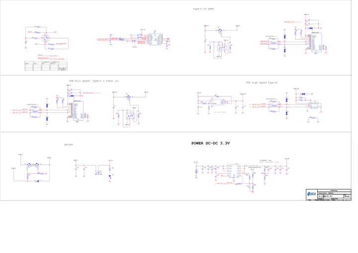
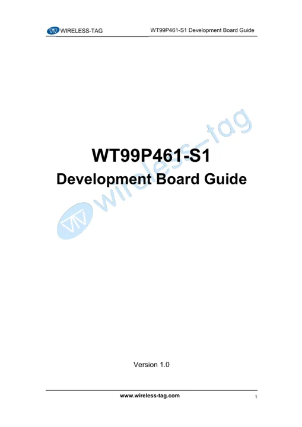

# WT99P461-S1

**Wireless-Tag** · ESP32-P4 / ESP32-C61

Revision: Match model and revision in manufacturer references

Coverage: Manufacturer references collected; independent complete-pinout approval pending

[Browse all manufacturers](../../../../BROWSE.md) · [Devices & IoT](../../../../DEVICES.md) · [Open in the browser guide](https://valleytech-black-wire-guide.pages.dev/?board=wireless-tag-wt99p461-s1)

## Datasheets and original documentation

Board datasheet: **not yet recorded**. Visual reference: **available**.

[Original manufacturer documentation](https://wiki.wireless-tag.com/docs/en/WT99P461-S1/board_resources.html)

- **hardware-guide / board**: [Manufacturer specifications and hardware documentation](https://wiki.wireless-tag.com/docs/en/WT99P461-S1/board_resources.html) · online
- **schematic / board**: [WT99P461-S1 Schematic](https://res.8ms.xyz/wiki_assets/WT99P461-S1/WT99P461-S1-SCH_V1.0.pdf) · [saved document](../../../../library/media/1d90524751e6d91b4c873a2155635dbc9e88cdec7f400fe930b5782610e9758d.pdf)
- **hardware-guide / board**: [WT99P461-S1 User Guide](https://res.8ms.xyz/wiki_assets/WT99P461-S1/WT99P461-S1_UserGuide_v1.0.pdf) · [saved document](../../../../library/media/b79346e9d86f1ec1b2c70a3ebff57034c31303822ba09607dd8882bebcccf2da.pdf)

Manufacturer board manual and schematic saved. These are earlier omissions, not claimed October launches. Separate verified physical pinout image remains missing; some manuals are Chinese-language originals.

[Documentation coverage and remaining gaps](../../../../DOCUMENTATION.md)

## Specifications and hardware documentation

- [Manufacturer hardware specifications](https://wiki.wireless-tag.com/docs/en/WT99P461-S1/board_resources.html)

## WT99P461-S1 Schematic

**reference PDF** · Source identity and visual scope reviewed on 2026-10-30; independent electrical and all-connector review pending · PDF

[Open original reference](../../../../library/media/1d90524751e6d91b4c873a2155635dbc9e88cdec7f400fe930b5782610e9758d.pdf)

**Credit and rights:** Original manufacturer artwork; redistribution and print rights not established. Attribution is not a license grant.. Source/manufacturer: Wireless-Tag.

[Source 1](https://res.8ms.xyz/wiki_assets/WT99P461-S1/WT99P461-S1-SCH_V1.0.pdf) · [Source 2](https://wiki.wireless-tag.com/docs/en/WT99P461-S1/board_resources.html)

Source retained unchanged. Connector scope and electrical limits require the matching manufacturer documentation.

Image revision: Match the source and PCB revision

SHA-256: `1d90524751e6d91b4c873a2155635dbc9e88cdec7f400fe930b5782610e9758d`

## WT99P461-S1 User Guide

**reference PDF** · Source identity and visual scope reviewed on 2026-10-30; independent electrical and all-connector review pending · PDF

[Open original reference](../../../../library/media/b79346e9d86f1ec1b2c70a3ebff57034c31303822ba09607dd8882bebcccf2da.pdf)

**Credit and rights:** Original manufacturer artwork; redistribution and print rights not established. Attribution is not a license grant.. Source/manufacturer: Wireless-Tag.

[Source 1](https://res.8ms.xyz/wiki_assets/WT99P461-S1/WT99P461-S1_UserGuide_v1.0.pdf) · [Source 2](https://wiki.wireless-tag.com/docs/en/WT99P461-S1/board_resources.html)

Source retained unchanged. Connector scope and electrical limits require the matching manufacturer documentation.

Image revision: Match the source and PCB revision

SHA-256: `b79346e9d86f1ec1b2c70a3ebff57034c31303822ba09607dd8882bebcccf2da`

Pin assignments have not been independently electrically verified. Check board revision before wiring.
