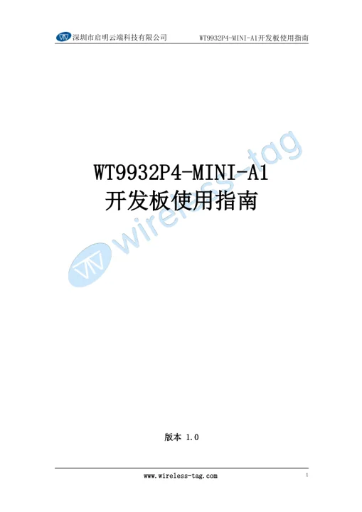
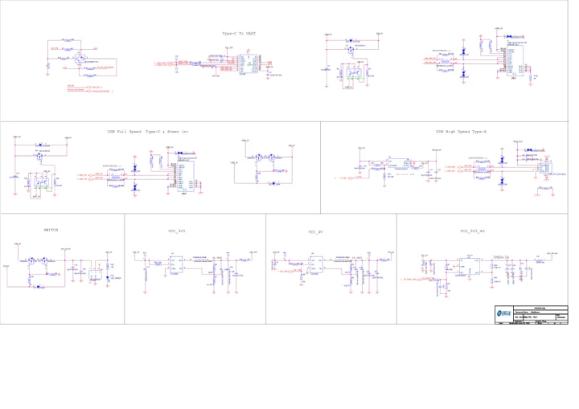

# WT9932P4-MINI-A1

**Wireless-Tag** · ESP32-P4

Revision: Match model and revision in manufacturer references

Coverage: Manufacturer references collected; independent complete-pinout approval pending

[Browse all manufacturers](../../../../BROWSE.md) · [Devices & IoT](../../../../DEVICES.md) · [Open in the browser guide](https://valleytech-black-wire-guide.pages.dev/?board=wireless-tag-wt9932p4-mini-a1)

## Datasheets and original documentation

Board datasheet: **not yet recorded**. Visual reference: **available**.

[Original manufacturer documentation](https://wiki.wireless-tag.com/docs/en/WT9932P4-MINI-A1/board_resources.html)

- **hardware-guide / board**: [Manufacturer specifications and hardware documentation](https://wiki.wireless-tag.com/docs/en/WT9932P4-MINI-A1/board_resources.html) · online
- **hardware-guide / board**: [2. WT9932P4-MINI-A1 User Guide](https://res.8ms.xyz/wiki_assets/WT9932P4-MINI-A1/WT9932P4-MINI-A1%E5%BC%80%E5%8F%91%E6%9D%BF%E4%BD%BF%E7%94%A8%E6%8C%87%E5%8D%97v1.0.pdf) · [saved document](../../../../library/media/c34d6876fb2b6031965b2affee863588d5474fd063fbb9da5b8498fa9f46bb9d.pdf)
- **schematic / board**: [3. WT9932P4-MINI-A1 Schematic Diagram](https://res.8ms.xyz/wiki_assets/WT9932P4-MINI-A1/ESP32-P4-MINI-%E5%8E%9F%E7%90%86%E5%9B%BE.pdf) · [saved document](../../../../library/media/f05ed72fd0ec49cd720a0940627cf6158b968b65dafbfde57cdece6498249c8d.pdf)

Manufacturer board manual and schematic saved. These are earlier omissions, not claimed October launches. Separate verified physical pinout image remains missing; some manuals are Chinese-language originals.

[Documentation coverage and remaining gaps](../../../../DOCUMENTATION.md)

## Specifications and hardware documentation

- [Manufacturer hardware specifications](https://wiki.wireless-tag.com/docs/en/WT9932P4-MINI-A1/board_resources.html)

## 2. WT9932P4-MINI-A1 User Guide

**reference PDF** · Source identity and visual scope reviewed on 2026-10-30; independent electrical and all-connector review pending · PDF

[Open original reference](../../../../library/media/c34d6876fb2b6031965b2affee863588d5474fd063fbb9da5b8498fa9f46bb9d.pdf)

**Credit and rights:** Original manufacturer artwork; redistribution and print rights not established. Attribution is not a license grant.. Source/manufacturer: Wireless-Tag.

[Source 1](https://res.8ms.xyz/wiki_assets/WT9932P4-MINI-A1/WT9932P4-MINI-A1%E5%BC%80%E5%8F%91%E6%9D%BF%E4%BD%BF%E7%94%A8%E6%8C%87%E5%8D%97v1.0.pdf) · [Source 2](https://wiki.wireless-tag.com/docs/en/WT9932P4-MINI-A1/board_resources.html)

Source retained unchanged. Connector scope and electrical limits require the matching manufacturer documentation.

Image revision: Match the source and PCB revision

SHA-256: `c34d6876fb2b6031965b2affee863588d5474fd063fbb9da5b8498fa9f46bb9d`

## 3. WT9932P4-MINI-A1 Schematic Diagram

**reference PDF** · Source identity and visual scope reviewed on 2026-10-30; independent electrical and all-connector review pending · PDF

[Open original reference](../../../../library/media/f05ed72fd0ec49cd720a0940627cf6158b968b65dafbfde57cdece6498249c8d.pdf)

**Credit and rights:** Original manufacturer artwork; redistribution and print rights not established. Attribution is not a license grant.. Source/manufacturer: Wireless-Tag.

[Source 1](https://res.8ms.xyz/wiki_assets/WT9932P4-MINI-A1/ESP32-P4-MINI-%E5%8E%9F%E7%90%86%E5%9B%BE.pdf) · [Source 2](https://wiki.wireless-tag.com/docs/en/WT9932P4-MINI-A1/board_resources.html)

Source retained unchanged. Connector scope and electrical limits require the matching manufacturer documentation.

Image revision: Match the source and PCB revision

SHA-256: `f05ed72fd0ec49cd720a0940627cf6158b968b65dafbfde57cdece6498249c8d`

Pin assignments have not been independently electrically verified. Check board revision before wiring.
