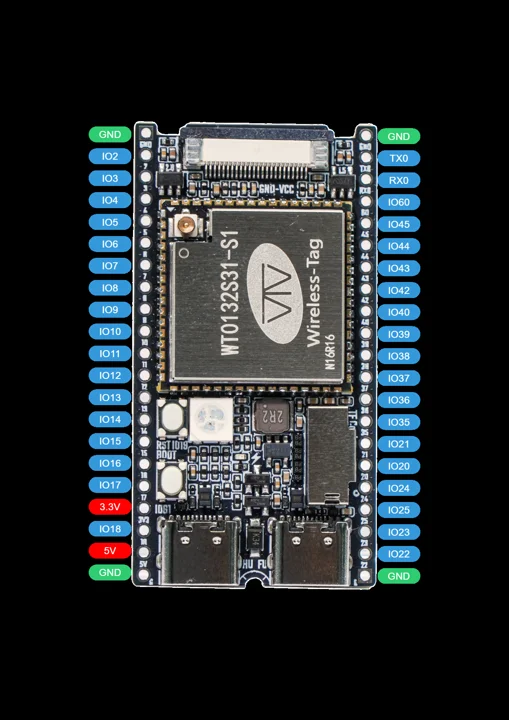
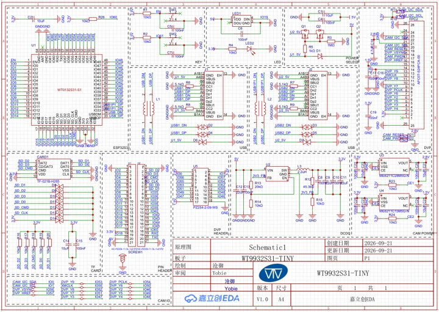
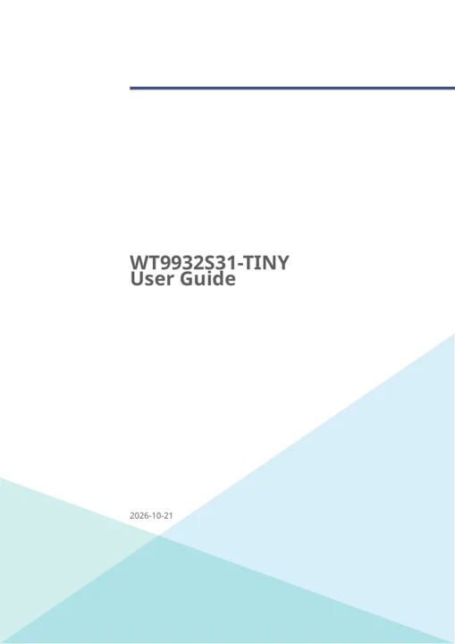

# WT9932S31-TINY

**Wireless-Tag** · ESP32-S31

Revision: Match model and revision in manufacturer references

Coverage: Manufacturer references collected; independent complete-pinout approval pending

[Browse all manufacturers](../../../../BROWSE.md) · [Devices & IoT](../../../../DEVICES.md) · [Open in the browser guide](https://valleytech-black-wire-guide.pages.dev/?board=wireless-tag-wt9932s31-tiny)

## Datasheets and original documentation

Board datasheet: **not yet recorded**. Visual reference: **available**.

[Original manufacturer documentation](https://wiki.wireless-tag.com/docs/en/WT9932S31-TINY/board_features.html)

- **hardware-guide / board**: [Manufacturer specifications and hardware documentation](https://wiki.wireless-tag.com/docs/en/WT9932S31-TINY/board_features.html) · online
- **schematic / board**: [WT9932S31-TINY_SCH_V1.0.pdf](https://res.8ms.xyz/wiki_assets/WT9932S31-TINY/WT9932S31-TINY_SCH_V1.0.pdf) · [saved document](../../../../library/media/0abf72fa7750462ca6d9ea746cc192c0e763cdf80f78144fe7da1de06efbc1bc.pdf)
- **hardware-guide / board**: [WT9932S31-TINY_UserGuide_V1.1.pdf](https://res.8ms.xyz/wiki_assets/WT9932S31-TINY/WT9932S31-TINY_UserGuide_V1.1.pdf) · [saved document](../../../../library/media/7e42de827c6f842a902654efe07b5edbfabd11b0e1bc01fd506efbe4352c6561.pdf)
- **datasheet / component**: [ESP32-S31 component datasheet](https://documentation.espressif.com/esp32-s31_datasheet_en.pdf) · online

Manufacturer pinout v1.0, schematic v1.0 and English user guide v1.1. Source documentation first added 2026-10-23; release availability not independently verified. H1/H2 map positions are not schematic pad numbers. GPIO36/37/60/61 are boot straps; DVP FPC orientation and supply rails require the manual.

[Documentation coverage and remaining gaps](../../../../DOCUMENTATION.md)

## Specifications and hardware documentation

- [Manufacturer hardware specifications](https://wiki.wireless-tag.com/docs/en/WT9932S31-TINY/board_features.html)

## WT9932S31-TINY_Pinout_V1.0.png

**pinout image** · Source identity and visual scope reviewed on 2026-10-30; independent electrical and all-connector review pending · PNG

[Open original reference](../../../../library/media/92b304cabd512109e081936003993039cdd7b26699f1ede17c6d90bc218ff81f.png)

**Credit and rights:** Original manufacturer artwork; redistribution and print rights not established. Attribution is not a license grant.. Source/manufacturer: Wireless-Tag.

[Source 1](https://res.8ms.xyz/wiki_assets/WT9932S31-TINY/WT9932S31-TINY_Pinout_V1.0.png) · [Source 2](https://wiki.wireless-tag.com/docs/en/WT9932S31-TINY/board_resources.html)

Source retained unchanged. Connector scope and electrical limits require the matching manufacturer documentation.

Image revision: Match the source and PCB revision

SHA-256: `92b304cabd512109e081936003993039cdd7b26699f1ede17c6d90bc218ff81f`

## WT9932S31-TINY_SCH_V1.0.pdf

**reference PDF** · Source identity and visual scope reviewed on 2026-10-30; independent electrical and all-connector review pending · PDF

[Open original reference](../../../../library/media/0abf72fa7750462ca6d9ea746cc192c0e763cdf80f78144fe7da1de06efbc1bc.pdf)

**Credit and rights:** Original manufacturer artwork; redistribution and print rights not established. Attribution is not a license grant.. Source/manufacturer: Wireless-Tag.

[Source 1](https://res.8ms.xyz/wiki_assets/WT9932S31-TINY/WT9932S31-TINY_SCH_V1.0.pdf) · [Source 2](https://wiki.wireless-tag.com/docs/en/WT9932S31-TINY/board_resources.html)

Source retained unchanged. Connector scope and electrical limits require the matching manufacturer documentation.

Image revision: Match the source and PCB revision

SHA-256: `0abf72fa7750462ca6d9ea746cc192c0e763cdf80f78144fe7da1de06efbc1bc`

## WT9932S31-TINY_UserGuide_V1.1.pdf

**reference PDF** · Source identity and visual scope reviewed on 2026-10-30; independent electrical and all-connector review pending · PDF

[Open original reference](../../../../library/media/7e42de827c6f842a902654efe07b5edbfabd11b0e1bc01fd506efbe4352c6561.pdf)

**Credit and rights:** Original manufacturer artwork; redistribution and print rights not established. Attribution is not a license grant.. Source/manufacturer: Wireless-Tag.

[Source 1](https://res.8ms.xyz/wiki_assets/WT9932S31-TINY/WT9932S31-TINY_UserGuide_V1.1.pdf) · [Source 2](https://wiki.wireless-tag.com/docs/en/WT9932S31-TINY/board_resources.html)

Source retained unchanged. Connector scope and electrical limits require the matching manufacturer documentation.

Image revision: Match the source and PCB revision

SHA-256: `7e42de827c6f842a902654efe07b5edbfabd11b0e1bc01fd506efbe4352c6561`

Pin assignments have not been independently electrically verified. Check board revision before wiring.
