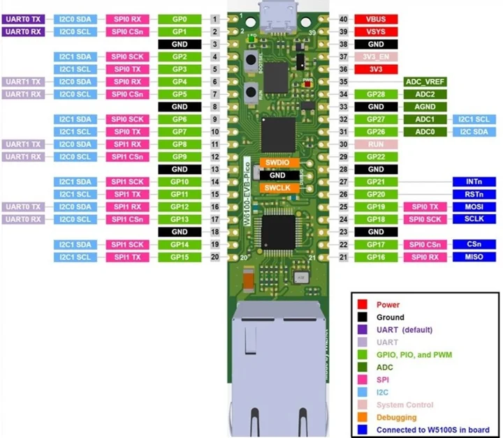
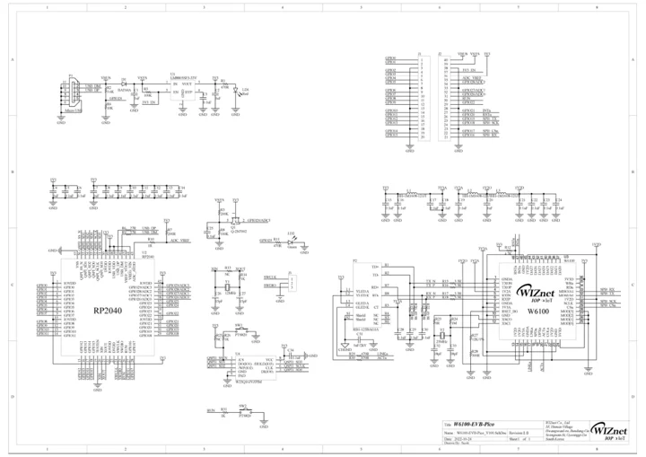

# W6100-EVB-Pico

**WIZnet** · RP2040

Revision: Manufacturer v1.0 references

Coverage: Manufacturer references collected; complete physical pinout approval pending

[Browse all manufacturers](../../../../BROWSE.md) · [Devices & IoT](../../../../DEVICES.md) · [Open in the browser guide](https://valleytech-black-wire-guide.pages.dev/?board=wiznet-w6100-evb-pico)

## Datasheets and original documentation

Board datasheet: **not yet recorded**. Visual reference: **available**.

[Original manufacturer documentation](https://docs.wiznet.io/Product/Chip/Ethernet/W6100/w6100-evb-pico)

- **hardware-guide / board**: [Manufacturer hardware documentation and specifications](https://docs.wiznet.io/Product/Chip/Ethernet/W6100/w6100-evb-pico) · online
- **schematic / board**: [W6100-EVB-Pico schematic](https://raw.githubusercontent.com/Wiznet/Hardware-Files-of-WIZnet/e3f0b08d2916cb961c0d723c476b693202c6fe79/02_iEthernet/W6100/W6100-EVB-Pico/W6100-EVB-Pico_V100/Schematic/W6100-EVB-Pico_SCH_V100.pdf) · [saved document](../../../../library/media/e52a8382d98b243a58cc042af4add77d465c38829d5b8663cb3c2eb774216bed.pdf)

Manufacturer physical pinout and schematic, with Ethernet controller connections identified. The manufacturer map legend says W5100S even though the source page and schematic identify W6100; retained unchanged and flagged for manual cross-check.

[Documentation coverage and remaining gaps](../../../../DOCUMENTATION.md)

## Specifications and hardware documentation

- [Manufacturer specifications and hardware documentation](https://docs.wiznet.io/Product/Chip/Ethernet/W6100/w6100-evb-pico)

## W6100-EVB-Pico pinout

**pinout image** · Source identity and visual reference scope reviewed; independent electrical and all-connector completeness review pending · JPG

[Open original reference](../../../../library/media/aa506f102010bb69f5f27cd7f4f3bfffbcae35565a8169f4cd91bb6562ecd6e7.jpg)

**Credit and rights:** Original manufacturer/publisher artwork; redistribution and print rights not established. Attribution does not grant a license or relicense the original.. Source/manufacturer: WIZnet.

[Source 1](https://docs.wiznet.io/assets/images/w6100-evb-pico-pinout-06ebd5c54b7d73c2034b0634d0a32122.jpg) · [Source 2](https://docs.wiznet.io/Product/Chip/Ethernet/W6100/w6100-evb-pico)

Original source retained unchanged. Scope review does not establish every connector or electrical limit.

Image revision: Match the revision printed in the original source

SHA-256: `aa506f102010bb69f5f27cd7f4f3bfffbcae35565a8169f4cd91bb6562ecd6e7`

## W6100-EVB-Pico schematic

**reference PDF** · Source identity and visual reference scope reviewed; independent electrical and all-connector completeness review pending · PDF

[Open original reference](../../../../library/media/e52a8382d98b243a58cc042af4add77d465c38829d5b8663cb3c2eb774216bed.pdf)

**Credit and rights:** Original manufacturer/publisher artwork; redistribution and print rights not established. Attribution does not grant a license or relicense the original.. Source/manufacturer: WIZnet.

[Source 1](https://raw.githubusercontent.com/Wiznet/Hardware-Files-of-WIZnet/e3f0b08d2916cb961c0d723c476b693202c6fe79/02_iEthernet/W6100/W6100-EVB-Pico/W6100-EVB-Pico_V100/Schematic/W6100-EVB-Pico_SCH_V100.pdf) · [Source 2](https://docs.wiznet.io/Product/Chip/Ethernet/W6100/w6100-evb-pico)

Original source retained unchanged. Scope review does not establish every connector or electrical limit.

Image revision: Match the revision printed in the original source

SHA-256: `e52a8382d98b243a58cc042af4add77d465c38829d5b8663cb3c2eb774216bed`

Pin assignments have not been independently electrically verified. Check board revision before wiring.
