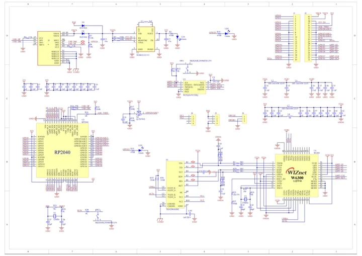

# W6300-EVB-Pico

**WIZnet** · RP2040

Revision: Manufacturer v1.0 references

Coverage: Manufacturer references collected; complete physical pinout approval pending

[Browse all manufacturers](../../../../BROWSE.md) · [Devices & IoT](../../../../DEVICES.md) · [Open in the browser guide](https://valleytech-black-wire-guide.pages.dev/?board=wiznet-w6300-evb-pico)

## Datasheets and original documentation

Board datasheet: **not yet recorded**. Visual reference: **available**.

[Original manufacturer documentation](https://docs.wiznet.io/Product/Chip/Ethernet/W6300/w6300-evb-pico)

- **hardware-guide / board**: [Manufacturer hardware documentation and specifications](https://docs.wiznet.io/Product/Chip/Ethernet/W6300/w6300-evb-pico) · online
- **schematic / board**: [W6300-EVB-Pico schematic](https://raw.githubusercontent.com/Wiznet/Hardware-Files-of-WIZnet/e3f0b08d2916cb961c0d723c476b693202c6fe79/02_iEthernet/W6300/W6300-EVB-Pico_V100/Schematic/W6300-EVB-Pico_SCH_V100.pdf) · [saved document](../../../../library/media/b0b3f4734dcb6aea76a015a77df531aaf8474eac5c67351934b57e7c6ba99d82.pdf)

Manufacturer Pin-out v1.0 section states that the pinout image is coming soon as of 2026-10-20. Schematic provided; physical connector map remains missing. Product photograph was not imported as a pinout.

[Documentation coverage and remaining gaps](../../../../DOCUMENTATION.md)

## Specifications and hardware documentation

- [Manufacturer specifications and hardware documentation](https://docs.wiznet.io/Product/Chip/Ethernet/W6300/w6300-evb-pico)

## W6300-EVB-Pico schematic

**reference PDF** · Source identity and visual reference scope reviewed; independent electrical and all-connector completeness review pending · PDF

[Open original reference](../../../../library/media/b0b3f4734dcb6aea76a015a77df531aaf8474eac5c67351934b57e7c6ba99d82.pdf)

**Credit and rights:** Original manufacturer/publisher artwork; redistribution and print rights not established. Attribution does not grant a license or relicense the original.. Source/manufacturer: WIZnet.

[Source 1](https://raw.githubusercontent.com/Wiznet/Hardware-Files-of-WIZnet/e3f0b08d2916cb961c0d723c476b693202c6fe79/02_iEthernet/W6300/W6300-EVB-Pico_V100/Schematic/W6300-EVB-Pico_SCH_V100.pdf) · [Source 2](https://docs.wiznet.io/Product/Chip/Ethernet/W6300/w6300-evb-pico)

Original source retained unchanged. Scope review does not establish every connector or electrical limit.

Image revision: Match the revision printed in the original source

SHA-256: `b0b3f4734dcb6aea76a015a77df531aaf8474eac5c67351934b57e7c6ba99d82`

Pin assignments have not been independently electrically verified. Check board revision before wiring.
