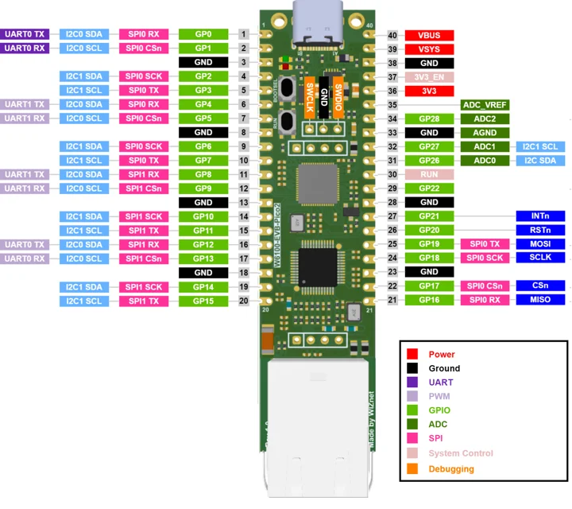
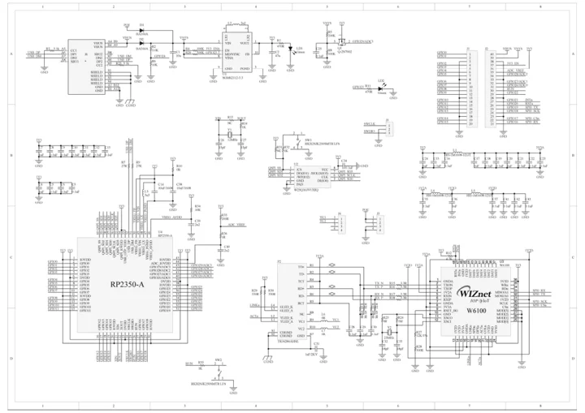

# W6100-EVB-Pico2

**WIZnet** · RP2350A

Revision: Manufacturer v1.0 references

Coverage: Manufacturer references collected; complete physical pinout approval pending

[Browse all manufacturers](../../../../BROWSE.md) · [Devices & IoT](../../../../DEVICES.md) · [Open in the browser guide](https://valleytech-black-wire-guide.pages.dev/?board=wiznet-w6100-evb-pico2)

## Datasheets and original documentation

Board datasheet: **not yet recorded**. Visual reference: **available**.

[Original manufacturer documentation](https://docs.wiznet.io/Product/Chip/Ethernet/W6100/w6100-evb-pico2)

- **hardware-guide / board**: [Manufacturer hardware documentation and specifications](https://docs.wiznet.io/Product/Chip/Ethernet/W6100/w6100-evb-pico2) · online
- **schematic / board**: [W6100-EVB-Pico2 schematic](https://raw.githubusercontent.com/Wiznet/Hardware-Files-of-WIZnet/e3f0b08d2916cb961c0d723c476b693202c6fe79/02_iEthernet/W6100/W6100-EVB-Pico2_V100/Schematic/SCH-W6100-EVB-PICO2-V100.pdf) · [saved document](../../../../library/media/658dc27cc09f6b78f2eabeeb2da9e6b8ea9882fe96e39e9c82b34d0d75b635be.pdf)

Manufacturer physical pinout and schematic, with Ethernet controller connections identified.

[Documentation coverage and remaining gaps](../../../../DOCUMENTATION.md)

## Specifications and hardware documentation

- [Manufacturer specifications and hardware documentation](https://docs.wiznet.io/Product/Chip/Ethernet/W6100/w6100-evb-pico2)

## W6100-EVB-Pico2 pinout

**pinout image** · Source identity and visual reference scope reviewed; independent electrical and all-connector completeness review pending · PNG

[Open original reference](../../../../library/media/11cef5ed1d8b486f7bc1b16e193dcb698801692fde3647a2326ac0d2835d4b5b.png)

**Credit and rights:** Original manufacturer/publisher artwork; redistribution and print rights not established. Attribution does not grant a license or relicense the original.. Source/manufacturer: WIZnet.

[Source 1](https://docs.wiznet.io/assets/images/w6100-evb-pico2-pinout-af9f8e417b9ec5ddf71804cc72a5f927.png) · [Source 2](https://docs.wiznet.io/Product/Chip/Ethernet/W6100/w6100-evb-pico2)

Original source retained unchanged. Scope review does not establish every connector or electrical limit.

Image revision: Match the revision printed in the original source

SHA-256: `11cef5ed1d8b486f7bc1b16e193dcb698801692fde3647a2326ac0d2835d4b5b`

## W6100-EVB-Pico2 schematic

**reference PDF** · Source identity and visual reference scope reviewed; independent electrical and all-connector completeness review pending · PDF

[Open original reference](../../../../library/media/658dc27cc09f6b78f2eabeeb2da9e6b8ea9882fe96e39e9c82b34d0d75b635be.pdf)

**Credit and rights:** Original manufacturer/publisher artwork; redistribution and print rights not established. Attribution does not grant a license or relicense the original.. Source/manufacturer: WIZnet.

[Source 1](https://raw.githubusercontent.com/Wiznet/Hardware-Files-of-WIZnet/e3f0b08d2916cb961c0d723c476b693202c6fe79/02_iEthernet/W6100/W6100-EVB-Pico2_V100/Schematic/SCH-W6100-EVB-PICO2-V100.pdf) · [Source 2](https://docs.wiznet.io/Product/Chip/Ethernet/W6100/w6100-evb-pico2)

Original source retained unchanged. Scope review does not establish every connector or electrical limit.

Image revision: Match the revision printed in the original source

SHA-256: `658dc27cc09f6b78f2eabeeb2da9e6b8ea9882fe96e39e9c82b34d0d75b635be`

Pin assignments have not been independently electrically verified. Check board revision before wiring.
