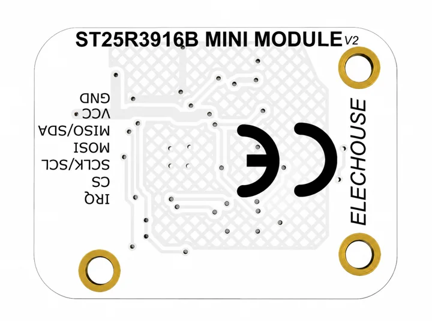

# RFID & NFC / visual references

[All categories](../../MAKER_VISUALS.md) · [Image attribution ledger](../../catalog/maker-attributions.json)

Manufacturer originals remain unchanged. Connector-model sheets add separately labeled callouts under the recorded source license. Check exact PCB/revision, source notes and rights before reuse. Photos and partial connector diagrams are not complete-device approvals.

## ST25R3916B Mini V2

Elechouse · Manufacturer documentation recorded

[Open full gallery](https://valleytech-black-wire-guide.pages.dev/?tab=makers&part=maker-elechouse-st25r3916b-mini-v2)

**board labels** · Source identity and visual scope reviewed on 2026-11-03; independent electrical and all-connector review pending

Original manufacturer artwork; redistribution and print rights not established. Attribution is not a license grant.
